# Friday 用户使用文档

> 面向家庭使用者，按新版界面编写。Friday 基础示例截图采集于 2026-10-31，智能服务设置于 2026-11-11 更新，手势、摄像头、自动化与游戏示例更新于 2026-11-12。ARL 原生开发版演示图保留 2026-10-30 的阶段含义。真实家庭验收资料保存在本机私有版。

[在线手册](https://lijunfeng722.github.io/friday-user-guide/) · [项目索引](https://github.com/lijunfeng722/friday-project-index)

## 阅读目录

1. [从零开始安装 Friday](#guide-getting-started-installation)

2. [macOS 从零准备](#guide-getting-started-installation-macos)

3. [Linux 从零准备](#guide-getting-started-installation-linux)

4. [安装 HA 并接入自己的小米设备](#guide-getting-started-installation-home-assistant)

5. [准备摄像头与本地识别（可选）](#guide-getting-started-installation-camera)

6. [启动、停止与日常维护](#guide-getting-started-installation-maintenance)

7. [第一次打开 Friday](#guide-getting-started-quick-start)

8. [连接自己的家](#guide-getting-started-connect-home)

9. [查看与操作设备](#guide-guides-devices)

10. [查看摄像头与识别](#guide-guides-cameras)

11. [完成第一条手势控制](#guide-tutorials-first-gesture)

12. [管理互动控制规则](#guide-guides-interactions)

13. [管理场景与自动化](#guide-guides-automations)

14. [连接录像并保护回看](#guide-guides-recordings)

15. [查看家庭事件的来源](#guide-guides-events)

16. [核对人物与待确认分组](#guide-guides-people)

17. [查看智能预警与本机画面复核](#guide-guides-safety)

18. [使用游戏库](#guide-guides-games)

19. [找到家庭资料预览](#guide-guides-files)

20. [用文字预览模拟规则变更](#guide-guides-dialogue)

21. [选择智能服务与每日上限](#guide-guides-intelligence)

22. [新版入口速查](#guide-reference-navigation)

23. [读懂页面状态](#guide-reference-status)

24. [十五个温度质量场景](#guide-reference-temperature-scenarios)

25. [这些程序分别做什么](#guide-explanation-components)

26. [怎样看待 ARL 管理界面](#guide-explanation-arl)

27. [2026-10-31 新版使用变化](#guide-releases-2026-10-31)

28. [按现象排查](#guide-troubleshooting-common-errors)

29. [常见问题](#guide-troubleshooting-faq)

30. [后续现场验证范围](#guide-)

<a id="guide-getting-started-installation"></a>

## 1. 从零开始安装 Friday

**本章目的：**帮你选好安装路线，知道接下来要准备哪些软件，以及每一步完成后能做什么。即使电脑还没有 Python、uv、Docker 或 Home Assistant，也可以从这里开始。

**为什么先看安装路线：**Friday 提供日常使用的家庭界面，真实设备由接入服务提供，摄像头与识别还需要另一组组件。先按自己的目标选择，才能分阶段得到可用结果：先打开示例，再连接设备，最后按需要增加摄像头和互动。

**读完后：**你应能选定 macOS 或 Linux 路线，分清基础安装、真实家庭接入和可选功能，并知道各阶段的验收标准。

已经能打开 Friday 的读者，可直接进入[第一次打开](#guide-getting-started-quick-start)；已有运行环境且准备接设备的读者，可进入[连接自己的家](#guide-getting-started-connect-home)。

### 1. 选择你要完成的目标

| 你的目标 | 需要完成的章节 | 完成标志 |
| --- | --- | --- |
| 先体验页面 | 选择 macOS 或 Linux 章节，完成基础安装 | 8740 页面显示“示例家庭” |
| 查看自己的设备 | 基础安装 → HA 与小米接入 → Friday 连接 | 显示自己的房间、设备和实际状态 |
| 操作灯、窗帘等 | 设备接入 → 首次配置控制范围 | 目标控件可用，现场确认动作 |
| 使用摄像头手势 | 上述步骤 → 摄像头与识别准备 → 手势教程 | 画面与关键点可见，规则有响应且设备实际执行 |

**安装路线：**[macOS 从零准备](#guide-getting-started-installation-macos) · [Linux 从零准备](#guide-getting-started-installation-linux) → [HA 与小米接入](#guide-getting-started-installation-home-assistant) → [可选摄像头与识别](#guide-getting-started-installation-camera) → [启动、停止与日常维护](#guide-getting-started-installation-maintenance)。

```mermaid
flowchart TB
  S[选择安装电脑] --> M[macOS：终端、Git、uv、Python]
  S --> L[Linux：终端、Git、uv、Python]
  M --> F[下载 Friday 并打开示例]
  L --> F
  F --> H[已有 HA 直接复用；没有则安装]
  H --> X[在 HA 内安装 Xiaomi Home 并登录]
  X --> C[Friday 连接 HA 并读取自己的设备]
  C --> D[配置控制范围并验证目标设备]
  D -. 按需继续 .-> V[macOS 本地视觉、摄像头与手势]
```

### 2. 先看平台差异

| 能力 | macOS | Linux |
| --- | --- | --- |
| Friday Web、示例、HA 设备接入 | 本机 Python 环境 | 本机 Python；本文详述 Ubuntu / Debian |
| 同机运行 HA Container | 先建立 Linux 虚拟机；本文使用 Colima | 直接使用 Linux Docker Engine |
| 连接其他主机的 HA | 填写 Friday 主机可访问的地址 | 填写 Friday 主机可访问的地址 |
| Miloco | 按发行包支持的系统与芯片选择 | 按发行包支持的系统与芯片选择 |
| 当前原生人体、手部识别 | 需要 Apple Vision、兼容 SDK 与编译工具 | 当前这套原生入口不能直接运行，没有等价的 Linux 安装命令 |
| 保护录像回看 | 另装媒体工具并配置录像来源 | 另装媒体工具并配置录像来源 |

不要把 Miloco 的平台支持范围理解为 Friday 的 Apple Vision 程序也支持这些平台。Intel Mac、Apple Silicon、Linux x86_64 和 Linux ARM64 的二进制包不能混用。

### 3. 安装前准备

准备可下载 GitHub 源码、Python 软件包和容器镜像的网络，以及保存项目和数据的磁盘空间。安装系统软件时可能需要自己的管理员密码，它只填写在系统提示中。

接真实设备需要已正常使用的小米账号和设备；接摄像头前，先确认米家或对应官方应用能正常查看它。只体验示例时可暂不准备账号和硬件。

本文把项目放在 `$HOME/friday-home/Friday`。`$HOME` 会展开为你自己的主目录，不需要替换成作者电脑的路径。`cd` 用来进入目录；以 `#` 开头的行是说明，不用输入命令提示符 `$`。

先完成一组命令，核对“应看到什么”，再进入下一步。报错时保留错误文字，按对应章节处理，再继续。

### 4. 各工具分别负责什么

| 名称 | 用途 | 何时需要 |
| --- | --- | --- |
| Git | 下载、记录源码版本 | 基础安装 |
| uv、Python | 准备项目独立运行环境 | 基础安装 |
| Docker Engine、Compose | 运行 HA 容器和读取容器配置 | 新建 HA |
| Colima、Lima | 在 Mac 提供 Linux 容器主机 | Mac 单机运行 HA |
| Home Assistant（HA） | 独立的家庭设备接入平台，管理房间、设备、状态和服务，供 Friday 连接 | 接入自己的家庭；已有 HA 可以复用 |
| [Xiaomi Home 集成（ha_xiaomi_home）](https://github.com/XiaoMi/ha_xiaomi_home) | 安装在 HA 内，让 HA 登录小米账号并接入受支持的小米设备 | 通过 HA 接入小米设备 |
| [Miloco（xiaomi-miloco）](https://github.com/XiaoMi/xiaomi-miloco) | 独立的小米智能家庭项目；本安装方案使用其账号绑定、摄像头与相关智能服务 | 选择 Miloco 摄像头或智能功能方案时 |
| Node.js | OpenClaw 使用的 JavaScript 运行环境 | 选择 OpenClaw 宿主方案时 |
| OpenClaw 或 Hermes | Miloco 插件的宿主平台，按官方指南选择其中一种 | 选择对应 Miloco 插件方案时 |
| 摄像头 SDK、Apple Vision、本地模型 | 视频连接、关键点与本地场景处理 | 兼容的本地识别方案 |
| FFmpeg、ffprobe | 媒体处理与录像信息检查 | 保护回看等媒体能力 |
| ARL、云端模型 | 可选智能任务 | 对应功能单独配置 |

**本手册中的 Xiaomi Home 指 HA 内的 `ha_xiaomi_home` 集成，和 Miloco 是两个不同项目。** 查看家庭设备的接入链路是 **Friday → Home Assistant → Xiaomi Home 集成 → 小米设备**；这条链路无需先安装 Miloco。选择 Miloco 方案时，需要另外安装并在其页面完成账号绑定。HA 中的小米授权与 Miloco 的账号绑定分别保存，一边完成不代表另一边也已完成。

更多分工见[这些程序分别做什么](#guide-explanation-components)。

### 5. 版本与下载来源

基础命令按以下公开入口核对，方便安装后定位差异。系统软件采用各厂商支持当前系统的发行方式，安装时记录实际版本。

| 对象 | 本教程基线 / 来源 |
| --- | --- |
| Friday | [公开提交 b069e20](https://github.com/Geeprox/Friday/tree/b069e20584e4d68f4a7fb9b3731a2f35fc87d29e)及该提交的 `uv.lock` |
| Python / uv | Python 3.12；示例使用 uv 0.13.6 的[官方安装器](https://docs.astral.sh/uv/getting-started/installation/) |
| HA / Xiaomi Home | HA `2026.10.4`；[HA 章节的更新安装工具](#guide-getting-started-installation-home-assistant)固定 Xiaomi Home `v0.5.0` 及官方提交；旧公开源码自带工具仍固定旧版 |
| Miloco | [固定发行版 v2026.10.16](https://github.com/XiaoMi/xiaomi-miloco/releases/tag/v2026.10.16)，按平台完整指南安装 |

基础安装不会自动下载摄像头 SDK、模型、ARL，或替你配置设备控制范围。摄像头章节分别说明可执行的准备步骤和仍需匹配部署组件的部分；不会把某台电脑的私有启动器当作通用安装包。

### 6. 每一阶段怎样算完成

1. **示例可用**：明确显示“示例家庭”，能够查看模拟设备。
2. **家庭接入**：HA 和 Friday 都能找到自己的目标设备，按各自统计口径核对数量。
3. **控制可用**：目标动作已开放，页面有回执，并由你观察设备实际执行。
4. **识别可用**：真实画面持续更新、关键点可见；仍要单独验证手势触发。
5. **可以日常使用**：知道如何停止、启动和备份，重启后核对真实来源与暂停状态。

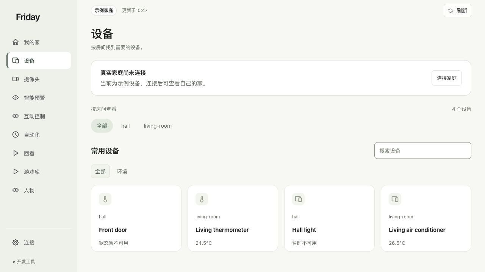

产品截图来自隔离示例，用于说明应核对的界面，不是操作系统安装过程的实机证明。各平台的新机安装、摄像头型号和真实动作按阶段分别验证，详见[验证范围](#guide-)。

<a id="guide-getting-started-installation-macos"></a>

## 2. macOS 从零准备

**本章目的：**在自己的 Mac 准备 Friday 的运行环境，下载程序并打开第一个示例页面。需要在同一台 Mac 新建 HA 时，再准备后半章的 Linux 容器环境。

### 为什么需要这些工具

Friday 的源码需要 Python 和依赖包才能运行。HA Container 则需要 Linux 容器主机，所以 Mac 的基础 Web 与 HA 容器环境分两段准备。

| 组件 | 本章用它做什么 | 你为什么需要 |
| --- | --- | --- |
| Command Line Tools、Git | 提供源码下载工具；后续原生构建也会使用编译工具 | 取得指定版本的 Friday |
| uv、Python | 为 Friday 创建独立运行环境并安装依赖 | 让 Web 服务能在自己的 Mac 启动 |
| Colima、Lima | 在 Mac 运行 Linux 虚拟机 | 仅在这台 Mac 新建 HA Container 时使用 |
| Docker 客户端、Compose | 管理虚拟机中的 HA 容器及其配置 | 创建并维护这套 HA 服务 |

**完成标志：**浏览器可打开 Friday，并看到明确标记的“示例家庭”；选择本机新建 HA 时，Docker 服务端也应可用。

**可以跳过什么：**已有可用 HA 的读者只需完成基础 Web，跳过本章的容器安装，转到[HA 与小米接入](#guide-getting-started-installation-home-assistant)。已有 Friday 服务可直接看[第一次打开](#guide-getting-started-quick-start)。

### 1. 查看电脑并打开终端

点击苹果菜单 →“关于本机”，记录系统版本和芯片。在“应用程序 → 实用工具”打开“终端”，输入：

```sh
sw_vers -productVersion
uname -m
```

**应看到：**系统版本及 `arm64`（Apple 芯片）或 `x86_64`（Intel）。下载软件时选择对应架构。

### 2. 准备 Git 和命令行工具

```sh
xcode-select --install
```

在 Apple 的窗口完成安装。提示已经安装时，继续检查：

```sh
xcode-select -p
git --version
```

**应看到：**开发工具目录和 Git 版本。工具还在下载时，等安装完成再继续。[Apple 开发工具说明](https://developer.apple.com/xcode/resources/)

### 3. 安装 uv，再准备 Python

uv 负责下载 Python 和管理项目环境。先下载官方安装器，再运行：

```sh
curl -fLsS https://astral.sh/uv/0.13.6/install.sh -o /tmp/friday-install-uv.sh
sh /tmp/friday-install-uv.sh
export PATH="$HOME/.local/bin:$PATH"
uv --version
uv python install 3.12
uv python find 3.12
```

**应看到：**uv 版本和 Python 3.12 的路径。无需先升级系统自带 Python，也不使用 `sudo pip install`。[uv 官方安装说明](https://docs.astral.sh/uv/getting-started/installation/)

若重开终端后找不到 uv，用 `nano ~/.zshrc` 将下一行加入自己的配置；保存按 Control+O、回车，退出按 Control+X，再打开新终端：

```sh
export PATH="$HOME/.local/bin:$PATH"
```

使用其他 shell 时按安装器显示的对应提示处理。

### 4. 下载 Friday 并安装基础环境

```sh
mkdir -p "$HOME/friday-home"
git clone https://github.com/Geeprox/Friday.git "$HOME/friday-home/Friday"
cd "$HOME/friday-home/Friday"
git switch --detach b069e20584e4d68f4a7fb9b3731a2f35fc87d29e
UV_PYTHON=3.12 ./scripts/install-home.sh
./bin/home doctor
```

**应看到：**依赖安装完成，doctor 返回状态信息，基础模式为 `simulator`。ARL、摄像头等可选能力未就绪，不阻止运行示例。`detached HEAD` 表示使用选定提交，不是安装失败。

已有同名目录时不要重复 clone 或删除 `data/`，先看[安装人员维护参考](docs/maintenance/installation-maintenance.md)。

### 5. 打开示例

```sh
cd "$HOME/friday-home/Friday"
./bin/home serve
```

保持终端运行，在同一台 Mac 打开 [Friday](http://127.0.0.1:8740/)。**应看到：**“示例家庭”和产品菜单。按 Control+C 停止前台服务；停止后网页暂时打不开属于正常现象。


只体验页面可到这里结束，继续[第一次打开](#guide-getting-started-quick-start)。已有 HA 可直接进入[家庭接入](#guide-getting-started-installation-home-assistant)。

### 6. 没有 HA 时，准备 Linux 容器环境

HA Container 使用 Linux Docker Engine。Mac 通过 Colima / Lima 提供 Linux 虚拟机，Docker 客户端负责向里面发送命令。[Colima 官方说明](https://github.com/abiosoft/colima/tree/v0.10.3)

先执行 `command -v brew`。没有结果时，按 [Homebrew 官网](https://brew.sh/)安装，也可下载官方脚本后运行：

```sh
curl -fLsS https://raw.githubusercontent.com/Homebrew/install/HEAD/install.sh -o /tmp/friday-install-brew.sh
/bin/bash /tmp/friday-install-brew.sh
```

按安装器末尾的 **Next steps** 设置环境，再打开新终端执行 `brew --version`。官网当前支持 macOS 15 及更新版本；较旧系统可按 [Colima 的其他安装方式](https://github.com/abiosoft/colima/blob/v0.10.3/docs/INSTALL.md)选择匹配发行包，或复用已有 / [Linux HA 主机](#guide-getting-started-installation-linux)。基础 Friday 不依赖 Homebrew。

在 Homebrew 支持的系统上执行：

```sh
brew install colima docker docker-compose
colima version
docker --version
docker-compose version
```

**应看到：**三个工具的版本。这一步尚未安装 HA 或完成账号接入。

### 7. 让 Docker 找到 Compose

若 `docker compose version` 已有结果，跳过本步；否则注册已安装的插件：

```sh
mkdir -p "$HOME/.docker/cli-plugins"
if [ ! -e "$HOME/.docker/cli-plugins/docker-compose" ]; then
  ln -s "$(command -v docker-compose)" "$HOME/.docker/cli-plugins/docker-compose"
fi
docker compose version
```

**应看到：**Compose 版本。若设置过 `DOCKER_CONFIG`，插件应放到该目录下的 `cli-plugins`，保留已有插件。[Homebrew Compose 说明](https://formulae.brew.sh/formula/docker-compose)

### 8. 创建专用虚拟机并检查 Docker

```sh
colima start --profile friday-home --runtime docker --cpus 2 --memory 4 --disk 32 --mount "$HOME/friday-home:w"
colima status --profile friday-home
docker context show
docker info
```

**应看到：**虚拟机运行，Docker 返回服务端信息。2 核、4 GiB 内存、32 GiB 虚拟磁盘是示例分配，可按负载调整，不是整机最低配置。可写挂载用于保存 HA 数据。

有其他 Docker / Colima 实例时，核对当前 context 对应本教程的 `friday-home` 再操作。保持虚拟机运行，继续[安装 HA 与小米接入](#guide-getting-started-installation-home-assistant)。

### 9. 常见安装问题

| 现象 | 下一步 |
| --- | --- |
| 找不到 uv | 核对安装器输出、`$HOME/.local/bin` 和当前终端的 PATH |
| 下载中断或证书错误 | 检查系统时间、网络和代理，重试官方源或固定发行包；保留证书校验 |
| Homebrew 不支持当前系统 | 采用 Colima 官方发行方式或已有 / Linux HA；基础 Friday 不依赖 Homebrew |
| `docker info` 失败 | 先启动 Colima，检查 context，再看虚拟机日志和网络 |
| HA 容器已启动，Mac 的 8123 仍打不开 | 按 [Mac 端口转发](#guide-getting-started-installation-home-assistant)处理 |
| 8740 已占用 | 先确认是否已有 Friday；并行示例可用 `./bin/home serve --port 8741`，正式连接另核对回调地址 |

**完成标准：**Friday 示例可打开；新建 HA 时，Colima 与 Docker 服务端也可用。摄像头另按[可选章节](#guide-getting-started-installation-camera)准备。

<a id="guide-getting-started-installation-linux"></a>

## 3. Linux 从零准备

**本章目的：**在 Linux 桌面或服务器上安装并启动 Friday。需要在这台 Linux 新建 HA 时，再安装 Docker Engine 和 Compose，为下一章提供容器主机。

### 为什么需要这些工具

| 组件 | 本章用它做什么 | 你为什么需要 |
| --- | --- | --- |
| Git、下载工具 | 获取源码、安装器和依赖 | 从空环境取得需要的软件 |
| uv、Python | 创建 Friday 的独立运行环境 | 按项目要求运行 Web，不依赖系统 Python 恰好符合版本 |
| Docker Engine、Compose | 直接在 Linux 运行 HA 容器 | 仅在这台主机新建 HA 时使用 |
| SSH 转发 | 在另一台电脑的浏览器访问本机监听的服务 | 无桌面或远程部署时，打开 Friday 和 HA 的页面 |

Linux 可以直接运行 Docker Engine，无需再为 HA 额外创建一层 Mac 式虚拟机。**完成标志：**本机浏览器或 SSH 转发后的浏览器能打开 Friday 示例；选择新建 HA 时，Docker 服务端也可用。

**适用范围：**命令示例针对 Ubuntu 22.04 / 24.04 / 26.04、Debian 12 / 13 的 64 位系统。其他发行版按其包管理器和 Docker 官方平台说明准备同等工具。当前 Apple Vision 原生识别不属于 Linux 安装路线，详见[摄像头平台范围](#guide-getting-started-installation-camera)。

**可以跳过什么：**已有可用 HA 时，跳过 Docker 安装；已有 Friday 时直接进入[家庭接入](#guide-getting-started-installation-home-assistant)或[日常使用](#guide-getting-started-quick-start)。

### 1. 打开终端，确认系统

桌面 Linux 打开“终端”；无桌面的服务器使用已经配置好的 SSH 或主机控制台。输入：

```sh
cat /etc/os-release
uname -m
```

**应看到：**发行版名称、版本和架构。`x86_64` 对应 amd64，`aarch64` 对应 ARM64。需要能使用 sudo 的个人账号。

### 2. 安装下载和编辑工具

```sh
sudo apt-get update
sudo apt-get install -y git curl ca-certificates nano unzip xz-utils
```

**应看到：**安装完成，没有软件源或证书错误。后续从自己的账号运行 Friday，不用 root 运行项目或安装 Python 包。

### 3. 安装 uv 和 Python

```sh
curl -fLsS https://astral.sh/uv/0.13.6/install.sh -o /tmp/friday-install-uv.sh
sh /tmp/friday-install-uv.sh
export PATH="$HOME/.local/bin:$PATH"
uv --version
uv python install 3.12
uv python find 3.12
```

**应看到：**uv 版本与 Python 3.12 的路径。无需依赖发行版自带 Python 的版本。[uv 安装](https://docs.astral.sh/uv/getting-started/installation/)与[管理 Python](https://docs.astral.sh/uv/guides/install-python/)

若新终端找不到 uv，使用 `nano ~/.bashrc` 加入下面一行并重新打开终端；zsh 用户改用自己的 `~/.zshrc`：

```sh
export PATH="$HOME/.local/bin:$PATH"
```

nano 保存按 Control+O、回车，退出按 Control+X。

### 4. 下载 Friday 并安装

```sh
mkdir -p "$HOME/friday-home"
git clone https://github.com/Geeprox/Friday.git "$HOME/friday-home/Friday"
cd "$HOME/friday-home/Friday"
git switch --detach b069e20584e4d68f4a7fb9b3731a2f35fc87d29e
UV_PYTHON=3.12 ./scripts/install-home.sh
./bin/home doctor
```

**应看到：**基础依赖安装成功，doctor 的基础模式为 `simulator`。选定提交产生的 `detached HEAD` 是版本定位提示。已有目录时先看[安装人员维护参考](docs/maintenance/installation-maintenance.md)，不覆盖原数据。

启动：

```sh
./bin/home serve
```

保持终端运行，在这台 Linux 的浏览器打开 [Friday](http://127.0.0.1:8740/)。看到“示例家庭”即完成基础安装，Control+C 用于停止前台服务。

### 5. 在另一台电脑查看 Linux 服务

Friday 默认只监听 Linux 主机自己的 `127.0.0.1`。已有 SSH 连接时，可在你的浏览器电脑另开终端建立转发：

```sh
ssh -N -L 8740:127.0.0.1:8740 -L 8123:127.0.0.1:8123 user@192.0.2.10
```

将 `user@192.0.2.10` 换成自己的 SSH 用户和 Linux 主机地址；这是文档示例地址。保持转发终端运行，再在浏览器电脑打开 `http://127.0.0.1:8740/`。8123 的转发供稍后的 HA 使用。

**应看到：**与 Linux 本机相同的 Friday 页面。正式账号连接使用默认端口，以便和当前版本的本机回调一致。直接把 Linux 的内网 IP 拼到 8740 后面，不能替代这个转发。

### 6. 需要新 HA 时，安装 Docker Engine

已有可用 HA 可跳过本节，直接进入[HA 与小米接入](#guide-getting-started-installation-home-assistant)。已有 Docker 时先运行 `sudo docker info` 和 `sudo docker compose version`，两项成功即可复用。

全新 Ubuntu / Debian 按下面步骤添加 Docker 官方软件源。先准备保存签名密钥的目录：

```sh
sudo install -d -m 0755 /etc/apt/keyrings
```

#### Ubuntu：执行这一组

```sh
curl -fLsS https://download.docker.com/linux/ubuntu/gpg -o /tmp/friday-docker.asc
sudo install -m 0644 /tmp/friday-docker.asc /etc/apt/keyrings/docker.asc
friday_codename="$(. /etc/os-release; printf '%s' "$VERSION_CODENAME")"
friday_arch="$(dpkg --print-architecture)"
printf 'deb [arch=%s signed-by=/etc/apt/keyrings/docker.asc] https://download.docker.com/linux/ubuntu %s stable\n' "$friday_arch" "$friday_codename" | sudo tee /etc/apt/sources.list.d/friday-docker.list >/dev/null
```

#### Debian：执行这一组

```sh
curl -fLsS https://download.docker.com/linux/debian/gpg -o /tmp/friday-docker.asc
sudo install -m 0644 /tmp/friday-docker.asc /etc/apt/keyrings/docker.asc
friday_codename="$(. /etc/os-release; printf '%s' "$VERSION_CODENAME")"
friday_arch="$(dpkg --print-architecture)"
printf 'deb [arch=%s signed-by=/etc/apt/keyrings/docker.asc] https://download.docker.com/linux/debian %s stable\n' "$friday_arch" "$friday_codename" | sudo tee /etc/apt/sources.list.d/friday-docker.list >/dev/null
```

两组只选匹配发行版的一组。接着安装并检查：

```sh
sudo apt-get update
sudo apt-get install -y docker-ce docker-ce-cli containerd.io docker-buildx-plugin docker-compose-plugin
sudo systemctl enable --now docker
sudo docker info
sudo docker compose version
```

**应看到：**Docker 服务端信息及 Compose 版本。`enable` 同时让 Docker 随系统启动；Friday Web 仍按自己的启动方式管理。本教程给需要 Docker 权限的 Linux 命令显式加 sudo，无需先修改用户组。

若机器已有其他容器软件、软件源或 Docker 数据，按 [Docker Ubuntu 官方安装](https://docs.docker.com/engine/install/ubuntu/)或 [Debian 官方安装](https://docs.docker.com/engine/install/debian/)处理兼容问题，不套用清空数据命令。其他发行版从 [Docker Engine 平台列表](https://docs.docker.com/engine/install/)选择。

### 7. 常见安装问题

| 现象 | 检查位置 |
| --- | --- |
| apt 找不到 Docker 包 | 发行版和代号是否匹配官方源，`apt-get update` 是否成功 |
| Docker socket 权限不足 | 使用本章带 sudo 的 Docker 命令；不改 socket 为任意用户可写 |
| Docker 服务没启动 | `sudo systemctl status docker`，再看服务日志 |
| 服务器运行但自己浏览器打不开 | 先核对 SSH 转发，区分浏览器电脑和 Linux 主机的 127.0.0.1 |
| 依赖下载失败 | 检查网络、时间、证书与包源；保留报错，不把软件源错误当成账号错误 |
| 想在 Linux 执行原生手势编译 | 当前 Apple Vision 入口不适用，见[摄像头平台范围](#guide-getting-started-installation-camera) |

**完成标准：**示例页面可打开；需要新 HA 时 Docker Engine、Compose 也已就绪。继续[安装 HA 与小米接入](#guide-getting-started-installation-home-assistant)。

<a id="guide-getting-started-installation-home-assistant"></a>

## 4. 安装 HA 并接入自己的小米设备

**本章目的：**把自己在米家中使用的设备接入 Friday，让 Friday 能显示真实房间、设备和状态。你将新建或复用 Home Assistant，在其中接入小米设备，再授权 Friday 读取这份家庭清单。

### 为什么需要 HA 和 Xiaomi Home

本教程使用 HA 作为 Friday 的设备接入平台。米家手机应用已经能控制设备，并不表示 Friday 已经获得这些设备和状态；需要先建立下面这条接入链路。

| 组件 | 它是什么 | 本章为什么需要 |
| --- | --- | --- |
| Friday | 你日常打开的家庭界面 | 从 HA 读取房间、设备和状态，并提供使用入口 |
| Home Assistant（HA） | 独立运行的家庭设备平台 | 汇集设备和房间，向 Friday 提供统一的状态与服务 |
| Xiaomi Home（ha_xiaomi_home） | 安装在 HA 内的小米设备集成 | 让 HA 登录你的小米账号，接入所选家庭中受支持的设备 |

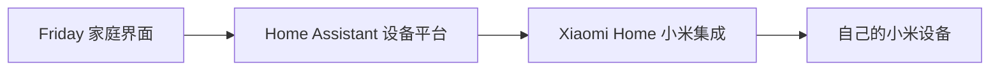

你会分别完成两项授权：**Xiaomi Home 登录小米账号，把设备接入 HA；Friday 登录 HA，读取已接入的家庭。** 它们有各自的页面和保存记录。

这条设备接入路线无需先安装 Miloco。Miloco 是独立项目，选择其摄像头或智能功能时，再按[可选摄像头章节](#guide-getting-started-installation-camera)准备。

**适用与跳过：**

- 还没有 HA：从第 1 步开始。
- 已有 HA，但尚未接入小米设备：按第 3 步说明在原实例安装集成，再完成第 5 步。
- HA 已能看到目标设备：直接进入第 6 步。其他品牌设备通过各自的 HA 集成接入后，也从这里继续。
- 只体验示例：可跳过本章。

**开始前：**已经完成 [macOS](#guide-getting-started-installation-macos)或 [Linux](#guide-getting-started-installation-linux)基础安装。新建 HA 时，Docker 服务端及 Compose 检查成功。

**完成标志：**HA 和 Friday 都能找到自己的目标设备，且 Friday 显示真实家庭来源。需要发送设备动作时，再按第 7 步配置控制范围并现场验证。

### 1. 准备持久化配置

在 Friday 安装电脑的终端执行：

```sh
cd "$HOME/friday-home/Friday"
.venv/bin/python scripts/setup-dependencies.py plan
.venv/bin/python scripts/setup-dependencies.py prepare
```

**应看到：**plan 列出当前工具，prepare 返回 `prepared: true`、`services_started: false`。它创建 `data/deployment/compose.yaml`、`.env` 和所需私有目录，还没有启动 HA。

已有这些文件时不要重复 prepare；先检查是否属于已有部署。HA 数据以后保存在 `data/deployment/homeassistant`，容器里对应 `/config`，重建容器不会替你重新创建账号。

### 2. 设置自己的时区

```sh
nano data/deployment/.env
```

将 `TZ=UTC` 改为自己的 IANA 时区，例如 `TZ=Asia/Shanghai`、`TZ=Europe/Berlin`。保存按 Control+O、回车，退出按 Control+X。

**应看到：**文件只保留所选时区配置。错误时区会影响时间显示和自动化时间判断。

### 3. 把 Xiaomi Home 安装到 HA 内

本教程现在使用 **Xiaomi Home v0.5.0**。当前 Friday 安装基线已包含更新的安装器；下方同时提供同内容的独立下载工具，便于沿用较早 Friday 版本的用户升级集成。工具只安装集成；小米登录仍在 HA 官方页面完成。

#### 下载安装工具

```sh
mkdir -p "$HOME/friday-home/service-tools"
cd "$HOME/friday-home/service-tools"
friday_setup_url="https://lijunfeng722.github.io/friday-user-guide/assets/scripts"
for friday_setup_file in setup-dependencies.py FRIDAY-SCRIPT-LICENSE.txt SETUP-SHA256SUMS; do
  curl -fL "$friday_setup_url/$friday_setup_file" -o "$friday_setup_file"
done
```

macOS 校验下载内容：

```sh
shasum -a 256 -c SETUP-SHA256SUMS
```

Linux 校验下载内容：

```sh
sha256sum -c SETUP-SHA256SUMS
```

**应看到：**安装工具和许可证均显示 `OK`。也可分别下载[安装工具](docs/assets/scripts/setup-dependencies.py)、[许可证](docs/assets/scripts/FRIDAY-SCRIPT-LICENSE.txt)和[校验清单](docs/assets/scripts/SETUP-SHA256SUMS)。

#### 首次安装集成

```sh
cd "$HOME/friday-home/Friday"
.venv/bin/python "$HOME/friday-home/service-tools/setup-dependencies.py" xiaomi-home --project "$PWD"
```

**应看到：**`installed: true`、`version: v0.5.0`，并提示需要 HA 重启和账号登录。工具校验官方固定提交 `75b3acb6325a3a8d295688b13904737d6738a6a5`；集成位于 `data/deployment/homeassistant/custom_components/xiaomi_home`。它是 HA 内部集成，不是另一个独立 Web 服务。

已有集成时，脚本会拒绝覆盖；按[已有集成升级步骤](docs/maintenance/installation-maintenance.md#已有-xiaomi-home-怎样升级)维护。对其他方式安装的 HA，要将集成安装到该实例实际使用的 `/config/custom_components`，不能把本教程新目录当作原实例配置。[Xiaomi Home 官方安装说明](https://github.com/XiaoMi/ha_xiaomi_home/tree/v0.5.0)

### 4. 启动 HA 并检查页面

#### macOS

确认 Colima 的专用实例运行后执行：

```sh
docker compose --project-name friday-home --file data/deployment/compose.yaml --env-file data/deployment/.env up -d
docker compose --project-name friday-home --file data/deployment/compose.yaml --env-file data/deployment/.env ps
```

#### Linux

```sh
sudo docker compose --project-name friday-home --file data/deployment/compose.yaml --env-file data/deployment/.env up -d
sudo docker compose --project-name friday-home --file data/deployment/compose.yaml --env-file data/deployment/.env ps
```

**应看到：**homeassistant 服务运行。首次拉取镜像和初始化需要等待。该 Compose 使用固定 HA 镜像和 Linux host network；没有自动配置 USB、蓝牙或 Zigbee 适配器。[HA Container 官方说明](https://www.home-assistant.io/installation/linux/)

在 HA 所在主机，或已经建立对应端口转发的浏览器电脑，打开 [HA 本机入口](http://127.0.0.1:8123/)。按页面创建自己的管理员、设置家庭位置与时区，直到进入 HA 主界面。密码和验证码只填在页面。

#### Mac 的 8123 打不开时

先检查容器仍在运行。Colima 自动转发没有生效、而虚拟机内 HA 可用时，可以在 Mac 新开终端建立仅本机转发：

```sh
umask 077
colima ssh-config --profile friday-home > "$HOME/friday-home/ha-ssh.config"
friday_ssh_host="$(awk '$1 == "Host" {print $2; exit}' "$HOME/friday-home/ha-ssh.config")"
ssh -F "$HOME/friday-home/ha-ssh.config" -o ExitOnForwardFailure=yes -N -L 127.0.0.1:8123:127.0.0.1:8123 "$friday_ssh_host"
```

保持这个终端运行，再打开 8123。端口已经被占用时先核对现有转发，不反复启动。此配置文件由你自己的 Colima 生成，不需要填写作者电脑的 SSH 路径。

Linux 远程主机使用 [Linux 章节的 SSH 转发](#guide-getting-started-installation-linux)。HA 地址需同时能被 Friday 所在主机访问；不在同一主机时，使用该 HA 的实际可达地址。

### 5. 在 HA 完成小米登录与设备选择

1. 在 HA 打开“设置 → 设备与服务 → 添加集成”。
2. 搜索 Xiaomi Home，阅读集成提示，选择自己的区域。
3. 打开其小米官方授权页，登录自己的账号并确认授权。
4. 回到 HA，选择需要接入的家庭和设备，完成后续页面。
5. 在 HA 集成页查找目标设备，查看房间和状态。

新增集成文件后搜索不到 Xiaomi Home，先重启本教程的 homeassistant 服务，再刷新浏览器。不要把 Miloco 登录当作这一步已经完成。

#### 小米确认授权后返回失败

检查授权回调使用的主机名，当前固定集成通常使用 `homeassistant.local:8123`。先在**进行登录的浏览器电脑**打开 `http://homeassistant.local:8123/`；它也应能打开同一台 HA。

如果这个名字不能解析或指向另一台机器，先修复本地域名 / mDNS，再重新发起授权。不要修改授权链接里的 state 或把含授权码的完整回调地址发给别人。

对于 HA 就在本机 8123、或通过上述 SSH 转发访问本机 8123 的情况，可由这台浏览器电脑的管理员在 hosts 文件中将该名称指向本机：

```sh
sudo nano /etc/hosts
```

在确认没有另一台同名 HA 后，添加单独一行并保存：

```text
127.0.0.1 homeassistant.local
```

再次访问该名称，能打开正确 HA 后才重试授权。若 HA 通过其他主机地址访问，应由自己的网络配置将这个名字指向那台 HA 的可达地址；不要照抄 loopback 映射。以后撤销本机映射时，只移除自己新增的这一行。

### 6. 让 Friday 读取自己的家庭

保持 HA 运行，重新打开 Friday 的“连接”：

1. 点击“查找并连接”；多个结果时选自己的 HA。
2. 没发现时点击“填写地址”，输入完整可达地址。
3. 在 HA 官方登录页面完成 Friday 的授权。
4. 返回 Friday，点击“连接并读取设备”。

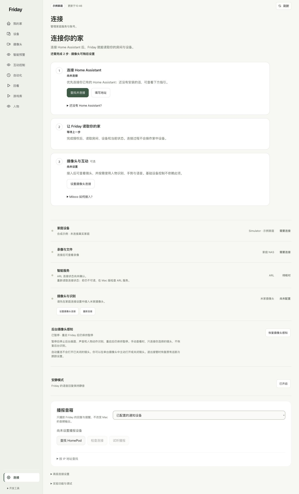

**应看到：**“家庭已连接”，设备页出现自己的设备。设备数量按当前家庭决定，不以示例截图的数量为标准。一个设备的多个实体也不是多台设备。详细操作见[连接自己的家](#guide-getting-started-connect-home)。

基础源码入口重启后可能仍从示例模式启动；已有授权与当前来源分别判断。重新进入连接页读取家庭，或使用部署版本提供的已配置来源启动器，再确认顶部状态；不需要因此反复删除账号授权。

### 7. 首次开放设备控制范围

读取设备完成后，可以先只查看状态。首次控制需要本机操作员根据自己的 HA 实例、实体标识和设备能力配置允许范围；这是一项部署设置，不是每次使用都要逐台重新登录。

当前界面可以暂停 / 恢复已有范围，但没有替代首次范围文件配置。源码 Web 默认使用 `data/homeplane/action-authority.json`；桌面部署的私有目录不同，应按其构建说明确认。

配置时核对：HA 地址与实例标识、允许的操作、明确的实体列表、是否启用及有效期。只开放准备使用的设备，不复制其他家庭的标识。文件格式以所选版本的 [HomeDeviceAuthority 契约](https://github.com/Geeprox/Friday/blob/b069e20584e4d68f4a7fb9b3731a2f35fc87d29e/homeplane/action_contracts.py)及[控制授权说明](https://github.com/Geeprox/Friday/blob/b069e20584e4d68f4a7fb9b3731a2f35fc87d29e/docs/deployment.md#6-设备控制权限)为准；配置完成后重新连接并核对候选目标。

先用一个选定设备验证：检查目标和动作 → 明确执行 → 看页面回执 → 观察设备实际变化。有记录并不替代现场确认。之后可继续[设备操作](#guide-guides-devices)或[摄像头与识别准备](#guide-getting-started-installation-camera)。

**完成标准：**HA、Friday 都能找到自己的目标，来源明确；需要控制时，相应动作范围已配置并由你确认实际效果。

<a id="guide-getting-started-installation-camera"></a>

## 5. 准备摄像头与本地识别（可选）

**本章目的：**准备摄像头连接和 Friday 本地识别所需的组件，逐步验证画面、人体与手部识别，再为手势控制提供输入。

### 为什么要分开准备视频、识别和控制

| 部分 | 负责什么 | 你为什么需要 |
| --- | --- | --- |
| Miloco 及所选插件宿主 | 本方案中的小米账号绑定、摄像头与相关服务 | 建立所选摄像头方案的账号和服务条件 |
| Friday 视觉环境 | SDK、视频解码、Apple Vision 与本地模型等组件 | 连接画面，得到人体、手部关键点及场景信息 |
| 手势规则与设备控制范围 | 把识别到的动作关联到允许控制的目标 | 让你选定的动作能触发正确设备 |

三部分分别配置和验收：先确认画面，再看识别结果，最后验证规则和真实设备效果。Miloco 能播放视频后，仍需准备 Friday 的识别环境；看到骨架后，也要核对规则和控制范围。

**适用与跳过：**需要摄像头或手势的读者继续；只查看或操作 HA 设备时可跳过。已经接通的用户直接看[摄像头使用指南](#guide-guides-cameras)。

**开始前与完成标志：**先让摄像头在官方应用中正常工作；本章按阶段核对安装、登录、画面、识别和动作效果。完整识别还需要所选部署版本提供摄像头注册与后台启动组件，具体见第 7 步。

### 先确认平台与目标

| 目标 | macOS | Linux |
| --- | --- | --- |
| 安装 Miloco、绑定账号、查看支持的摄像头 | 选择官方支持的系统与芯片包 | 选择官方支持的架构包 |
| Friday 原生人体、手部识别 | 需要 Apple Vision、匹配 SDK、模型与后台装配 | 当前原生程序依赖 Apple Vision，不能照搬 macOS 编译步骤 |
| 普通 HA 设备控制 | 完成家庭接入和控制范围配置即可 | 完成家庭接入和控制范围配置即可 |

摄像头画面正常，不表示 Friday 已具备识别环境；识别可见，也不表示规则已允许执行。Intel Mac 如没有匹配的 SDK 发行包，同样不能使用 arm64 包替代。

### 1. 先检查摄像头与账号

在米家或摄像头官方应用确认：目标属于自己的账号、设备在线、镜头已由你主动打开、画面能播放。记下目标名称供本机选择，不将设备标识或家庭画面放进公开仓库。

HA 的 Xiaomi Home 登录与 Miloco 的小米绑定各自保存授权，一边完成不能代替另一边。普通本地手势不要求先购买云端模型服务。

### 2. 准备 Miloco 的插件宿主

Miloco v2026.10.16 的安装入口提供 OpenClaw、Hermes 平台指南。这里以 OpenClaw 为例；已有兼容宿主可以复用，先确认原配置，不新建覆盖原账号。

从 [Node.js 官方发行目录](https://nodejs.org/dist/v24.22.1/)选择 Node 24.22.1 对应系统、架构的安装包，并按同目录的校验清单核对。Mac 可下载 `.pkg` 安装器，按系统窗口完成安装后重开终端。

Linux 先按 `uname -m` 的结果二选一：

```sh
# x86_64 使用这一行
friday_node_archive=node-v24.22.1-linux-x64.tar.xz
```

```sh
# aarch64 / arm64 使用这一行
friday_node_archive=node-v24.22.1-linux-arm64.tar.xz
```

接着在同一个终端下载、校验和解压：

```sh
mkdir -p "$HOME/friday-home/downloads" "$HOME/friday-home/tools"
cd "$HOME/friday-home/downloads"
curl -fLO "https://nodejs.org/dist/v24.22.1/$friday_node_archive"
curl -fLsS https://nodejs.org/dist/v24.22.1/SHASUMS256.txt -o node-SHASUMS256.txt
sha256sum --check --ignore-missing node-SHASUMS256.txt
tar -xf "$friday_node_archive" -C "$HOME/friday-home/tools"
friday_node_folder="${friday_node_archive%.tar.xz}"
export PATH="$HOME/friday-home/tools/$friday_node_folder/bin:$PATH"
```

**应看到：**下载文件的校验结果为 `OK`。需要新终端继续使用时，把实际解压目录的 `bin` 路径加入自己的 shell 配置，例如 x64 对应 `$HOME/friday-home/tools/node-v24.22.1-linux-x64/bin`。随后确认：

```sh
node --version
npm --version
```

**应看到：**Node `v24.22.1` 和 npm 版本。需要详细平台操作时见 [Node 官方下载入口](https://nodejs.org/en/download)。不要用系统里一个过旧的 Node 继续安装。

在个人目录安装选定宿主版本：

```sh
mkdir -p "$HOME/friday-home/tools/openclaw"
npm install --prefix "$HOME/friday-home/tools/openclaw" openclaw@2026.10.9
export PATH="$HOME/friday-home/tools/openclaw/node_modules/.bin:$PATH"
openclaw --version
openclaw configure --section gateway
```

按本机向导配置本地网关及其认证，再安装、检查服务：

```sh
openclaw gateway install
openclaw gateway status
```

**应看到：**网关可用。需要后续终端继续找到 openclaw 时，把同一条 PATH 配置加入自己的 shell 配置。网关认证信息保存在自己的本机配置；本阶段不必配置 IM，也不把网关启动当作模型任务已经可用。[OpenClaw 官方入门](https://docs.openclaw.ai/start/getting-started)

### 3. 安装固定版本 Miloco

先阅读[固定版本平台选择入口](https://github.com/XiaoMi/xiaomi-miloco/blob/v2026.10.16/scripts/install-guide.md)，确认选择 OpenClaw 路线。下载该版本官方安装器：

```sh
curl -fLsS https://github.com/XiaoMi/xiaomi-miloco/releases/download/v2026.10.16/install.sh -o /tmp/friday-install-miloco.sh
bash /tmp/friday-install-miloco.sh --agent-prepare
```

**应看到：**环境准备、核心包和服务状态结果，或明确的失败步骤。安装器可能准备自己的 Python 和依赖，这不需要把 Friday 的 Python 3.12 替换掉。系统出现本地网络权限提示时，按自己要使用的本地设备功能选择。

按输出打开本机 Miloco 页面，默认入口为 `http://127.0.0.1:1810/`。自己完成小米登录与绑定；授权结果只填回对应页面，不放进聊天、命令历史或文档。

账号绑定后，按同版本平台指南完成剩余安装：

```sh
bash /tmp/friday-install-miloco.sh --agent-finish
openclaw gateway restart
miloco-cli service status
miloco-cli device list
```

**应看到：**服务运行，设备清单中能找到自己的摄像头。若终端找不到 miloco-cli，核对安装器输出及 `$HOME/.local/bin`。没有模型 Key 时，服务与账号、摄像头接入分别验收；不把未配置的多模态智能功能计为完成。

### 4. 在 Friday 记录摄像头连接

在“连接 → 摄像头与互动”按页面选择安装或已有服务入口。兼容服务地址必须是本机入口；填写自己的摄像头并检查服务和绑定状态。


服务检查成功只说明连接和账号条件，接下来还需 Friday 自己的视觉环境。

### 5. macOS：准备独立视觉环境

以下是源码部署的进阶准备。使用统一的默认目录 `data/embodied`，不要把另一台机器的私有目录、会话或绝对路径复制进来。

```sh
cd "$HOME/friday-home/Friday"
mkdir -p data/embodied
uv venv --python 3.12 data/embodied/runtime
uv export --locked --no-dev --extra vision --extra camera-media --no-emit-project --format requirements.txt --output-file data/embodied/requirements-vision.txt
uv pip install --python data/embodied/runtime/bin/python --require-hashes -r data/embodied/requirements-vision.txt
```

**应看到：**锁定依赖安装到独立的 `runtime`，与 Web 的 `.venv` 分开。不要对已有且正在使用的视觉环境重复创建。

SDK 不随 Friday 分发。从 [Miloco 固定发行版](https://github.com/XiaoMi/xiaomi-miloco/releases/tag/v2026.10.16)及其官方说明取得与系统、芯片、Python 匹配的 SDK wheel，在本机指定实际下载路径：

```sh
printf '请输入匹配 SDK wheel 的完整本机路径：'
read -r friday_sdk_wheel
uv pip install --python data/embodied/runtime/bin/python "$friday_sdk_wheel"
data/embodied/runtime/bin/python -c 'import av, cv2, onnxruntime, miot.camera; print("视觉依赖与摄像头 SDK 可导入")'
```

**应看到：**依赖和 SDK 可导入。下载了 Miloco 服务或在 Web 环境装了 PyAV，不能替代这个检查。

### 6. macOS：编译原生程序并准备模型

先检查编译器，再编译当前源码：

```sh
xcrun --find swiftc
xcrun --find clang
.venv/bin/python scripts/embodied/runtime.py --build-native
```

**应看到：**`data/embodied/bin` 下生成 `friday-vision` 与 `camera-sockets.dylib`，命令返回文件摘要。它不会下载模型、注册账号或启动摄像头。

另外准备 `data/embodied/models/yolov8n.onnx`。可使用对应部署版本提供、来源和摘要明确的模型；自行导出时，使用 [Ultralytics 官方权重](https://github.com/ultralytics/assets/releases/tag/v8.3.0)和[官方 ONNX 导出方式](https://docs.ultralytics.com/integrations/onnx/)，在独立导出环境生成，不在生产视觉环境临时升级依赖。

交给部署者核对的参数包括：所用权重及许可、导出器版本、ONNX opset、输入尺寸、是否动态尺寸和实际 SHA-256。一个采用 opset 17、640×640、静态输入的导出产物，也必须核对当前程序兼容性；不能直接把它标成参考清单中另一个文件的摘要。

### 7. 初始化自己的摄像头与后台入口

这一阶段仍需要对应版本的部署组件或部署维护者完成注册。当前公开基础命令 `./bin/home serve` 默认不启动识别后台；安装上面的包并不自动补齐这一阶段。

| 必须准备 | 要核对的内容 |
| --- | --- |
| 摄像头私有配置 | 来自自己账号的设备、匹配设备描述、稳定 camera ID、默认镜头 |
| 当前登录会话 | 有效的访问会话和过期时间；由原登录服务持有刷新职责 |
| 本机查看和控制配置 | 私有密钥、页面 origin、查看地址和端口，文件权限受限 |
| 一致的运行目录 | 安装、构建、模型、私有配置、主进程与 worker 读取同一目录 |
| 后台启动 | 所选入口启用 supervisor、真实家庭来源和识别策略，并恢复已保存的暂停状态 |
| 设备控制范围 | 与自己的 HA 实例和选定设备绑定；不因打开摄像头自动扩大 |

使用部署版本提供的正式注册、启动入口。没有这些入口或匹配组件时，先停在准备阶段，把缺项交给部署维护者；不要复制别人的私有 JSON 或猜测设备属性。基础 CLI 没有一个“安装全部识别环境”的通用开关，手册也不会把某台电脑的私有修复脚本当作公开安装器。

可先运行不会打开硬件的缺项检查：

```sh
.venv/bin/python scripts/embodied/runtime.py --check
```

本文公开基线的检查包含额外语音 / 决策资源，只检查预期文件，不等于实际连接、推理或物理动作成功。它没有 `--profile gestures` 参数；不要照抄其他本机修复版本才有的参数。普通手势的准备范围应按所用部署版本说明逐项核对。

### 8. 分层验收

1. 先保持手势触发暂停，确认自己的摄像头画面持续更新。
2. 在 Friday“摄像头 → 人物与手势检查 → 查看识别”查看骨架或手部提示。
3. 核对镜头、房间、设备控制范围，再保存规则。
4. 明确这条规则的实际效果后恢复手势控制。
5. 同时查看“最近响应”和目标设备的实际变化。

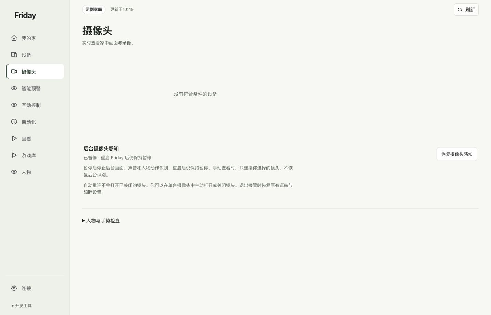

按[第一条手势控制](#guide-tutorials-first-gesture)完成现场验证。“电视未连接”不妨碍电脑预览；语音、云台、电视、人脸登记和房间标定按自己的需求分别准备。

**完成标准：**安装、登录、画面、识别、规则响应与物理效果分别有依据。Linux 完成 Miloco 接入后仍不因此具备当前 Apple Vision 手势链路。

<a id="guide-getting-started-installation-maintenance"></a>

## 6. 启动、停止与日常维护

已经安装好 Friday 后，平时使用原来准备好的脚本即可。账号连接和已保存的规则会保留，不用每次重新设置。

### 1. 日常启动与停止

在**安装 Friday 的电脑**上，打开安装时保存的脚本文件夹。

macOS 如果已有“优雅停止.command”或“重新启动.command”，双击对应文件即可。使用 `.sh` 脚本时，在这个文件夹的终端里，按需要运行下面**一条**命令：

| 你想做什么 | 运行哪个脚本 |
| --- | --- |
| 开始使用 Friday | `./start-friday.sh` |
| 暂时关闭 Friday | `./stop-friday.sh` |
| 重新启动 Friday | `./restart-friday.sh` |

等待脚本提示完成。启动或重启完成后，再打开 [Friday 页面](http://127.0.0.1:8740/)。启动可能需要等一会儿，不要连续双击或同时运行多个脚本。

找不到脚本或提示尚未配置时，请安装人员先准备好本机入口；脚本下载和首次配置见本页末尾的安装人员参考。

只想暂时停用手势时，在“互动控制 → 手势控制”点击“暂停手势控制”即可，不必关闭整套 Friday。重新启动后，原来的暂停设置也会保留。

#### 电脑重新开机后

继续使用原来的启动入口，等待完成后再打开 Friday。如果平时要先打开其他配套软件，也按安装时约定的方式打开。

### 2. 打开后看一眼

- 显示的是自己的家庭，而不是“示例家庭”；仍是示例时，到“连接”读取自己的家庭。
- 要用的设备状态正常；使用手势时，再确认画面更新、手势控制已开启。

需要确认手势是否恢复时，做一次已保存的动作，同时看页面提示和设备实际反应。

### 3. 遇到问题怎么办

| 遇到的情况 | 先这样做 |
| --- | --- |
| 网页打不开 | 确认启动脚本已经完成，再刷新页面；手机或其他电脑请使用安装时提供的访问地址 |
| 脚本报错或一直没有完成 | 记下报错或截图，联系安装人员，不要反复重装 |
| 有画面，手势没反应 | 确认手势没有暂停；多人在镜头前时，先比 OK 保持约 2 秒，放下手后再做动作 |
| 有手势记录，设备却没动 | 先看设备是否离线或显示“不可用”；恢复连接后再试，不用重新添加规则 |

仍未解决时，查看[按现象排查](#guide-troubleshooting-common-errors)，或把发生时间、刚才的操作和错误提示发给安装人员。不要发送密码、验证码或包含私人画面的截图。

### 4. 更新或换电脑前

请先让安装人员备份账号连接、规则和家庭配置，确认备份可用后再更新、重装或迁移。启动、停止和重启脚本**不会自动备份或升级**。

---

**安装人员参考：**[脚本下载、首次配置、升级与备份](docs/maintenance/installation-maintenance.md)。日常使用不需要执行这些步骤。

<a id="guide-getting-started-quick-start"></a>

## 7. 第一次打开 Friday

完成后，你能确认自己打开了正确的服务、看懂设备来源，并找到日常操作入口。

**开始前：**Friday 已经安装并启动。全新电脑先按[从零安装](#guide-getting-started-installation)选择 macOS 或 Linux 路线，再回到本节。

### 1. 打开本机页面

在部署 Friday 的电脑上打开 [Friday 本地控制台](http://127.0.0.1:8740/)。网页打不开时，先按[启动与维护](#guide-getting-started-installation-maintenance)运行服务，再刷新页面。Linux 远程部署先建立对应的 SSH 转发。

`127.0.0.1` 表示“当前这台电脑”。把它复制到手机上，不会自动访问电脑上的 Friday。

### 2. 看顶部家庭来源

顶部显示“示例家庭”时，先阅读演示，不要把卡片数量当作你家实际设备数量。“家庭已连接 · 只读”可以查看信息；能够操作哪些设备仍由已配置的控制范围决定。

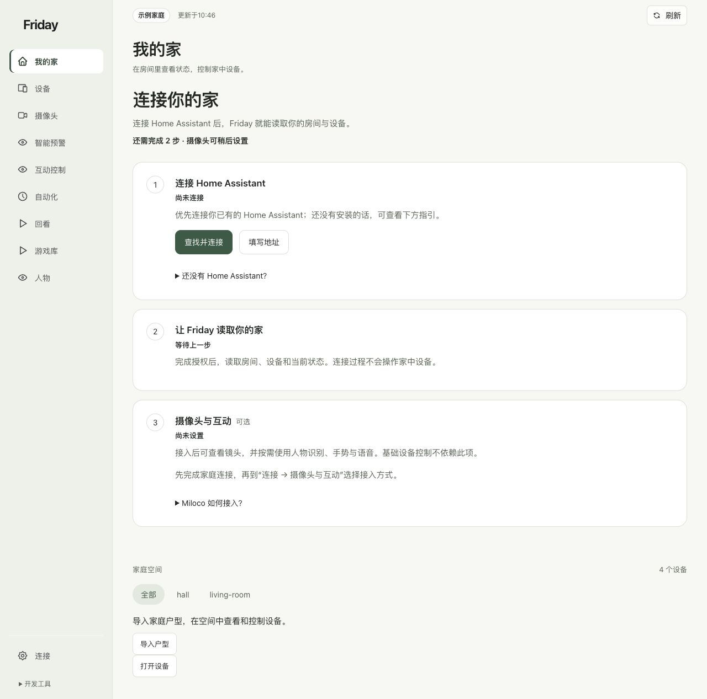

### 3. 打开设备页

点击“设备”，按房间或设备类型筛选。卡片的读数与按钮分别表达状态和可用操作；“暂时不可用”不是“已经关闭”。详见[查看与操作设备](#guide-guides-devices)。

### 4. 需要自己的家庭时再连接

打开“连接”，按“连接 Home Assistant → 让 Friday 读取你的家”完成必要步骤。摄像头与互动是可选项，可以稍后配置。

### 5. 确认你已完成

你能够重新打开页面、分清示例与真实来源，并找到设备页，就完成了本节。接下来按[连接自己的家](#guide-getting-started-connect-home)或[第一条手势控制](#guide-tutorials-first-gesture)继续。

**如果卡住：**网页打不开，先查[启动与连接问题](#guide-troubleshooting-common-errors)，不用先删除账号或重装。

<a id="guide-getting-started-connect-home"></a>

## 8. 连接自己的家

把已经接入 Home Assistant 的家庭设备显示到 Friday。连接过程先读取房间和设备，不会替你执行开关动作。

**开始前：**你已有可打开的 Home Assistant，并已在里面添加所需设备。没有服务时，先按[安装 HA 与小米接入](#guide-getting-started-installation-home-assistant)准备；Mac 和 Linux 的容器环境分别在安装章节说明。

### 先分清三个位置

| 在哪里操作 | 负责什么 |
| --- | --- |
| Home Assistant | 接入设备和集成，管理真实家庭清单 |
| HA 里的 Xiaomi Home 集成 | 登录小米账号，选择家庭与设备 |
| Friday 的连接页 | 授权 Friday 读取 HA，并查看当前连接情况 |

**XiaoMi/ha_xiaomi_home 装在 HA 内部，是集成，不是另一套需要独立启动的服务。** Miloco 可用于其摄像头与智能功能，但不是 HA 小米登录的前置条件。详见[各程序的分工](#guide-explanation-components)。

### 1. 先在 HA 接入小米设备

在 HA 的“设置 → 设备与服务 → 添加集成”进入 Xiaomi Home，按官方页面完成区域、登录、家庭和设备选择。密码、验证码和授权结果只填在对应页面。

完成后，在 HA 集成页核对是否已经出现目标设备。一个物理设备可能对应多个状态项目，设备数与实体数不必相同。

### 2. 在 Friday 查找并连接

打开“连接”，点击“查找并连接”。找到多个地址时选自己的 HA；未找到时点击“填写地址”，填写浏览器可以打开的完整 HA 地址。


### 3. 完成登录，再读取家庭

在 HA 官方登录页完成授权，返回 Friday 后点击“连接并读取设备”。看到“家庭已连接”及自己的房间、设备后，读取接入完成。

服务离线时，先检查地址和服务状态再重试。不要反复删除已有授权，也不要把授权结果复制到聊天或文档仓库。

### 4. 分别检查控制和摄像头

“只读”时仍可查看设备。首次开放设备操作范围需要本机配置；这不等于每次都要逐台登录。现有范围可以暂停或恢复，新设备不会因被发现就自动获得控制权。

摄像头接入、画面识别与设备控制需要分别准备。完成读取后，可继续[设备操作](#guide-guides-devices)或[摄像头与识别](#guide-guides-cameras)。

**完成标准：**Friday 显示家庭已连接，能在设备页找到自己的目标。**有设备但按钮不可用：**查[只读与权限](#guide-troubleshooting-faq)。

<a id="guide-guides-devices"></a>

## 9. 查看与操作设备

按房间找到设备，分清当前状态与可用操作，再使用设备专属控件。

### 先找设备，再看状态

点击“设备”，选择房间、类型，或在“搜索设备”输入名称。新版会保留只读及暂时不可用的设备，不再因为没有控制按钮就隐藏整台设备。


“我的家”侧重家庭空间与房间入口；需要完整卡片列表时点“打开设备”或左侧“设备”。没有导入自己的户型时，空间区域留空，未定位设备仍可在列表中使用。

### 看全屋镜头状态

打开「我的家」，在 Friday 栏查看「家庭感知」。「1 / 2 台感知中」表示两台参与感知的镜头里，有一台当前有可用的识别画面。隐私关闭的镜头不计入分母。

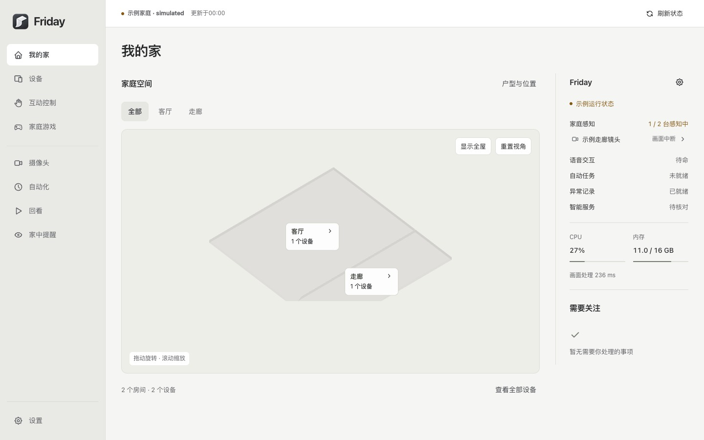

画面中断时，Friday 会在后台尝试恢复。想查看情况时，点击状态下方的镜头名称。进入详情后，可以再点击「查看实时画面」。

「画面处理」显示最近有效画面从到达本机到完成处理的耗时。多台有读数时显示其中最慢的一台。过期后会撤下读数。

### 使用对应控件

| 设备类型 | 常见控件 | 操作前看什么 |
| --- | --- | --- |
| 灯 | 开关、亮度，受支持时可调色温 | 是目标房间的目标灯；哪些调节项已开放 |
| 窗帘 | 打开、关闭、停止、开合位置 | 当前开合程度与电机支持范围 |
| 空调 | 工作模式、设定温度，受支持时有风速 | 当前室温与设定温度不是同一个数 |
| 风扇 | 开关及受支持的风速 | 设备在线，当前动作可用 |
| 摄像头 | 镜头状态与查看画面 | 查看画面和主动打开镜头的含义不同 |

点击卡片名称可展开设备详情。具体出现哪些控件，由设备能力与本机控制范围共同决定；不能因为新版增加了某种控件，就认为所有设备已获得新权限。

### 核对操作结果

选择模式、点击开关或调节按钮可能直接执行已授权操作。先确认目标，再操作一次，观察页面提示和设备实际变化。

“暂时不可用”时先检查设备连接，不要把它当成“关闭”。传感器读数是设备报告；插座内部温度和空调回风温度不自动等于房间室温。

**完成标准：**找到正确设备，页面报告与实际效果一致。设备列表为空或按钮灰色，见[常见问题](#guide-troubleshooting-faq)。

<a id="guide-guides-cameras"></a>

## 10. 查看摄像头与识别

先确认镜头状态，再按需要查看普通画面或人体、手部识别结果。

### 看画面

1. 打开「摄像头」，选择要查看的镜头。
2. 在画面下方点「查看实时画面」。镜头已经关闭时，可以点「打开镜头并查看」。
3. 画面打开后，可用方向键调整视角，或选择跟随人物、跟随宠物和巡视。
4. 在同一位置点「停止查看」即可结束预览。要关闭设备镜头，使用详情底部的「关闭镜头」。


显示「实时画面 · 感知恢复中」时，可以继续查看画面和使用可用的方向键。自动跟随和巡视会等待感知恢复。

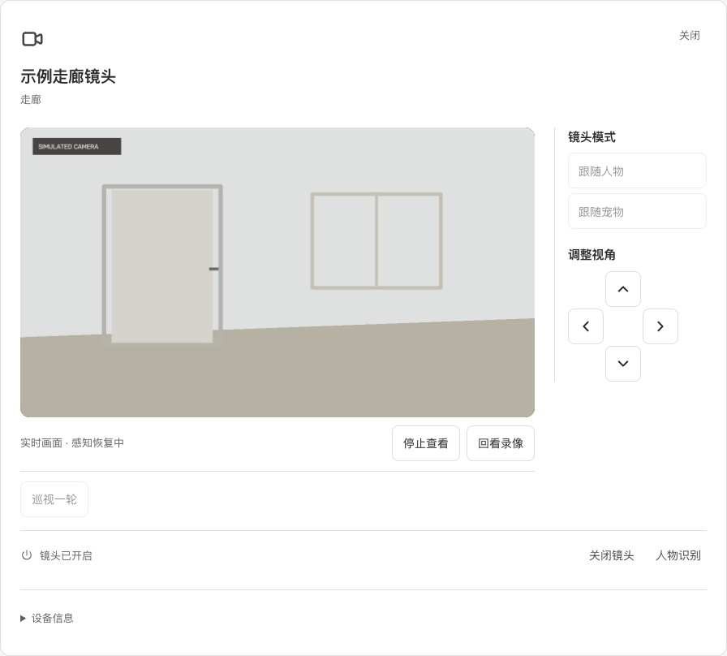

镜头在米家里关闭后，Friday 的自动重连不会替你强行打开它。需要画面时，由你在米家或摄像头的明确开关入口主动打开。

### 看人体与手部识别

展开“人物与手势检查”，在“识别调试”点击“查看识别”。时间应持续更新；骨架或手部提示只表示检测结果，设备有没有执行要去互动页核对。

“电视未连接”只说明没有电视端，不妨碍电脑上的实时查看。位置尚未标定主要影响空间指向和座位，不要求为了普通手势先填一套猜测户型。

### 跟随人物或宠物

查看实时画面后，选「跟随人物」或「跟随宠物」。宠物跟随需要当前镜头支持猫狗识别。

转动后，看到「正在确认原目标」时，等镜头核对新的画面。人物或宠物相互遮挡时，镜头也会停一下，等重新确认原来的对象。如果显示「未找到原目标」，让目标回到清楚的视野中，再点「重新跟随人物」或「重新跟随宠物」。

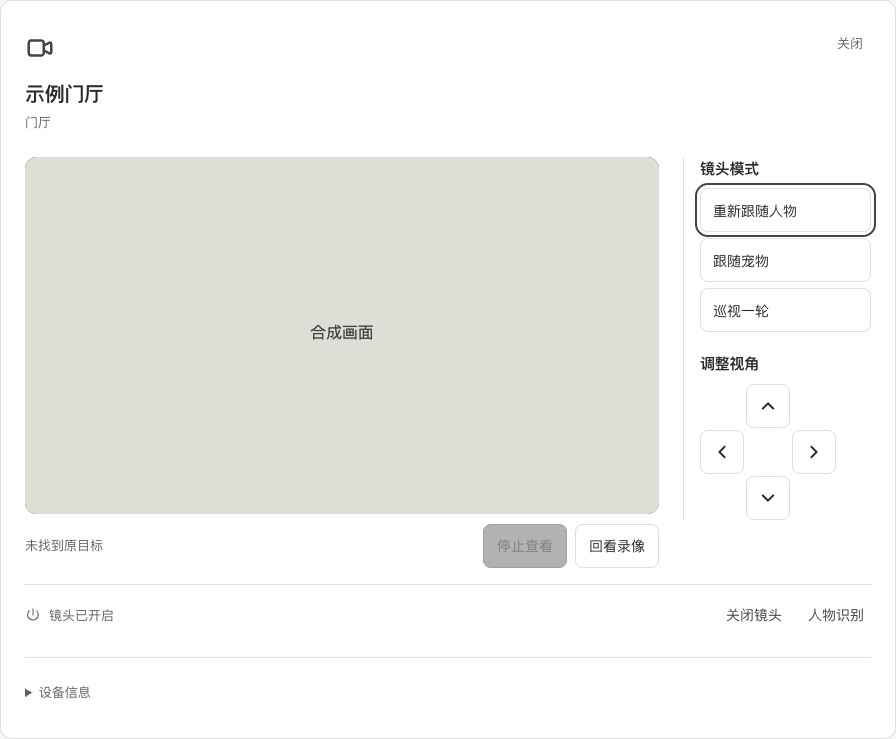

#### 唤醒后转向

开启语音并使用「跟随人物」时，单说一声「Friday」即可。如果画面里只有一个人，镜头会朝偏在一侧的人转过去；人已接近画面中央时会保持当前角度。转过后，镜头会用新画面重新对准。

人还没入镜时，镜头会短暂查看两侧。如果先试的一侧转不动，镜头确认画面后会试另一侧。多人同框时，镜头会等到目标明确。

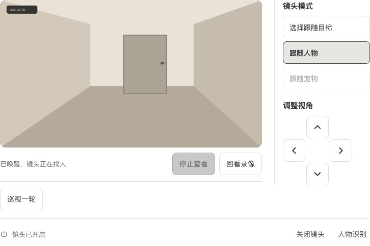

多台摄像头都听到时，Friday 会选择收音更清楚的一台。云台方向由这台镜头的画面判断。定时巡视中收到有效唤醒时，镜头会结束这轮巡视。手动停留、指定目标、手动巡视、游戏和异常复核仍优先。

#### 选中画面中的人物或宠物

1. 打开摄像头详情，开始查看实时画面。
2. 选择「选择跟随目标」，然后选「人物」或「宠物」。等目标进入画面。
3. 点击画框或按对应的编号。状态显示「跟随所选人物」或「跟随所选宠物」时，镜头已确认目标。

如果点选时目标已被遮挡或短暂离开画面，先在原处刷新，再从清楚的画面选择。目标离开后也可用「重新选择目标」。结束实时查看后，跟随仍会在后台运行。用「停止跟随」让镜头停在当前视角。

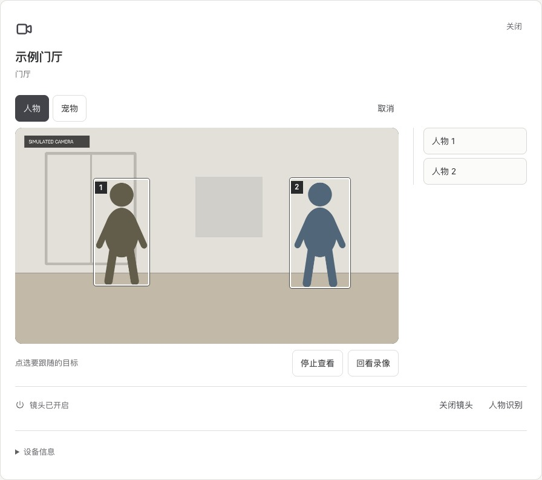

### 镜头巡视

查看实时画面后，选「巡视一轮」。镜头依次查看平视和较低的区域，进度按已确认的视角增加。看到「本轮巡视完成」后，镜头会停留。

「停止查看」收起实时画面，详情仍会显示当轮巡视。点进度旁的「停止巡视」，让镜头停在当前视角。

有人在画面里时，选定的镜头仍按路线巡视。看到「巡视中，观察当前视角」时，镜头正在这一处观察。如果有需要复核的异常，镜头会短暂停留，再根据当前画面继续巡视。

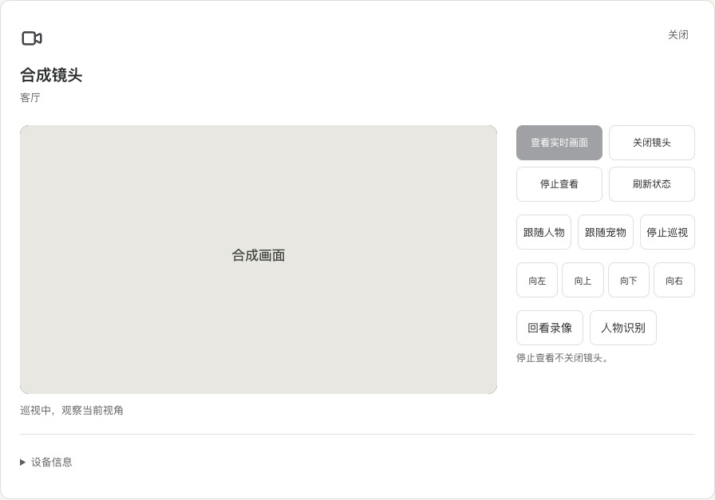

画面暂时中断时，可以从详情停止仍在进行的巡视。当前路线提前结束时，详情会显示「本轮巡视未完成」。画面恢复后，可以再巡视一轮。

#### 定时巡视

查看实时画面后，选择「每 30 分钟巡视」。该镜头在 Friday 后台运行时自行巡视。两轮之间继续跟随人物。镜头关闭或感知暂停时，巡视停止，恢复后重新计时。

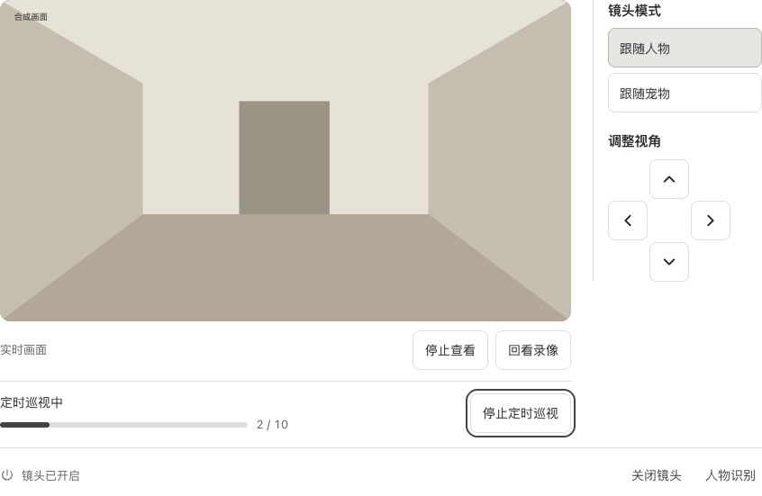

用「停止定时巡视」让镜头停在当前视角。结束实时查看后，详情仍可停止定时巡视。手动调整视角或切换跟随模式，也会退出定时巡视。

### 回看这台镜头

点画面下方的「回看录像」进入该镜头的列表。选日期可以缩小范围，点片段开始保护播放。停止回放后会回到列表；点「查看全部录像」可查看其他镜头。

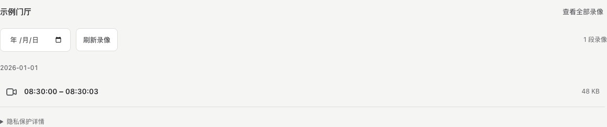

页面提示镜头尚无可用的对应关系时，点「设置录像对应」，为当前镜头选择实际的录像目录。

### 分清三个开关

| 你想暂停什么 | 应在哪里操作 | 仍会发生什么 |
| --- | --- | --- |
| 只停止手势触发设备 | 互动控制 → 暂停手势控制 | 后台识别可以继续 |
| 停止 Friday 后台感知 | 摄像头或连接页 → 暂停摄像头感知 | 暂停状态重启后保留；按需手动查看选定镜头不代表恢复全部后台识别 |
| 让摄像头设备本身关闭镜头 | 米家镜头开关或明确的设备开关 | 以设备自己的录像和镜头设置为准 |

麦克风、语音回复和云台接管有独立配置。接通视频不表示这些功能也已开启。

**如果 Miloco 有画面而 Friday 未配置：**按[摄像头与本地识别准备](#guide-getting-started-installation-camera)分别核对 SDK、独立环境、原生程序、模型、私有注册和后台入口。当前原生识别依赖 macOS Apple Vision；Linux 的 Miloco 视频成功不表示同一套手势链路已可运行。

完成后可继续[第一条手势控制](#guide-tutorials-first-gesture)。

<a id="guide-tutorials-first-gesture"></a>

## 11. 完成第一条手势控制

把一个身体动作绑定到一台已授权设备，并分别核对识别、响应记录和设备实际效果。

**开始前：**Friday 摄像头和本地识别已准备好；目标设备在 Friday 中允许控制；你了解本次绑定会执行什么动作。

### 1. 先看到实时识别

打开“摄像头”，展开“人物与手势检查”，点击“查看识别”。确认时间持续变化，人体或手部提示能够跟随你。电视未连接不影响本机查看。


如果这里只显示未配置，先完成[摄像头接入](#guide-guides-cameras)，反复做动作不能补齐识别环境。

### 2. 选手势控制，而不是语音页

打开“互动控制”，切换到 **手势控制**。默认的“对镜头说话”是语音功能，打开页面不代表语音已经开启。

### 3. 保存一条完整规则

依次选择“使用范围 → 控制设备 → 动作 → 执行动作”。例如：在目标房间，双臂合上时关闭指定窗帘。核对后点击“保存手势控制”，再到“已设置的控制”确认规则已出现。

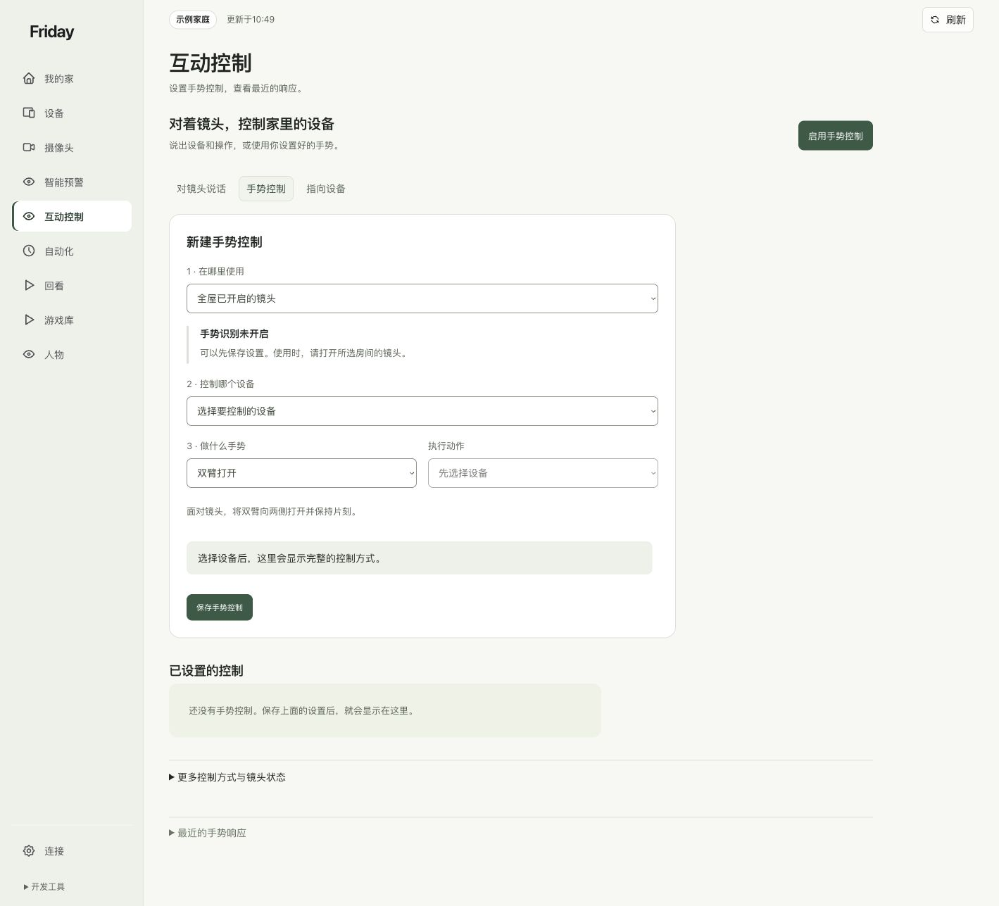

上方表单的默认选项不会自动修改已经保存的规则。修改旧规则要点击那条规则的“编辑”，再“保存修改”。

### 4. 开启总开关并完成动作

确认该规则的开关已启用，再点击“启用手势控制”。按钮显示“暂停手势控制”表示总开关正在运行。

站在镜头能清楚识别身体的位置，先保持稳定，再按所选动作说明完成连续变化。例如双臂合上应先张开，再向胸前合拢并短暂停留；一直保持合拢不等于新的动作。多人入镜时，由准备控制的人比 OK 保持约 2 秒选定自己，再放下手开始；已选中另一人时也可这样接管，详见[操作者切换](#guide-guides-interactions)。

### 5. 看记录，再看设备

展开“最近的手势响应”。出现记录后，再观察目标设备是否实际执行。“指令已发送”不能代替现场确认；设备本来已在目标状态，也可能没有新的可见动作。

### 6. 暂时不用时暂停

点击“暂停手势控制”会保留规则，阻止后续手势触发。它不会撤回已经发出的动作；关闭网页也不会自动停掉后台。

**完成标准：**规则已保存、总开关运行、最近响应出现对应目标，并且你确认设备实际效果。任一步缺失，按[手势不触发排查](#guide-troubleshooting-common-errors)逐层检查。

<a id="guide-guides-interactions"></a>

## 12. 管理互动控制规则

在同一页选择语音、手势或指向方式，修改已有规则，而不必删除后重建。

### 三种方式分别做什么

| 页签 | 用途 | 另外需要的准备 |
| --- | --- | --- |
| 对镜头说话 | 用设备和房间名称表达操作 | 全屋语音已开启，所在房间有可用的摄像头 |
| 手势与动作 | 把明确动作绑定到设备 | 画面、本地识别与目标控制已配置 |
| 指向设备 | 在镜头画面标记目标，再按指向控制 | 镜头位置、设备点位和相应识别已核对 |

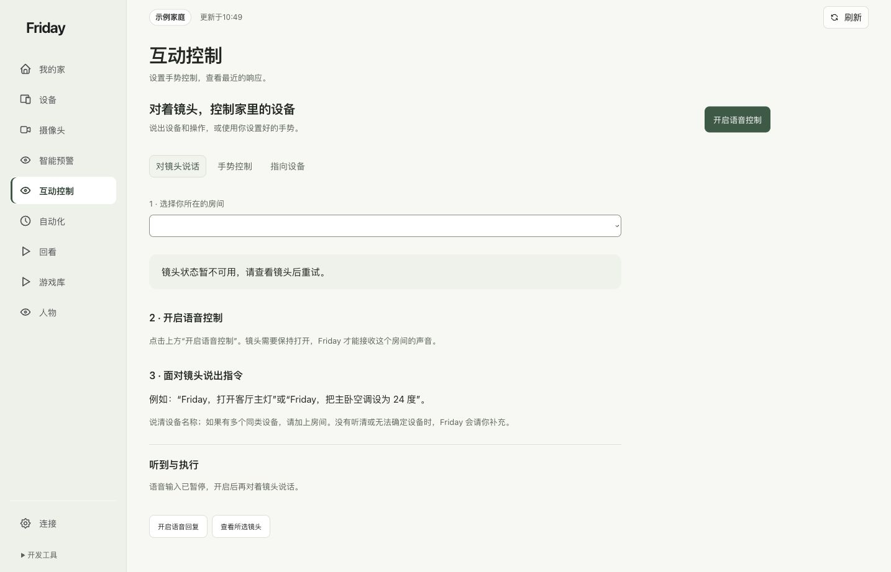

只想做手势时，直接切到“手势与动作”。本地手势可以独立使用。早期界面的“手势控制”页签和“已设置的控制”列表，对应新版的“手势与动作”和“设备控制”。

### 喊 Friday，让镜头转过来

1. 在「互动控制 → 对镜头说话」开启语音。全屋正在感知的摄像头都可以收音，无需切换房间。要让镜头转向，摄像头还需支持由 Friday 控制云台。
2. 在摄像头详情里选择「跟随人物」。平时可以关掉实时预览。
3. 单独说一声「Friday」或自己设置的唤醒词，说完稍停。即使还没看向镜头，Friday 也能识别完整的唤醒词。多台镜头同时听到时，Friday 选一路来识别并转向。

想直接开灯，可以连着说「Friday，打开客厅灯」。也可以先喊一声，等镜头转过来，再看向镜头说出指令。

[摄像头详情中的唤醒状态](#guide-guides-cameras)

### 新建、修改和暂停

1. 如果表单未展开，在“设备控制”点击“添加设备控制”。选择使用范围，有多房间镜头时核对房间或全屋范围。
2. 选择设备、动作和执行动作，检查表单中的完整描述，再保存。
3. 修改旧规则时点它的“编辑”，检查回填内容，点击“保存修改”；不想改就“取消编辑”。
4. 单条规则的开关只影响这一条；页顶手势总开关暂停时，已启用的规则也不会触发。


移除规则后，页面提供撤销入口时可立即撤销。编辑草稿、设备失效提示和修复入口用于减少误改；最终以已保存卡片为准。重新发现同名设备不等于自动替换原来的目标。

### 多人时选择或切换操作者

镜头里只有一人持续可见时，系统可自动选择；之后有人进入画面，需要控制设备的人面向镜头比 OK，保持约 2 秒，放下手后再做绑定动作。即使已经选中了另一人，也可以用这个方式接管。两人同时比 OK 时，不会据此切换。

用于选择操作者的这次 OK 不执行设备动作。需要用 OK 触发已配置的控制时，先放下手，再重新做一次。重启识别服务或追踪丢失后，临时操作者需要重新确认；设备规则和允许控制范围仍会保留。

已有操作者时允许接管的修复包含在 Friday 提交 [5961567](https://github.com/Geeprox/Friday/commit/5961567d3ed897eed20fb161be6dfa49d522df3d)。旧版可能一直保留最先选中的人；更新 Friday 后重启识别服务，再按上述步骤验证。

### 连续动作与设备响应

如果把“张开”和“合上”分别绑定为打开与关闭窗帘，两种动作会分别产生控制请求。在“手势与动作”或“指向设备”页签底部展开“最近的手势响应”，按表格核对每次请求，再观察设备实际运动。

| 表格列 | 怎样核对 |
| --- | --- |
| 触发时间 | 这次手势触发的日期和时间，使用当前浏览器的本地时区 |
| 触发动作 | 做出的手势，以及接收该手势的镜头所在房间 |
| 对应规则 | 这次触发的手势、设备、执行动作和使用范围，可与“设备控制”中的规则核对 |
| 响应结果 | 区分“状态已更新”“指令已发送”和“操作未完成” |

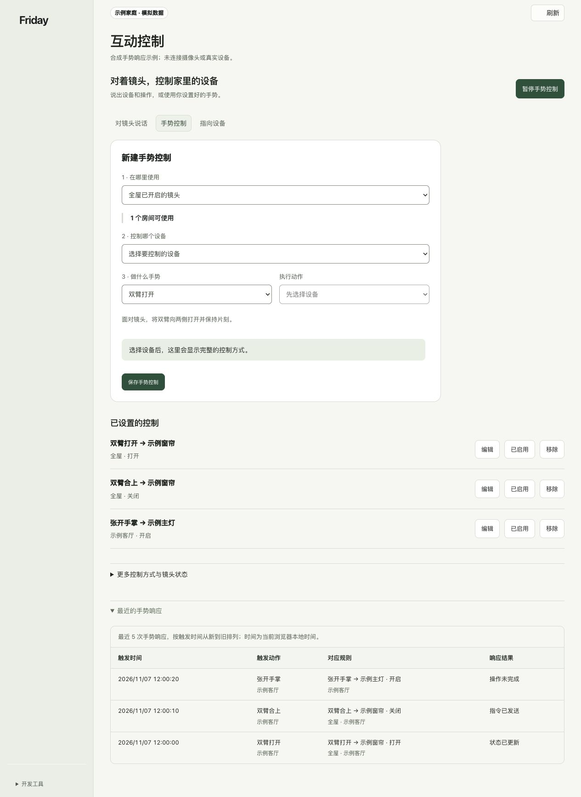

此图采集于 2026-11-12，使用隔离的模拟数据。表格按触发时间从新到旧显示最近 5 条。手机上可左右滑动表格查看完整列。记录在设备服务返回后出现，慢回报不会改变触发时间或排列顺序。修改或移除规则后，已有记录仍保留当时的手势、范围和执行动作。设备名称按当前清单显示，原设备不在清单中时会提示不可用。

没有记录时会显示操作提示；旧版记录缺少信息时显示“未记录”，不会推测触发手势或规则。这里是临时响应记录，识别服务重启后会清空，不是长期操作历史。

新响应出现时，表格会保留当前横向浏览位置；用 Tab 聚焦表格后，也可继续用方向键滚动，无需重新聚焦。

“指令已发送”表示设备服务已接受请求，窗帘可能仍在运动；“状态已更新”表示回报符合目标。窗帘回报停留在“正在打开”或“正在关闭”时，仍需现场确认是否到位。

响应结果保存的是本次控制返回时的回报，不会随着后续设备状态持续更新。因此，“指令已发送”不一定稍后自动变成“状态已更新”；设备原本已在目标状态时，也可能直接显示“状态已更新”。

旧版等待上一条指令的设备回报时，可能挡住紧接着的手势，使它失效。遇到“张开有记录、合上未完成”时，更新到包含[连续手势修复](https://github.com/Geeprox/Friday/commit/7c0c6d6f4096654eb873852f43013f3c8c26f874)的版本并重启 Friday，原规则和设备授权继续使用。修复后，等待回报与后续手势发送分开处理；真实发送仍按顺序检查和执行。

本手册的安装基线 [b069e20](https://github.com/Geeprox/Friday/tree/b069e20584e4d68f4a7fb9b3731a2f35fc87d29e)同时包含上述修复、中文代码注释及设备来源检查。

### 指向设备前先核对点位

在“指向设备”选择目标，按当前画面标记位置或填写百分比。镜头移动后需要重新核对，不能把画面坐标当作永久房间坐标。

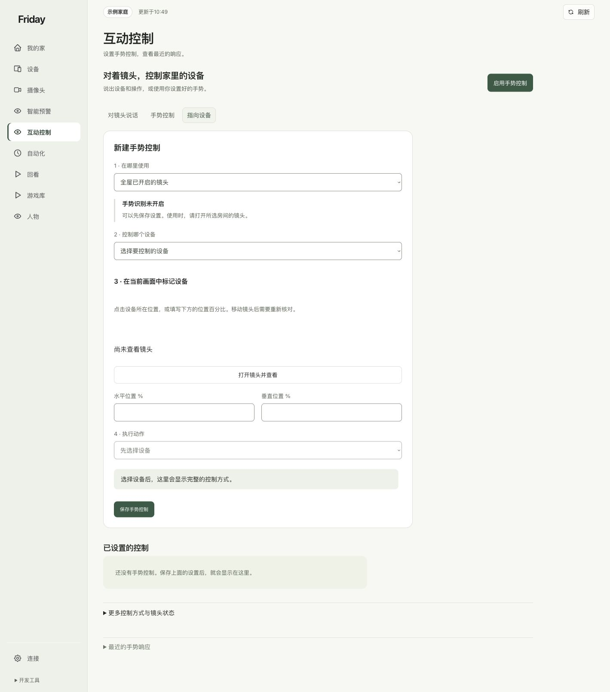

**完成标准：**保存卡片中的范围、手势、目标和动作都正确，并按[第一条手势控制](#guide-tutorials-first-gesture)完成现场验证。设备列表为空见[权限问题](#guide-troubleshooting-faq)。

<a id="guide-guides-automations"></a>

## 13. 管理场景与自动化

先确认规则来源，再决定运行一次、修改 Friday 自有规则，还是回到原平台管理。

### 三个分类

| 分类 | 你能做什么 |
| --- | --- |
| 一键场景 | 读取米家已有手动场景，核对后运行一次 |
| 自动运行 | 查看、暂停、编辑 Friday 自有自动化 |
| 其他平台的规则 | 查看原规则记录，按当前家庭设备重建 |

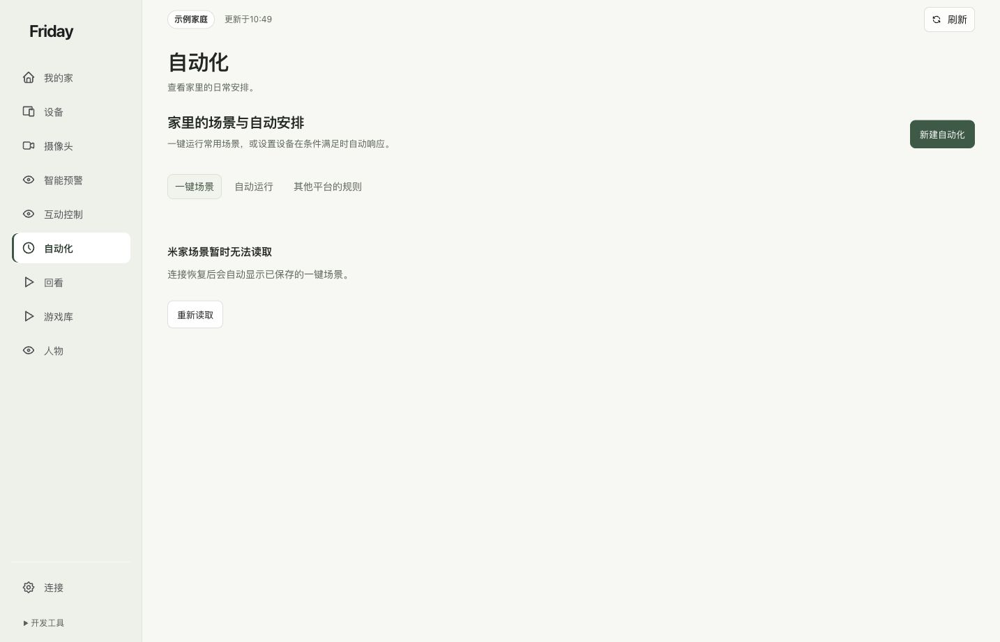

### 运行米家一键场景

选择场景后，先核对确认框中的名称和涉及设备数量，再决定是否运行。场景按米家保存的内容执行，可能同时操作多个设备。

**米家场景是独立执行入口，其范围与 Friday 设备页已开放的逐台控制范围不同。** 想只操作指定设备时，使用设备页或对应手势规则；不要把场景设备数当作已逐台验证的控制范围。“已发送”后仍要核对现场效果。

### 新建 Friday 自动化

1. 点击“新建自动化”，填写能说明用途的名称。
2. 选择触发设备与状态变化，再添加需要执行的设备动作。
3. 需要时设置附加条件。
4. 点击“核对并保存”，检查预览；确认无误后再“确认保存并启用”。

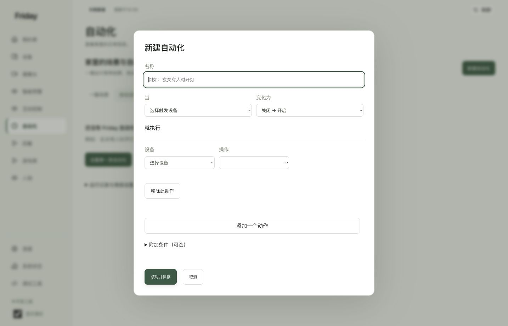

保存规则与立即操作设备不同，但启用后，后续条件满足就可能执行。已有规则可以“编辑”或暂停；“执行一次”是主动操作入口，不必等触发条件。

### 重建其他平台的自动化

1. 打开「其他平台的规则」，展开要重建的规则，点「在 Friday 重新设置」。
2. 对照「原规则」选择当前家庭的触发设备、条件和动作。只有名称的记录需要回到原应用核对具体设置。
3. 点「核对规则」，检查「何时执行」「且满足」和「就执行」。点「保存为暂停」后，新规则会出现在「自动运行」。
4. 准备切换时，先到米家或极客版暂停原自动化，再回到「自动运行」启用新规则。让一个新的事件满足条件，并核对设备结果。

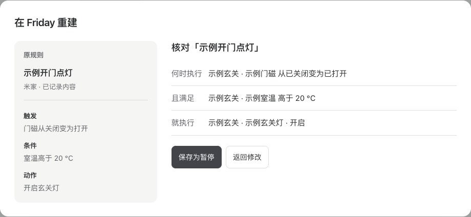

数值条件可指定传感器、比较方式和数值。例如「室温高于 20 °C」。收到读数不可用的提示时，先检查该传感器的读数，或选择当前可用的读数后再核对。原规则记录更新时，刷新列表并重新打开。

<a id="guide-guides-recordings"></a>

## 14. 连接录像并保护回看

从你已配置的录像目录查找片段，播放本机生成的保护预览，并核对时间范围。

**开始前：**NAS 或录像来源已由你连接，目标目录允许读取。摄像头直播正常不代表已接入历史录像。

### 1. 先检查来源

打开“回看”。未能读取时，进入“登录与存储设置”检查网络、已保存登录和允许目录；原来已配置的连接会尝试恢复，不需要每次重复填写。

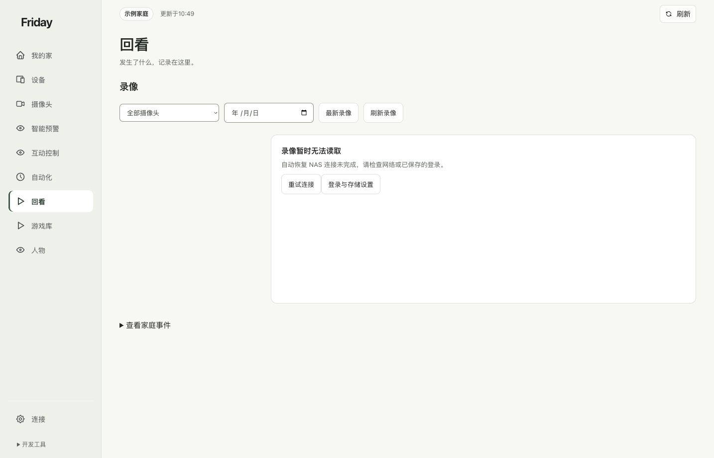

### 2. 选择镜头和日期

按录像来源、日期或“最新录像”找到片段，再点击播放。文件名时间、设备时钟和实际事件时间不一定完全相同，需要先核对录像来源。

### 3. 看懂保护预览

默认播放短时的整帧马赛克预览，保留原片。选择性遮挡需要另外安装和配置本机模型；未配置时不能承诺只遮住特定区域。生成保护预览失败时，不会自动改播未保护原片。

播放器默认静音。视觉遮挡并不清除原音轨中的个人信息，有声音的录像需要你按场景决定是否取消静音。

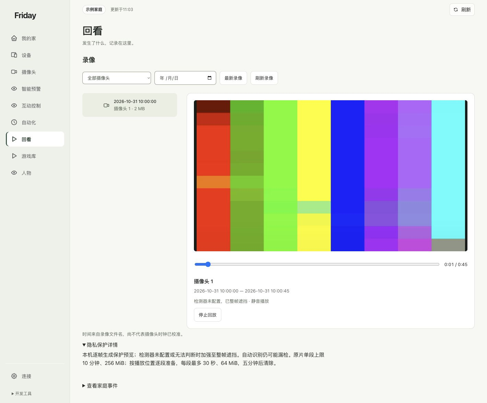

本图使用独立示例服务中的 **45 秒纯合成测试片**，用于演示播放器、保护状态和时间线，不代表真实 NAS 已连接或任何家庭录像已经验收。

### 4. 定位、继续播放与结束

可用时间线定位到片段内的位置。播放器按短片段准备后续内容，因此看到一个预览成功，不代表所有录像都已读取。来源变化或预览过期时，重新读取；结束查看后停止播放。

**完成标准：**能核对正确镜头、日期、时间范围，看到明确的保护状态，并成功定位到所需内容。没有录像、时间不符或准备失败时，见[回看问题](#guide-troubleshooting-common-errors)。

<a id="guide-guides-events"></a>

## 15. 查看家庭事件的来源

从设备状态变化查看已有记录、相关操作和录像引用，并分清“时间接近”与“原因已知”。

### 选择事件

1. 打开“回看”，展开“查看家庭事件”。
2. 选择房间、设备和时间范围，点击“刷新事件”。
3. 选择一条事件，查看“记录来源”“记录归属”“时间依据”和“物理效果”。

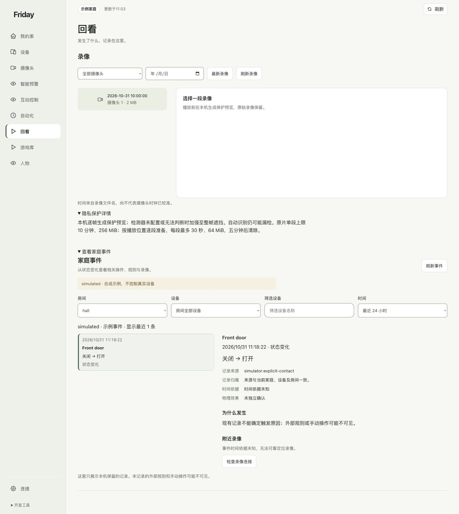

本图由独立示例服务明确注入一次模拟开门状态，不来自真实门锁、家人活动或家庭录像。

### 怎样理解为什么发生

来源明确记录的操作链、同组记录和仅仅时间相近的记录含义不同。页面显示“现有记录不能确定触发原因”时，不能据前后顺序推断某个手势或自动化造成了变化。

这里只展示本机保留的记录。外部平台规则和手动操作可能不可见；没有记录也不代表没有发生事件。

### 怎样查附近录像

只有摄像头、目录和事件时间范围能够可靠对应时，录像入口才有依据。时间未知或未核对时，先检查录像连接，不随意拼一个相近视频当作证据。

**完成标准：**你能说明这条记录来自哪里、哪些关联有依据、哪些仍未知。打开详情不会自动操作设备；继续看[保护回看](#guide-guides-recordings)。

<a id="guide-guides-people"></a>

## 16. 核对人物与待确认分组

把相似的匿名观察整理成可核对的候选组，再由你确认是否同一人、是否登记名字。

### 先核对，再登记

打开“人物”，查看实时人物、已登记人物和待确认组。绿色骨架或一次手势成功不表示已经完成姓名登记。

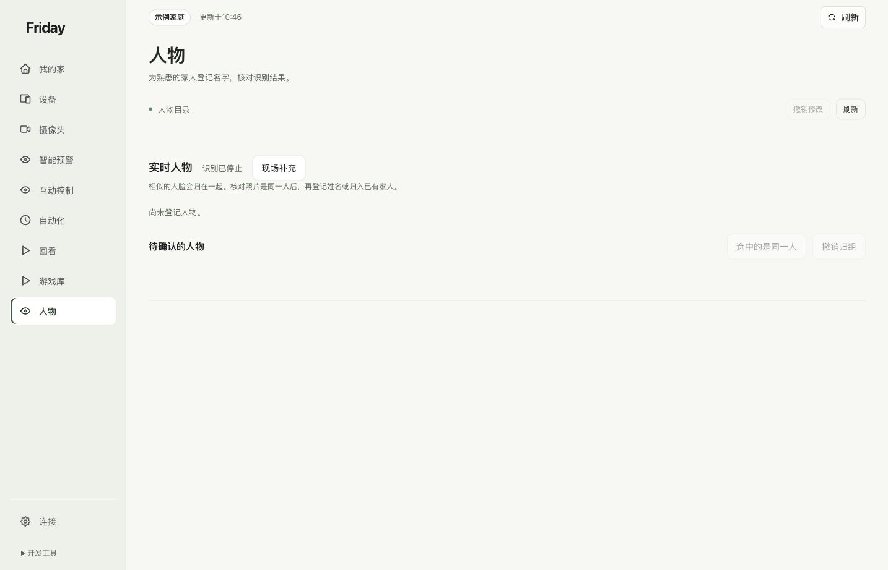

有候选照片时，逐张核对是否同一个人，再合并到同组、拆分错误观察，或归入已有家人。界面提供撤销时，可回退最近的整理操作；不要仅凭自动相似度就认定身份。

姓名登记用于资料整理与连续识别，不授予开门、账号访问或设备控制权限。没有登记人脸，也可在满足条件时使用单人动作控制；多人时按镜头提示选择操作者。

人物交错或短暂离开画面后，Friday 会等新的人脸识别结果，再显示该人在场。如果登记时画面已变化，从更新后的画面重新选择。

**完成标准：**照片和成员对应关系由你确认，错误分组已纠正。示例中没有人物资料，因此不能据截图认定人脸功能已完成现场验收。

<a id="guide-guides-safety"></a>

## 17. 查看智能预警与本机画面复核

分别检查监测、提醒和记录，不把一个开关当成整套能力已经准备好。

### 在首页看复核状态

打开「我的家」，在 Friday 栏查看已选用的「画面复核」和「声音复核」。显示「运行中」表示本机近期处理过当前来源的输入。「等待画面」或「等待声音」表示还在等可用输入。

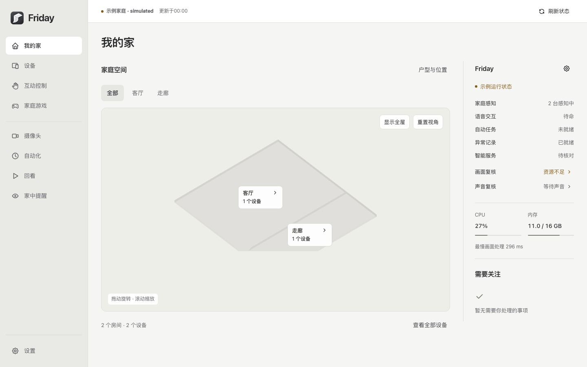

看到「资源不足」或「复核延迟」时，可以点击状态，直接打开「家中提醒」中对应的监测设置。提醒列表中的已存记录仍可查看。

### 监测与语音提醒分别设置

打开「家中提醒」，看清监测是否运行、语音提醒是否开启，以及播报音箱有没有选择。没有音箱时，不能因为存在提醒按钮就认为已经播报。

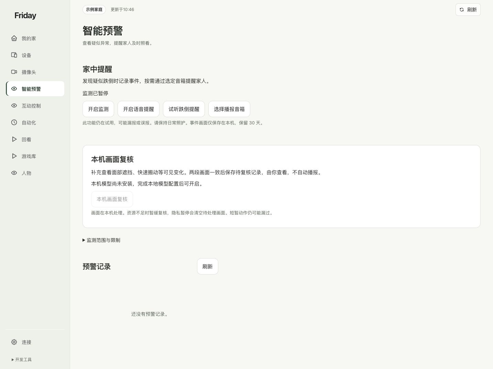

预警记录用于核对疑似异常。界面已说明可能漏报或误报，记录与现场情况仍需由你检查。

### 查看疑似跌倒提醒

监测开启后，看到有人快速倒卧时，镜头可短暂停留以继续观察。肩部或髋部短暂被挡住时，如果同一人仍可辨认，Friday 会等清楚的画面恢复后继续确认。人出画或被其他人遮挡、无法确认仍是同一人时，Friday 会重新观察。

收到「疑似跌倒」时，打开对应的「家中提醒」，查看关键帧和摄像头，及时核对现场情况。

### 本机画面复核是额外能力

新版提供可选的本机短画面复核，例如补充查看可见变化。看到“模型尚未安装”时，该项不能开启；它不由基础部署自动下载，也不是普通手势识别的必要步骤。

按页面说明确认本机资源、模型和使用范围后，再由维护人员准备。摄像头隐私暂停时，后台待处理画面会停止或清空。没有实际验证过的提醒效果，不计作已经通过。

在「监测设置」开启「画面复核」后，可通过「趴卧复核镜头」选定一台摄像头。同一人连续入镜，两段画面都支持趴卧线索时，会出现「疑似趴卧」提醒。画面被遮挡、无法确认是同一人时，会重新观察。

收到「快速搬动」时，按顺序查看同一次动作的四张关键帧，并结合现场情况核对。

### 查看疑似持续婴儿哭声

macOS 桌面版内置声音复核程序。摄像头接入后，在「家中提醒 → 监测设置」开启「声音复核」。
本机分类器支持婴儿哭声时，三段连续的同源声音证据可以产生「疑似持续婴儿哭声」提醒。打开提醒后，按时间核对「哭声时的画面」。已对应录像的镜头还可选择「查看附近录像」，从这条提醒的时间定位。

镜头转动或画面识别暂时中断时，只要这台镜头仍在取流和收音，声音复核会继续。没有同时间的清晰画面时，提醒会保留发生时间，可从对应录像查看。

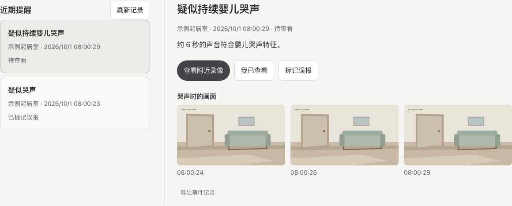

此前已有「疑似哭声」时，三段符合条件的新证据仍会生成一条独立提醒。原记录及其查看或误报标记继续保留。

### 异响后查看附近画面

打开「家中提醒 → 监测设置」，开启「声音复核」，再选择「开启异响后环视」。镜头处于「跟随人物」或单轮巡视时，可以按当前画面接续异响查看。

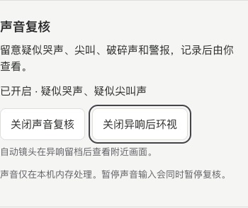

异响留档后，如果来源镜头画面无人，Friday 会短时查看起始视角两侧。原提醒会保留最多三张已确认的环视画面。接上视觉跟随后，镜头再次确认新视角和同一个目标时，会留下一张跟随画面。打开原提醒，在「关键画面」中按时间查看「异响时」「环视」和「跟随」。

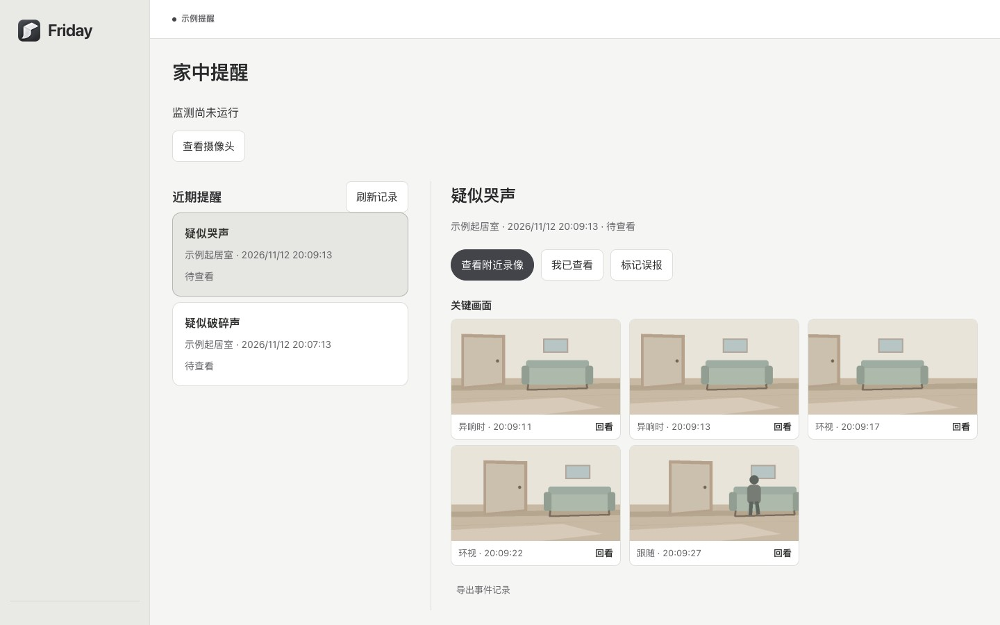

正在巡视的镜头符合环视条件时，会先完成当前视角的核对，再转入异响查看。镜头详情会保留本轮已经确认的视角数量。查看结束后显示「本轮因异响结束」。需要继续巡视时，点「巡视一轮」。环视中也可以点「停止巡视」，让镜头停在当前视角。


点击画面下方的「回看」，打开对应采集时刻的录像。要看异响发生时的画面，点「查看附近录像」。录像需要事先对应到这台摄像头。

监测状态暂时无法读取时，仍可打开已保存的提醒和关键帧。

**听到声音就会马上转向吗？** 镜头会先保存复核结果。正在使用手动停留、玩体感游戏或复核画面时，优先保留原视角。异响用于选择发起环视的镜头。镜头跟随的是画面中确认的人物，声源仍需结合记录核对。

关闭「异响后环视」可只保留声音复核。关闭声音复核也会同时关闭环视。

### 按关键帧回看

1. 在「家中提醒」打开一条记录。画面复核有两段证据时，分别查看「首次观察」和「再次观察」。
2. 点击带「回看」的关键帧。保护预览会在所选时刻暂停，点击播放即可从这里开始。疑似跌倒、声音和环视记录的画面也使用这个入口。
3. 拖动进度条可以查看同一片段内的前后画面。「回到所选时刻」会回到刚才选中的画面并暂停。「停止回放」会回到原入口。
4. 如果提示「未找到所选时刻的录像」，可以手动打开列出的相邻片段。缺少录像对应关系时，从「录像设置」核对镜头和时间。

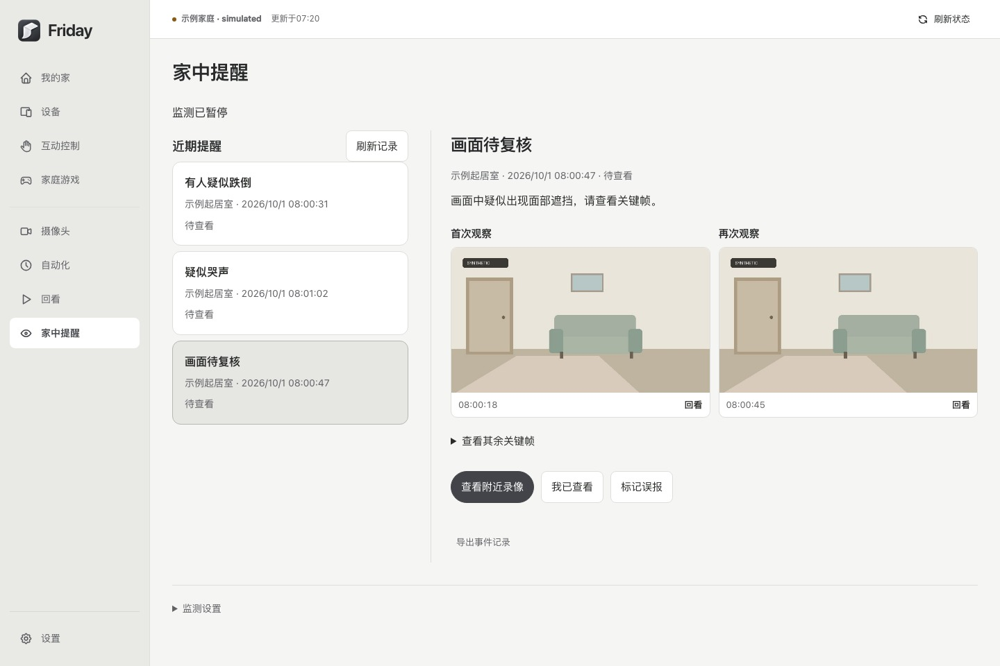

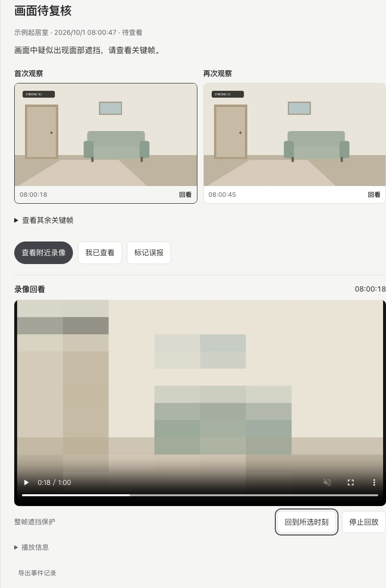

「查看附近录像」会按提醒本身的时间查找。要查看较早的画面，直接点那张关键帧。

**完成标准：**监测、提醒、输出设备和记录的状态都能分别说明。只想停止手势，使用互动页开关；想停全部后台感知，见[摄像头开关](#guide-guides-cameras)。

<a id="guide-guides-games"></a>

## 18. 使用游戏库

先检查识别与显示条件，再选择游戏和玩家。

家庭游戏里可以玩林间滑雪、体感网球、体感闯关、光线保卫队、狼人杀和家庭 KTV。体感闯关内可选山径冒险或运动训练。玩家人数和玩法可在各游戏的详情中查看。

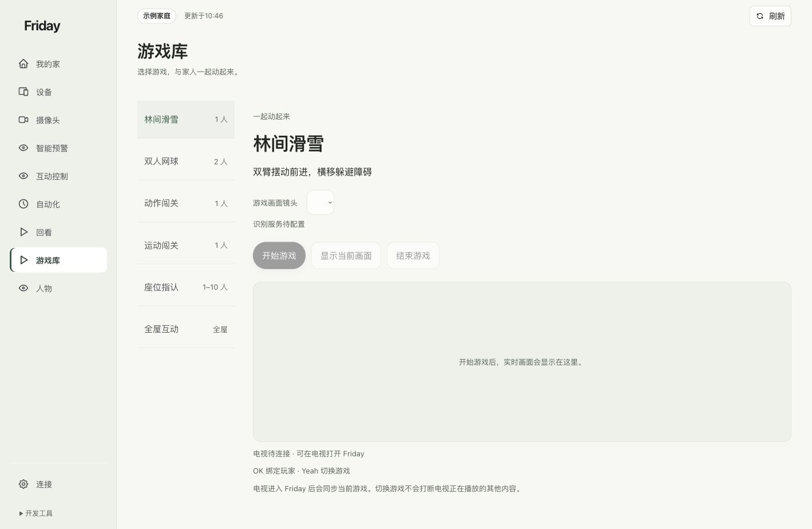

1. 先在摄像头页确认可用画面与识别。
2. 打开「家庭游戏」，选好游戏和玩法。详情提供当前游戏的路线和难度选项。
3. 进入游戏后，让玩家全身入镜，按屏幕提示开始。

在滑雪、网球、山径冒险和运动训练中，看到「让双脚入镜」时，站到镜头能看见全身的位置，双脚入镜后站定。双人网球开始前，画面里留两位玩家，等两人站好后分配编号。


### 林间滑雪

打开林间滑雪详情，先选雪道，再选难度。每条雪道旁边显示长度、门数和路线预览。

- **初雪坡** 54 米、5 道门，适合练习起滑和转向。
- **松林回转** 92 米、8 道门，后半段连续左右转弯。
- **三段山径** 180 米、18 道门，三段逐渐收紧门宽。


初次游玩可点「先试滑」。站在镜头前，让双手和双脚入镜，跟着示范依次左移、右移，再回到中间交替摆臂。Friday 识别后会勾选对应动作。需要声音提示时，打开「更多」中的「开启音效」。

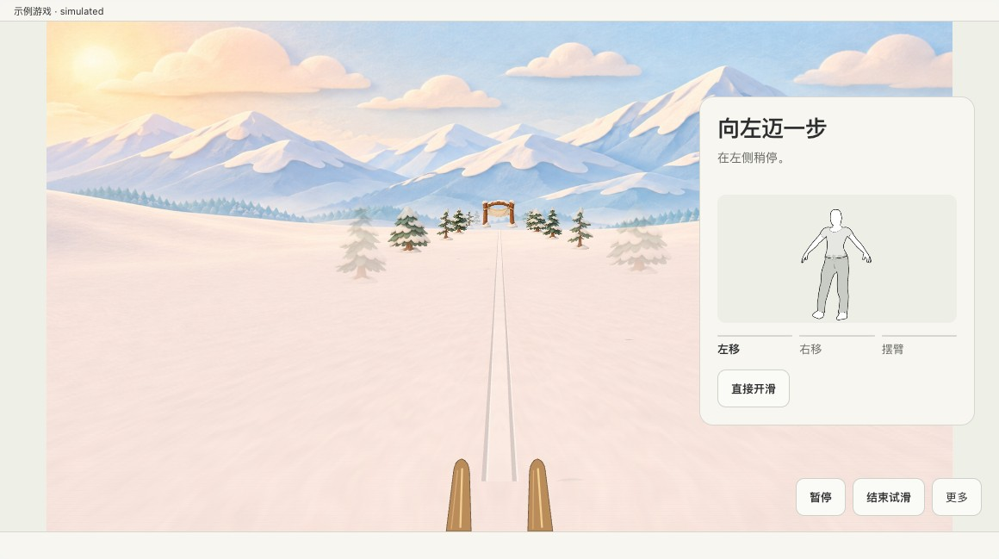

三个动作完成后选择「开始滑行」。熟悉操作时，可以在选道后选择「开始本局」，也可以在试滑中选择「直接开滑」。正式局从雪道起点计时和计分。

滑行时摆动双臂前进，左右移动，沿着成对的滑痕穿过木门。停下摆臂后会逐渐减速。

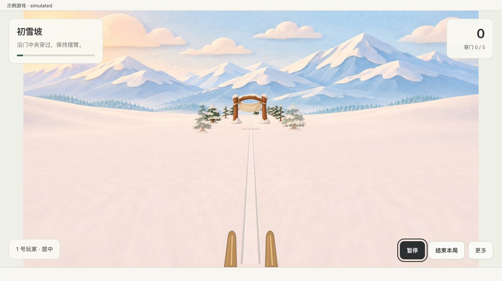

点「暂停」可以停在当前位置，点「继续本局」接着滑。想简化滑行画面时，在显示游戏的电脑或手机上开启系统的「减少动态效果」。雪道、木门和需要避开的树仍会随滑行移动。

滑到终点后，可查看用时、星级和各段穿门成绩。选择「再滑一程」会保留原雪道和难度，从起点重新开始。选择「换雪道」可先看其他路线，也可返回查看本局成绩。


### 山径冒险

从「家庭游戏」进入「体感闯关」，选择「山径冒险」。可以一次走完 14 站，也可以只玩林间入口（3 站）、溪畔步道（4 站）或山顶营地（7 站）。下方的动作示范会随路线变化。

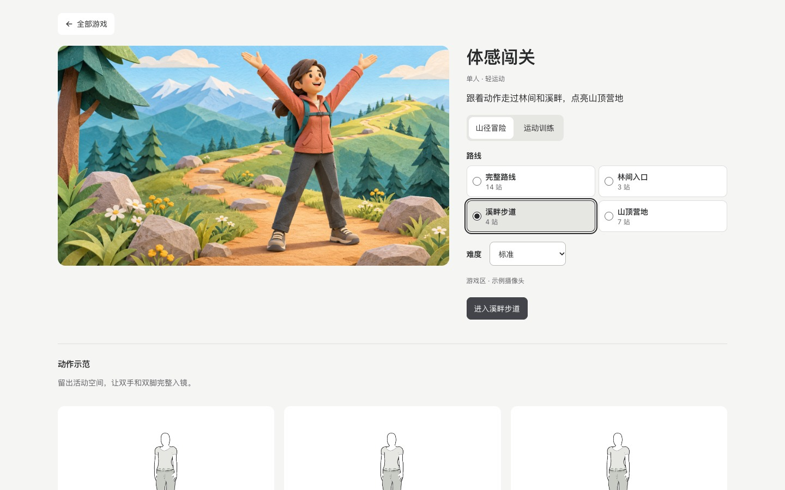

点「进入」后，确认手和脚都在画面里，选择「开始本段」或「开始全程」。每一站都有当前动作的示范。完成要求的次数或保持时长后，画面会更新进度。

溪畔第一站是「踏过溪石」。跟着亮起的溪石，用同侧的脚向外点一下，再收回站稳。收脚后会记下一块溪石，接着亮起下一个目标。看清箭头再出脚，同一侧有时会连着出现两次。想先练动作，可以在游戏详情的「侧点步」示范下点「试一试」。

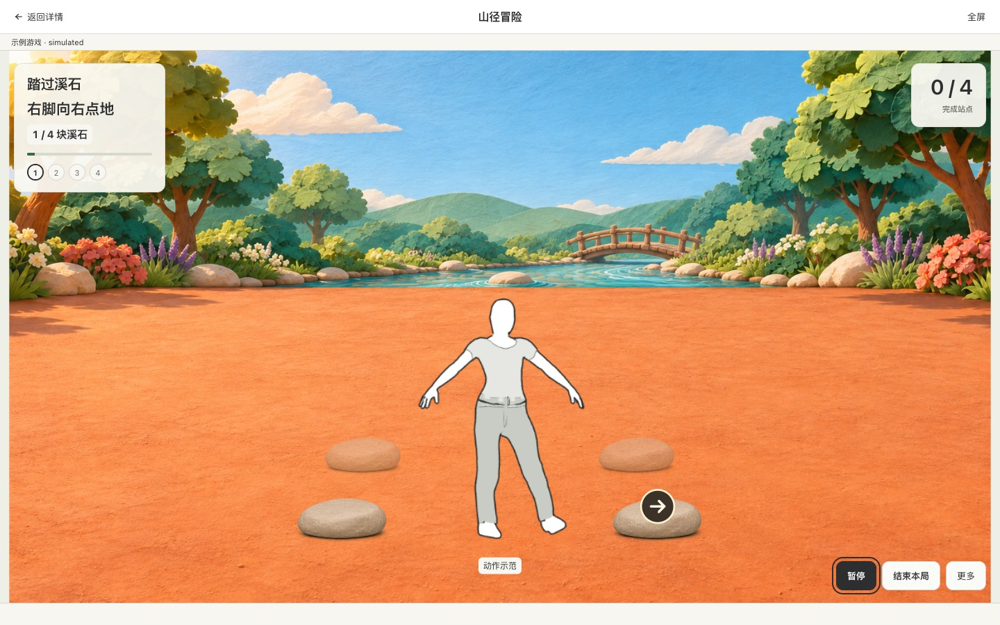

林间和溪畔完成后，点「下一段」进入相邻路线的准备页。也可以重玩本段，或选择「换路线」。打开选路时仍可点「返回成绩」查看刚完成的一局。


### 光线保卫队

一位玩家面对电脑或电视屏幕。让已经接入 Friday 的摄像头能同时看清肩膀、肘、手腕和上半身。先在游戏库选「光线保卫队」，进入后点「开始校准」。

1. 把一只前臂竖起，另一只横在胸前靠近竖臂，形成 L；左右手可以对调。
2. 跟着屏幕提示，先保持正前方，再向左、右偏一点，最后稍稍抬高和放低双臂。每个光点停稳片刻。
3. 放下双臂，等第一只绒球出现。重新摆出 L 才会显示准星。小幅转身或抬臂把准星移到绒球身上，保持到光环蓄满。
4. 看到「命中！」后放下双臂，等下一只绒球。六次命中后可以查看成绩或重玩。想听命中提示，可在「更多」中开启音效。


校准记录的是这台摄像头看到的动作幅度。换摄像头、换玩家或重玩时，按提示重新校准。投影地面或墙面的玩法暂未提供。

### 狼人杀

从游戏库打开「狼人杀」，创建 6–12 人房间。大家在各自手机扫码入座并确认身份，主持端开始首夜。

创建房间时可启用「Friday 语音主持」并选择氛围灯。音箱短暂断开时，可先看公屏的提示。音箱及时恢复后，Friday 会尝试播出当前环节尚未发送的提示。

发言结束后在手机提交投票。收票后，手机和公屏同步展示结果。公屏按得票对象显示票数和投票座位，主持端也能按座位核对。已选的氛围灯在公布期间保持白天亮度。

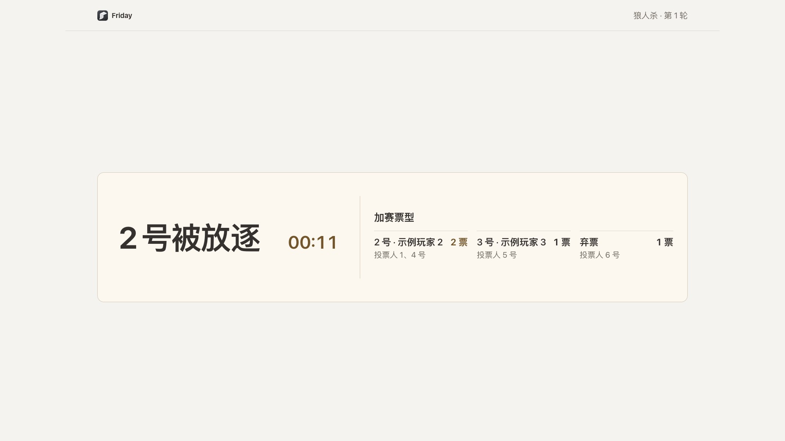

公布默认停留 12 秒。还在看票型时，主持端可选择「暂停对局」。看完后可继续计时，也可选择「下一环节」。首轮平票先公布并列结果，再进入平票发言和加赛。加赛再次平票时，本轮无人被放逐。

#### 结算与复盘

本局结束后，手机、主持端和公屏会显示获胜阵营、获胜原因及各座位的身份。在「对局复盘」用左右箭头换轮次，可查看天亮时的出局结果、猎人开枪、放逐及加赛。展开「查看放逐票型」或「查看加赛票型」，可按座位核对。

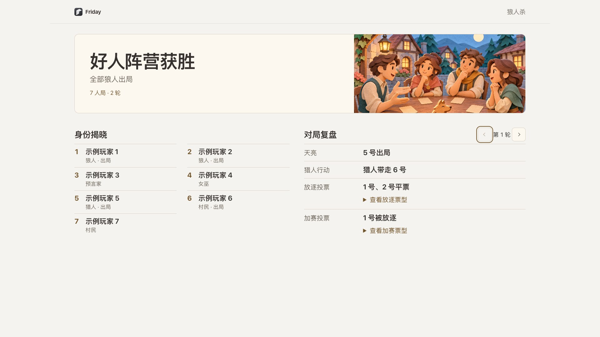

复盘随当前局保留。大家看完后，主持人可选「再开一局」，原房间的玩家在自己的手机上重新准备。

### 体感闯关

在游戏库打开「体感闯关」，可选 14 站的「山径冒险」或 12 关的「运动训练」。让双手和双脚完整入镜，跟着角色做动作。想先练习，可在游戏详情找到对应动作，点击「试一试」。

- **单腿站立**。轻抬一脚，站稳 1 秒再落地。下一次换脚。
- **交叉触膝**。抬起一侧膝盖，用另一侧的手靠近膝盖。落脚后换侧。
- **交替侧抬腿**。向侧面轻抬一只脚，停一下再落地。落脚后计一次，下一次换脚。山径冒险会在营地种下一丛野花。
- **头顶合掌**。先举起并打开双臂，在头顶合掌后再打开。双臂重新打开时计一次。山径冒险会点亮一盏灯。

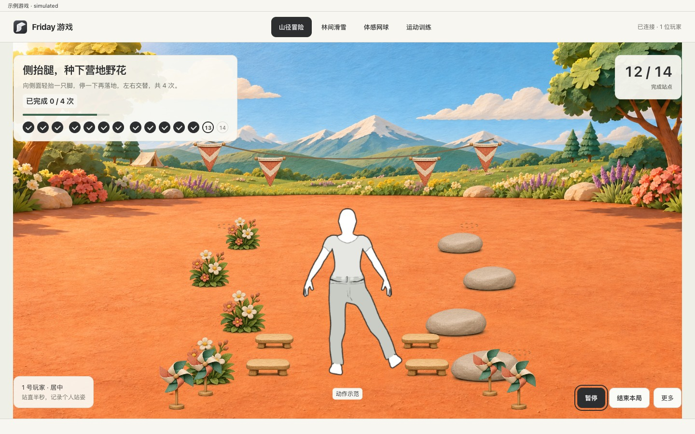

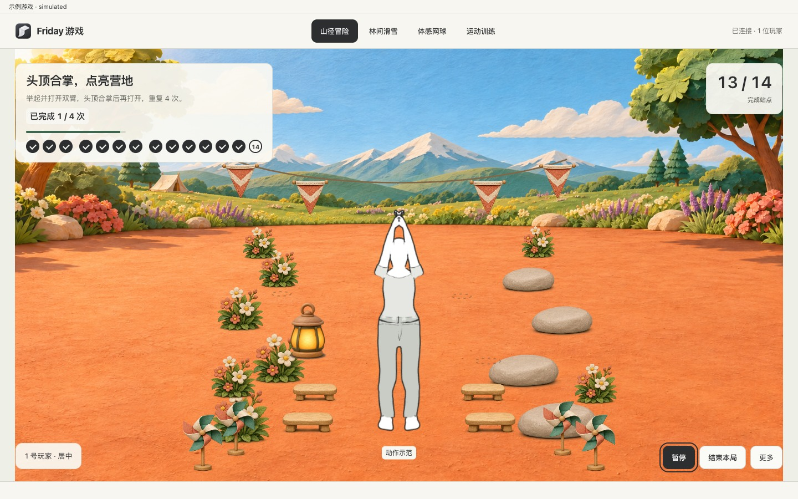

动作没计数时，确认双手和双脚完整入镜，按当前示范从起点重新做一次。头顶合掌从双臂打开开始。

### 体感网球

在「家庭游戏」打开「体感网球」，选择「单人练习」「单人挑战」或「双人对打」，再按对应的进入按钮。进入球场后，等画面准备好，选择「开始本局」。

已有对局时，可以直接继续。要换玩法，选好下一局玩法，再按「换玩法并开局」。打完一局后，详情也可以直接查看本局成绩。

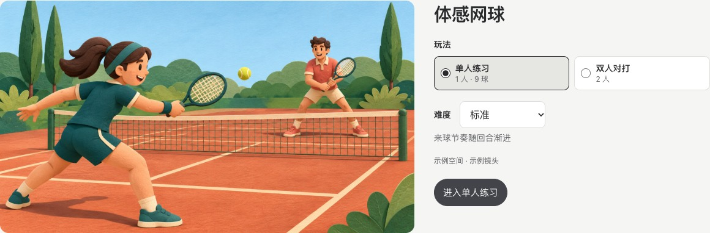

**一个人怎么练？** 独自站在镜头前，让双脚和挥拍手入镜。陪练依次送出三组球，先练定点回球，再练左右移动和更快的来球。走进落点圈，看到「挥拍」再出手。手部或脚部识别丢失时，本球会暂停，归位后继续。

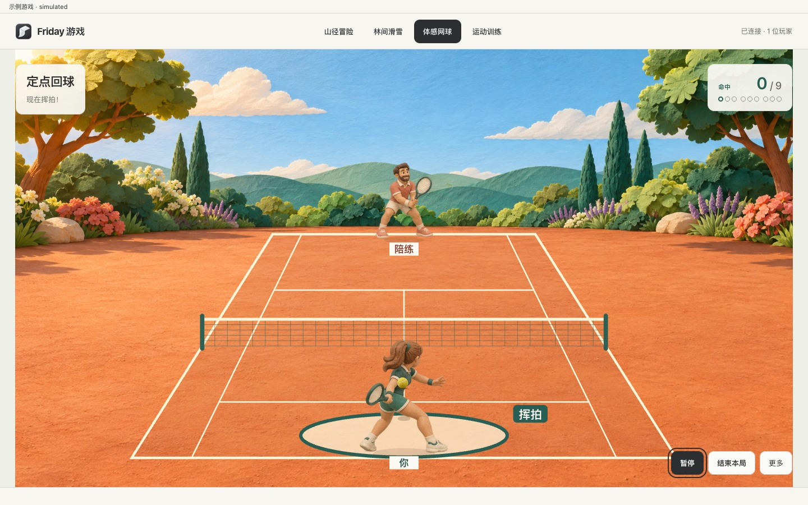

九球结束后可以查看命中和最长连击，选择「再练一轮」，也可以切换到计分比赛。


#### 一个人打一场计分赛

选择「单人挑战」，进入球场后点击「开始本局」。站到镜头前，让双脚和挥拍手入镜。看到「挥拍发球」时开出第一球。对手回球时，先移动到落点圈，再按「挥拍」提示出手。

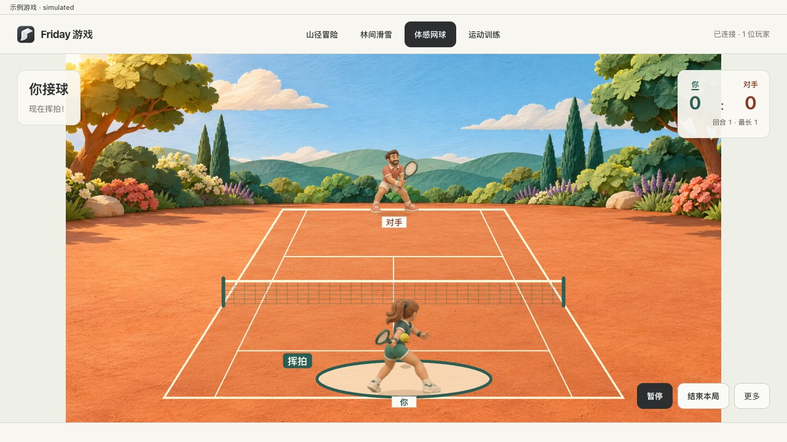

首分后换发，此后每两分换发。先到 7 分并领先 2 分获胜，15 分封顶。选「轻松」时来球较慢、对手移动较慢，选「挑战」时需要更快移动和挥拍。离开画面时暂停当前一分，回到原站位后继续。赛后可选「再打一场」或切换玩法。

**两个人怎么开球？** 并排站好，双脚入镜。左侧的 1 号先发球，看到自己的发球提示后挥拍。首分后换发，此后每两分轮换。

### 从大屏加入狼人杀

1. 在家庭游戏选择「狼人杀」，选 6–12 人并创建房间。
2. 在主持端选择「打开公共画面」，或复制大屏地址到同一局域网的电视浏览器。
3. 每人用自己的手机扫大屏二维码，选座、填昵称，再点「准备好了」。坐满后大屏会收起邀请。


二维码暂不可用时，可在手机打开大屏显示的地址，输入房间号。也可以从主持端打开手机入口。全员准备后，主持人点击「发放身份」。玩家在自己的手机上确认身份后，主持人开始首夜。

### 换手机或找回狼人杀座位

1. 在 Friday 主持端点击「找回座位」，选中对应的玩家，再点「生成二维码」。
2. 让这位玩家用手机扫码，点击「继续对局」。如果正在认牌，照常按住查看身份，再点「我已看完」。
3. 手机回到当前环节，已经确认的身份和已经提交的行动仍然有效。原手机会退出该座位。

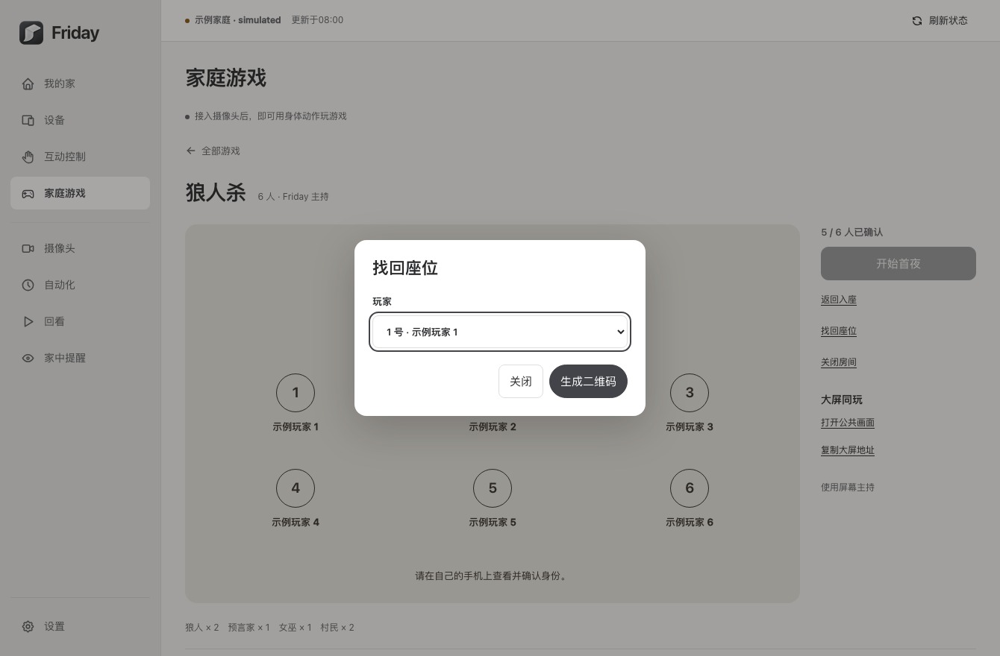

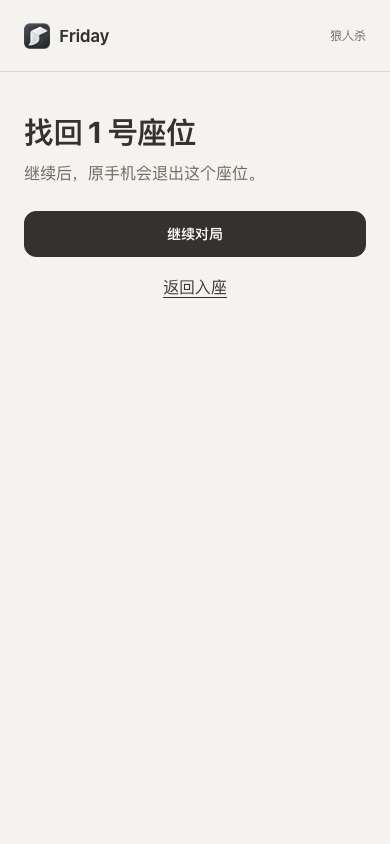

恢复二维码两分钟内有效，只交给对应的玩家。过期后由主持人重新生成。

### 局域网断开后继续狼人杀

恢复网络时保持 Friday 运行。局域网入口断开时，当前环节会暂停。如果原入口重新连上，手机和电视会继续读取本局。等大家连回后，主持人点击「继续对局」。

如果主持端显示「手机与电视已断开」，并且 Friday 已换到新的局域网地址，可以接着玩原局。

1. 在 Friday 主持端点击「恢复连接」。有多个局域网可选时，选手机和电视所在的网络。
2. 让玩家从新二维码找回原座位。电视打开主持端显示的新地址，用六位码重新连接。
3. 等大家连回后，点击「继续对局」。原身份、已提交的行动和剩余时间都会接着用。

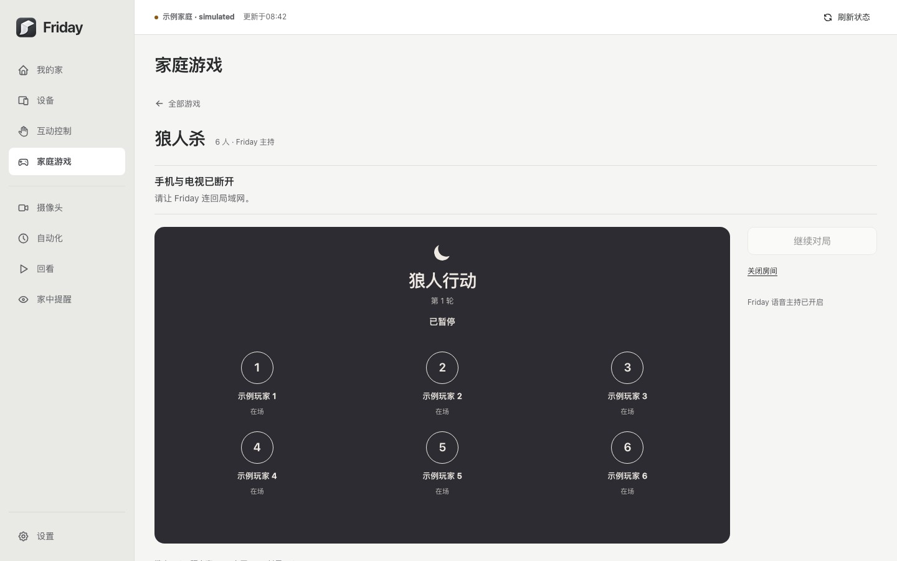

### 狼人杀轮流发言

创建房间时，「发言方式」默认选中轮流发言，也可以改为自由发言。轮流发言时，Friday 按座位依次点名，每位 30 秒。大屏显示当前和下一位。轮到你时，手机会显示「发言完毕」。点它可以提前交给下一位，时间到也会自动换人。

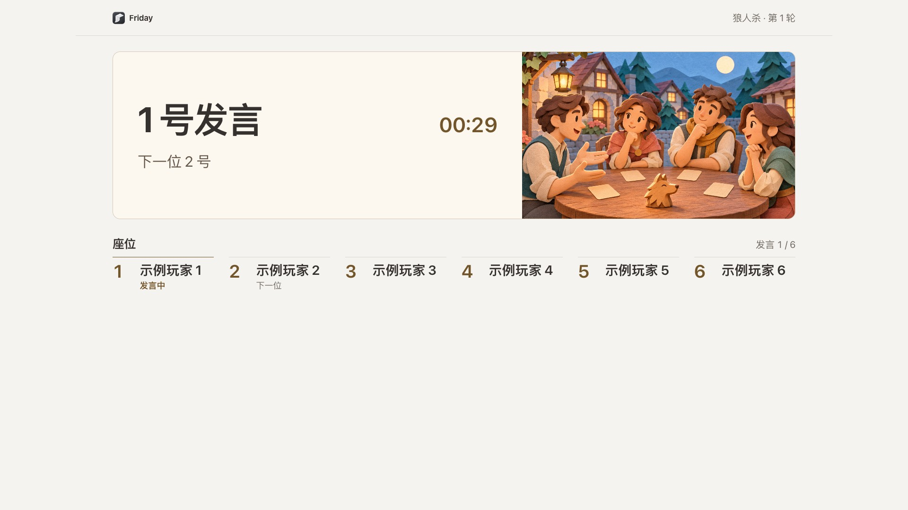

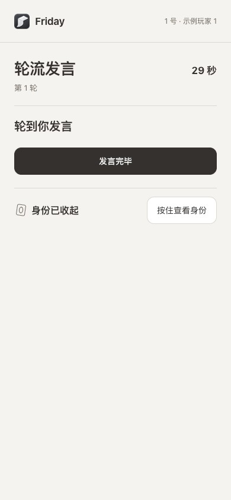

主持端可以点「下一位」代为换人。暂停后会保留当前座位和剩余时间。最后一位完成后进入投票。平票发言时，只有平票玩家轮流发言。

### 局中恢复镜头座位

开房时勾选「使用已运行的摄像头辅助举手与指认」。白天发言和平票发言时，主持端可以从「镜头座位」调整人物编号，镜头恢复后也可以继续对应。

1. 点击「调整座位」，选中一位仍在场的玩家。
2. 在画面里找到这位玩家的编号，在「画面中的人物」中选中它，点击「确认对应」。
3. 对应完成后，座位旁会重新显示镜头识别到的举手与指向。点击「完成」收起画面。

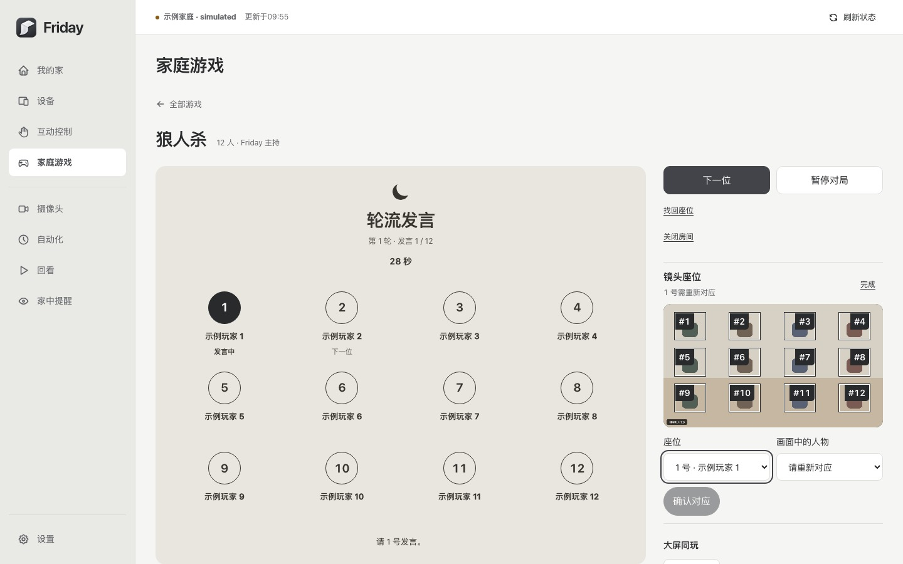

调整座位时继续计时。预览只出现在本机主持端，进入投票时自动收起。

### 狼人杀连玩

一局结束后，主持人在结算页选择「再开一局」。


**大家需要重新扫码吗？** 手机留在原页面，看到「重新准备」后点击「准备好了」。大屏沿用原链接，主持人等全员准备后重新发牌。

如果上一局灯光还有待恢复，先在结算页选择「恢复灯光」。选择「关闭房间」后，手机和大屏会退出，Friday 会恢复选中的氛围灯。需要补做恢复时，可从创建房间的页面选择「恢复灯光」。

### 进入游玩舞台

打开体感游戏后，舞台会铺满 Friday 窗口。顶部「全屏」可在支持的浏览器上铺满屏幕。需要离开时，点「返回详情」，之后从详情的「继续游戏」接回原局。


手机横屏时，比分、画面和局内操作可以在同一屏查看。


#### 在电视上玩体感游戏

1. 在电脑的「家庭游戏」中选好游戏和玩法，进入舞台。
2. 在已配对的 Android TV 上打开 Friday 3.3，用遥控器选「家庭游戏」。电视会载入同一局的场景、比分和动作示范。
3. 用遥控器方向键选择按钮，确认键开始、暂停或继续。按返回键回到电视的全屋视野。还开着的游戏画面可以继续显示原局。


电视需要与电脑在同一家庭局域网。镜头隐私开关、游戏选择和难度在电脑上设置。

### 玩家出画后继续本局

体感游戏会保留本局进度。短暂离开镜头后，回到原站位即可接着玩。

看到「重新确认站位」时，让原来的玩家回到各自站位，双脚入镜后站定。显示「站位已确认」后，点「继续本局」，或先放下手再保持 OK。三秒倒计时后从原进度接续。


候场时可用 OK 开始，结算后可用 OK 重玩。玩家已就位时，也可以保持剪刀手换游戏。

### 查看成绩与重玩

本局完成后，游戏库顶部会显示「已完成」。点「查看成绩」可打开这一局。也可以从游戏详情上方点「查看本局成绩」。


要再玩一局，在详情选好路线、玩法或难度，再点下方的重玩按钮。滑雪原道重玩的按钮会显示「重滑」和雪道名称。点「退出游戏」后，本局的成绩入口会收起。


**完成标准：**游戏画面、玩家识别与实际动作响应都正确。普通手势控制成功一次，并不能替代每种游戏的验收。

### KTV 歌曲背景

已经接通 KTV 的家庭可在“设置 → 智能服务”开启歌曲自动背景。图片按歌曲预取与复用，先显示本地主题；图片失败或达到 API 上限不影响点歌、音源准备和播放。已有可用 MV 时默认跳过生成。

通道、独立开关、每日上限与隐私范围见[智能服务与每日上限](#guide-guides-intelligence)。电脑页面可打开不代表电视、麦克风或现场音效已经验收。

<a id="guide-guides-files"></a>

## 19. 找到家庭资料预览

新版将家庭资料放到实验功能中，用于搜索已索引的 NAS 资料和核对整理建议。

打开“连接 → 实验功能与调试 → 打开资料索引预览”。旧版左侧的“文件”不再是当前默认导航入口。


| 入口 | 用途 |
| --- | --- |
| 已索引资料 | 查看已经建立索引的资料 |
| 待提取 | 查看待补充提取的内容 |
| 搜索内容 | 在已有可用内容中搜索 |
| 整理建议 | 核对建议后再决定如何处理 |

来源未就绪时，先“设置资料来源”或“核对连接”。这不表示电脑中没有文件，也不表示 Friday 扫描了你的个人目录。

**完成标准：**你明确选择了资料来源，页面显示的索引范围和资料状态可核对。没有 NAS 或没有扫描时，不把空页面当作文件数量证明。

<a id="guide-guides-dialogue"></a>

## 20. 用文字预览模拟规则变更

在独立示例环境练习“先看差异、再批准、必要时恢复”，理解文字操作的范围。

**仅用于示例：**下面截图来自独立的示例家庭。不要为了照图练习，把已经连接真实家庭的服务改成模拟来源。

### 找到入口

打开“连接 → 实验功能与调试 → 文字指令调试”。旧版“对话”菜单已移动到这里。

### 1. 生成差异

输入“以后回家不开空调”，点击“发送”。检查保留的灯动作与移除的空调动作，以及本次预览的范围和有效期。


### 2. 批准这一份预览

在有效期内点击“批准变更”。示例返回“自有模拟规则配置已读取验证”，只证明示例规则配置完成，不证明实际空调已经关闭。


### 3. 需要时恢复

点击“恢复配置”，核对原模拟规则已恢复。配置回滚不能撤回此前已发生的设备动作。


不能识别的文字会要求更明确的命令。不要把文字输入框当作可以任意删改所有规则的通用助手；结构化的“查看依据”适合核对已有家庭记录。

**完成标准：**你能够读懂预览、批准范围和恢复结果，并分清模拟配置与真实设备效果。理解不同读数时，可继续[温度场景图解](#guide-reference-temperature-scenarios)。

<a id="guide-guides-intelligence"></a>

## 21. 选择智能服务与每日上限

Friday 可以通过 ARL 调用 Codex，也可以使用自己的 OpenAI API。已经准备好的设备按钮、规则和 KTV 播放不要求先购买 API 用量。

### 1. 选择文字处理方式

打开 **设置 → 智能服务**，找到“智能通道与每日用量”。

| 选择 | 适合的情况 |
| --- | --- |
| ARL · Codex | 继续使用已经接通的 ARL 共享运行服务 |
| OpenAI API | 使用自己的 API 项目处理家庭问题与任务草稿 |
| 自动 · API 优先 | 先尝试 API，需要时改用 ARL |
| 仅本地功能 | 暂停云端增强，继续使用已准备好的本地功能 |

选择 API 时还需勾选“允许云端文字处理”。如需备用通道，勾选“API 不可用时改用 ARL”，并确保 ARL 本身可用。最后点击“保存智能配置”。

文字处理会发送本次问题和必要的设备目录。旧版即时规划还包含开关状态、亮度和温度等有限属性。模型只解释意图或提出草稿，实际读数与设备动作继续由 Friday 核对；任务仍要经过原有的预览和确认。


截图来自隔离的示例服务，显示合成用量；不代表真实账户余额或现场设备验收。

### 2. 配置已有 API Key

展开“配置已有 API Key”，在自己电脑上的 Friday 页面填写已有 Key，点击“保存已有 Key”。页面只显示是否已配置，不回显内容。不要把 Key 发到聊天、截图或公开仓库。

在 Codex 或其他应用里连接了 OpenAI，不代表 Friday 已经取得同一 Key。也可以让安装人员为 Friday 服务配置现有 Key。保存成功不代表账户余额或模型权限已经核验，Friday 不会因为保存设置就调用付费模型。

文字、歌曲背景与云端语音是独立开关；只保存 Key 不会自动开启它们。

### 3. 设置每日用量

在“每日上限”分别填写请求次数、文本 Token、歌曲背景张数和语音会话秒数，再保存。**0 表示暂停对应调用。**“模型配置”还可调整文字、图片与语音模型、单次文字输出上限、背景保留张数和是否为已有 MV 的歌曲生成背景。

页面显示 Friday 今天已经使用的量与下一次重置时间。文字 Token 不包含图片和语音的计费 Token；图片按张数限制，语音按会话时间限制。这些限制只管理本机 Friday，不是整个 OpenAI 账户的金额余额或账单上限。

每次请求先预留用量，收到可靠结果后结算。超时、取消或结果未知时会保留预留，所以数字可能比自己数到的成功次数多。重启程序不会清空本日用量；更改重置时区也不会立即恢复额度。

### 4. 达到上限或 API 不可用时

- 允许 ARL 备用时，Friday 在剩余等待时间内尝试 ARL。
- 未允许备用或 ARL 也不可用时，保留本地功能；复杂文字可能需要改成明确输入或稍后再试。
- 云端语音失败时保留原输入草稿，可继续打字发送。
- 歌曲背景失败时使用本地主题；已经缓存的图仍可使用，点歌与音频播放继续。

API 余额不足、限流、超时、Key 未被接受或模型无权限时，页面给出原因并暂缓新尝试。处理好原因后可点击“重新允许 API 尝试”；它不会清空每日用量，也不会重新执行设备动作。

### 主动语音输入

先单独开启“开启云端语音输入”并保存，再点击“打开家庭对话”。点击语音输入并允许本轮麦克风访问，最多录 8 秒；可提前结束或取消。

转写插入输入框的光标位置，**核对后由你点击发送**。取消、切换离开或隐藏页面会停止本轮录音；已有本地语音识别仍按原设置工作。API Key 留在本机服务，不发给网页。

### KTV 自动配背景

在智能服务中单独开启“自动为歌曲生成背景”。Friday 只把歌名和演唱者用于生成，不发送歌曲音频、歌词或家庭画面。

待唱歌曲先使用本地主题，图片准备好后再显示；同一歌曲的相同背景可以复用。默认跳过已有可用 MV 的歌曲，需要时可在“模型配置”开启“已有 MV 时也生成背景”。

API 达到上限、下载失败或图片校验失败都不会阻止音源准备、歌词和伴奏。背景保留张数达到上限后停止生成；已经缓存的图仍可使用。电视显示效果需在自己的电视上单独核对。

**完成标准：**能切换通道、看懂本机用量并设置上限；关闭云端增强后，自己已配置的设备按钮、规则与 KTV 播放仍可使用。

<a id="guide-reference-navigation"></a>

## 22. 新版入口速查

按你要完成的任务找页面，避免沿用旧截图中的菜单名称。

| 你要做什么 | 新版入口 |
| --- | --- |
| 看家庭空间和房间 | 我的家 |
| 找完整设备卡片、开关与设定 | 设备 |
| 看镜头、暂停后台感知 | 摄像头 |
| 看骨架或手部识别 | 摄像头 → 人物与手势检查 → 查看识别 |
| 配置身体动作 | 互动控制 → 手势控制 |
| 使用声音输入 | 互动控制 → 对镜头说话 |
| 给画面中的设备标点位 | 互动控制 → 指向设备 |
| 看手势结果 | 互动控制 → 最近的手势响应 |
| 手动场景或自有自动化 | 自动化的三个分类 |
| 查历史录像与家庭事件 | 回看 |
| 登记或核对人物 | 人物 |
| 配置服务、账号与静音 | 连接 |
| 家庭资料预览 | 连接 → 实验功能与调试 → 打开资料索引预览 |
| 文字操作与结构化查询 | 连接 → 实验功能与调试 → 文字指令调试 |
| 系统状态和调试场景 | 开发工具 → 勾选显示调试 |


“对镜头说话”是互动页默认页签，不表示语音已经开启。只想使用动作绑定，切换到“手势控制”即可。

<a id="guide-reference-status"></a>

## 23. 读懂页面状态

同一设备可能同时有“读取正常”和“控制不可用”。先看状态描述的是哪件事。

| 页面文字 | 表示什么 | 接下来怎么做 |
| --- | --- | --- |
| 示例家庭 | 使用模拟数据 | 学习界面；不要当作自己的家庭 |
| 家庭已连接 | 已切到家庭来源 | 核对设备和当前控制范围 |
| 只读 | 当前只能查看，不能执行真实控制 | 如需控制，检查已有范围或首次配置 |
| 暂时不可用 | 当前条件不足以操作或确认状态 | 检查在线状态和连接，避免反复点击 |
| 识别运行 | 本地识别进程在处理画面 | 看提示是否跟随你，再检查规则 |
| 已启用（规则旁） | 这一条规则允许参与运行 | 仍需手势总开关开启 |
| 指令已发送 | 已产生或发送请求 | 观察实际设备，不直接认定完成 |
| 状态已更新 | 读回的设备报告符合目标 | 仍区分现场效果和设备报告 |
| 读数已过期 | 不能当作当前有效测量 | 等新测量或检查来源 |
| 暂不可确认 | 当前依据不足 | 不把它当作零、关闭或损坏结论 |

### 几个常见词

- **设备**：一台实际产品；它可以提供多个状态和操作。
- **实体或状态项目**：同一设备的一项能力，例如当前温度、设定温度或工作模式。
- **房间**：你在家庭平台里分配的位置，不一定等于设备测量所在位置。
- **规则**：何时、在什么条件下，对哪个设备做什么。
- **后台感知**：Friday 在后台接收画面并识别，不等于你正打开预览窗口。
- **保护预览**：为观看临时生成的保护画面，不是覆盖原录像。

更多实际例子见[温度场景图解](#guide-reference-temperature-scenarios)。

<a id="guide-reference-temperature-scenarios"></a>

## 24. 十五个温度质量场景

这些图来自独立、明确标为“示例家庭”的运行环境，用于学习读数含义。日常真实家庭无需切换来源或加载模拟场景。

### 怎样阅读

在示例环境打开“连接 → 实验功能与调试 → 文字指令调试”，房间选“客厅”，点击“只读查询”。同时看设备自身温度、房间室温、测量时间和质量说明。

读数来源位置不同，空调内部或插座内部的温度不自动代表房间室温。

### 01. 正常状态

温度计与空调都有有效测量，房间室温选择已配置的主来源，不能简单平均两种设备读数。


### 02. 相对校准演示

成对模拟样本用于说明校准过程；示例样本不证明你家的设备已经校准。


### 03. 主源过期，备用未校准

主温度计只返回旧记录，空调虽有读数但未通过相对校准，因此室温暂不可确认。


### 04. 使用相对校准备源

备用来源符合当前校准条件，室温显示推算区间；这个区间不是绝对真值保证。


### 05. 读数冻结

一个来源不变，独立来源持续变化时，冻结来源会暂时退出室温判断。


### 06. 读数不一致

不同来源互相矛盾，系统保留无法确认的结论，不随意选一个数。


### 07. 所有来源异常

没有可用依据时保持暂不可确认，而不是把旧数当作当前室温。


### 08. 连接恢复，观察不足

恢复连接不等于测量已经可信，还要等待足够的新测量和观察时间。


### 09. 暂缓切回主源

恢复期间继续使用已经可信的备用来源，避免在主备之间反复切换。


### 10. 恢复后仍返回缓存

刷新旧记录不等于产生了新测量，不能据更新时间认定已经恢复。


### 11. 样本够，时间还不够

短时间内多个样本不能代替跨过完整观察期。


### 12. 电量读数过期

旧电量记录不能证明当前设备健康；温度仍有效与电量过期可以同时出现。


### 13. 空调模式不符

工作模式未知或不符合原校准条件时，不继续套用旧的室温推算。


### 14. 校准过期

校准范围或有效期已经失效，备用温度存在也不能继续当作合格室温。


### 15. 连接中断

连通性不足时，需要重新核对状态，不能把上次测量当作现在仍有效。


遇到自己家庭的异常时，先看[页面状态](#guide-reference-status)与[按现象排查](#guide-troubleshooting-common-errors)。

<a id="guide-explanation-components"></a>

## 25. 这些程序分别做什么

Friday 是你日常打开的家庭界面。其他程序提供设备接入、摄像头或智能服务，各自需要自己的准备。


### 为什么 Miloco 有画面，Friday 还可能没有识别

视频播放与人体、手部识别是两套准备。Friday 的视觉代码就在 Friday 仓库里，但运行时还需要本地依赖、模型、原生组件和自己的摄像头配置。

本地确定性手势不需要先配置 ARL 模型服务，也不需要先启用语音。Miloco 的画面理解、语音和云端模型是其他能力，不能因摄像头能播放就视为全部可用。

### 为什么设备数不相同

Miloco、HA 和 Friday 读取或展示的范围可能不同；一个设备还有多个状态项目。新版 Friday 会保留只读和暂不可用的设备；仍需看清统计的是物理设备、状态项目还是可控制目标。

### 为什么要区分连接和控制

账号接通先让设备可读取；控制范围还需要明确配置。规则保存后，还需要对应总开关、识别条件和设备连接都满足。它们分别显示，方便你判断卡在哪一步。

进一步了解项目之间的仓库关系，可查看[项目索引元仓库](https://github.com/lijunfeng722/friday-project-index)。

<a id="guide-explanation-arl"></a>

## 26. 怎样看待 ARL 管理界面

Friday 也可选择自己的 OpenAI API，与 ARL 使用不同的凭据和用量。切换方式、每日上限、语音输入与歌曲背景见[智能服务与每日上限](#guide-guides-intelligence)。ARL 不是本地设备按钮和 KTV 播放的必需前提。

ARL 为应用提供共享智能运行服务。日常家庭操作仍从 Friday 开始，不需要把 ARL 的所有页面都配置好，才使用本地手势。

### 各页看什么

| 页面 | 主要用途 | 不能直接据此认定什么 |
| --- | --- | --- |
| 运行概览 | 看后台是否可读、运行情况与基础状态 | 不能因此认定模型任务可执行 |
| 模型 | 看模型来源、连接与加载情况 | 有模型选项不表示已安装、已授权或正在调用 |
| 服务连接 | 查看日历、提醒、NAS 等独立服务能力 | 不表示已授予所有个人资料权限 |
| 应用接入 | 查看应用身份与接入状态 | 没有应用会话不能认定正式应用已经接通 |
| 性能、运行记录、诊断 | 查服务状态与问题线索 | 不替代家庭设备现场验收 |


本图保留 **2026-10-30** 的原生开发版演示界面；本轮没有升级 ARL 源码，Friday 的界面图则于 10 月 31 日重新采集。图中“源码候选、待授权”和灰色按钮表达的是开发版边界，不是已经加载模型。

### 为什么服务可读，界面仍待核对

后台可被读取，与模型来源、任务决策、应用会话及外部工具都准备好不同。Friday 的“连接”卡与“系统状态”也可能分别表达这些层次，按具体功能核对即可。

**完成标准：**能分清服务状态、模型状态与可执行任务。不需要为了让本地手势工作，开放日历、消息、模型或其他不相关服务。仓库关系见[项目索引](https://github.com/lijunfeng722/friday-project-index)。

<a id="guide-releases-2026-10-31"></a>

## 27. 2026-10-31 新版使用变化

本页说明这版用户手册覆盖的重要界面与使用方式。功能可用性仍取决于你的部署、设备能力和已配置权限。

| 更新 | 对日常使用的影响 | 阅读 |
| --- | --- | --- |
| 分步连接向导 | 查找、登录、读取分别显示；摄像头可稍后设置 | [连接自己的家](#guide-getting-started-connect-home) |
| 设备专属控件与完整列表 | 按类型操作；只读和暂不可用设备也保留 | [查看设备](#guide-guides-devices) |
| 新版互动配置 | 三种方式分开；规则可编辑、暂停、移除和撤销 | [互动控制](#guide-guides-interactions) |
| 场景和自有规则管理 | 分清米家一键场景、Friday 自动运行与外部规则 | [自动化](#guide-guides-automations) |
| 保护录像回看 | 默认整帧保护、静音、时间线与分段准备 | [回看](#guide-guides-recordings) |
| 事件来源说明 | 分清已知操作链、时间接近和未知原因 | [家庭事件](#guide-guides-events) |
| 人物候选分组 | 核对、归组、拆分和撤销，仍由你确认身份 | [人物](#guide-guides-people) |
| 摄像头隐私与恢复 | 尊重镜头开关；后台感知暂停重启后保留 | [摄像头](#guide-guides-cameras) |
| 可选本机画面复核 | 缺少模型时明确不可开启，不自动下载 | [智能预警](#guide-guides-safety) |
| 预览功能入口收纳 | 旧“文件”“对话”移入连接页实验功能 | [入口速查](#guide-reference-navigation) |

### 这版文档怎样验证

主要入口、规则编辑界面、模拟规则预览与恢复、15 个温度质量场景，以及合成视频保护预览都通过本地运行的产品界面核对。合成测试不是每台真实设备的现场验证。

升级前一次真实手势的成功，也不代表新版全部设备、游戏、语音和智能预警均已验收。自己开始使用时，按任务指南分别确认结果。

### 维护与反馈

本手册由独立文档仓库维护。产品行为参考 [Friday 源码](https://github.com/Geeprox/Friday)，相关依赖见[元仓库索引](https://github.com/lijunfeng722/friday-project-index)。反馈时说明手册页、产品版本与实际可见行为。

<a id="guide-troubleshooting-common-errors"></a>

## 28. 按现象排查

先定位卡住的环节，再处理对应设置；不要一次重装所有服务。

### 网页打不开

确认在部署服务的电脑上，地址和端口正确。先启动交付的环境，再刷新。关闭网页与停止后台不同，刷新不能启动已经停止的服务。

### 家庭连接失败

先在浏览器确认 HA 能正常打开，再回 Friday 核对地址。小米授权后，回原 HA 设置页看看是否已经进入家庭和设备选择。若没有，记录报错页面和时间，不必先删除已有集成。

### 设备或操作选项为空

先在 HA 确认设备已导入，再到 Friday 设备页找目标。若仍是只读，检查是否首次控制范围未配置，或已有操作被暂停。点击手势总开关不能替设备新增授权。

### Miloco 有画面，但 Friday 没有

检查 Friday 摄像头接入和本地识别环境。再看米家的镜头是否打开、设备是否在线。视频服务、识别环境和查看入口是不同环节。

### 手势不触发

按顺序检查：

1. 识别画面和时间持续更新。
2. 所需身体部位无遮挡，动作提示能跟随你。
3. 多人时，由准备控制的人持续比 OK 约 2 秒选择自己，放下手后再做动作；避免系统一直保留最先入镜的人。旧版接管问题见[操作者切换](#guide-guides-interactions)。
4. 目标规则确实出现在“已设置的控制”，目标与设备动作正确。
5. 单条规则和手势总开关都已开启。
6. 完成连续动作，再看“最近的手势响应”，最后核对实际设备。

有骨架但没有记录，先检查识别和规则条件；有记录但设备没动，再检查目标、读回状态及现场。不要连续做动作催动可能仍在执行的设备。

### 录像不能播放

先分清“未连接录像来源”“没有找到文件”和“保护预览准备失败”。检查网络、来源目录、日期和设备时间；来源变更或预览过期后重新读取。不要为播放失败直接回退到未保护原片。

### ARL 待核对或按钮灰色

服务可以被读取，与模型、应用会话和工具能力全部就绪不同。本地手势可以独立运行，不要把 ARL 的所有可选能力当作手势前提。

### 提供什么信息便于协助

记录时间、页面、你的操作、可见提示和设备实际有没有变化。保留必要截图；账号密码、验证码和模型密钥只在对应服务页面填写。真实家庭画面只在你认可的范围内分享。

完整问答见[常见问题](#guide-troubleshooting-faq)。

<a id="guide-troubleshooting-faq"></a>

## 29. 常见问题

从使用者角度回答日常问题。需要按步骤定位时，先看[按现象排查](#guide-troubleshooting-common-errors)。

### Q01. 我每天应该打开哪个页面？

主要打开 Friday。添加集成或核对家庭清单时进入 Home Assistant；检查小米摄像头相关服务时再进入 Miloco，不必每天在三个页面重复登录。

### Q02. 网页打不开，第一步做什么？

确认在部署服务的电脑上，使用交付的启动入口启动环境，再打开 Friday。把本机地址复制到手机并不能访问电脑上的服务。

### Q03. 怎样判断是真实设备还是演示数据？

看顶部：“示例家庭”是模拟数据，“家庭已连接”是家庭来源。本文示例图中的英文设备不是自动发现的真实设备。

### Q04. 为什么几个页面的设备数量不同？

它们支持和展示的范围不同；同一物理设备还有多个状态项目。新版 Friday 会保留只读和暂不可用设备。核对时先确认统计的是设备、状态项目还是可控制目标。

### Q05. Xiaomi Home 要单独启动吗？

不用作为独立服务启动。它安装在 Home Assistant 内部，在 HA 的设备与服务里完成设置。Miloco 不是 HA 小米登录的前置条件。

### Q06. 小米授权后报错，需要重新安装吗？

先回原 HA 页面看看是否已经进入家庭和设备选择。仍未完成时，记录错误页面与时间再排查；不要先删除已有家庭或把授权结果发到聊天。

### Q07. 显示只读时能做什么？

可以查看已接入信息，不能从 Friday 发出真实设备控制。已有控制范围可暂停或恢复；首次开放范围需要在本机配置。

### Q08. 每次使用都要逐台设备重新授权吗？

日常不需要。已配置的范围会保留，你在规则里选择目标即可。新增设备不会因为被发现就自动取得控制权限。当前连接页可暂停或恢复已有范围；首次扩展仍需部署人员在本机设置，日常选设备不需要改代码。

### Q09. 规则里的设备列表为空怎么办？

先在设备页确认目标存在，再检查是否只读、操作是否暂停，以及该设备有没有支持的控制。启用手势总开关不会替设备增加权限。

### Q10. 选择了设备和手势，为什么没有规则？

还要选择执行动作并点击“保存手势控制”。以“已设置的控制”中的卡片为准，上方表单的临时选择不会自动保存。

### Q11. 怎样修改已经保存的规则？

在目标规则上点击“编辑”，核对回填的范围、动作、设备和执行动作，再点“保存修改”。没有打算改就“取消编辑”。

### Q12. 双臂打开可以绑定关闭窗帘吗？

可以。身体动作与设备动作由你绑定，核对完整描述即可，不能只看动作名称猜测设备会做什么。

### Q13. 为什么互动页首先显示语音？

新版默认打开“对镜头说话”。只想使用动作绑定，切到“手势控制”；打开语音页本身不表示声音输入已开启。

### Q14. Miloco 有画面，Friday 为什么还未配置？

视频服务与 Friday 的本地识别是分开的。需要先完成 Friday 这一侧的摄像头、识别环境和查看入口准备。

### Q15. 查看识别在哪里？

打开“摄像头”，展开“人物与手势检查”，再点击“查看识别”。确认时间持续更新，再观察人体或手部提示。

在「我的家」的「家庭感知」可以看到有几台镜头正在感知。画面中断时可以点镜头名称打开详情。详见[查看与操作设备](#guide-guides-devices)。

镜头显示「感知恢复中」时，等待 Friday 自动恢复。仍有实时画面时可以继续查看。详见[查看摄像头](#guide-guides-cameras)。

### Q16. 电视未连接会影响电脑上的手势吗？

不会。它只说明没有电视显示端连接。本机查看画面和手势不需要先连接电视。

想在电视玩体感游戏，请在 Friday TV 3.3 打开「家庭游戏」，再在电脑端进入一局。若电视上没有这个入口，先核对电视 App 版本、家庭局域网和已有配对。见[在电视上玩体感游戏](#guide-guides-games)。

狼人杀大屏在大厅有空座时显示邀请。断开后等画面恢复，或从主持端打开手机入口。详见[家庭游戏](#guide-guides-games)。

### Q17. 有绿色骨架，为什么还没有控制设备？

骨架只表示检测结果。还需满足动作变化、操作者选择、规则启用、总开关运行与设备可用等条件，按排查页逐层检查。

镜头里有其他人时，系统可能先选中了对方。由准备控制的人比 OK 保持约 2 秒，放下手，再做绑定动作。身体动作还需要对应肩、腕、腰胯等关键点清晰，单独识别到手或人形不等于已形成动作事件。

### Q18. 一直保持双臂合上为什么没有反应？

它判断连续变化，先张开再合拢并短暂停留。一直保持同一姿势，不一定会产生新的动作事件。

### Q19. 旁边有人时怎样选操作者？

准备控制的人面向镜头比 OK 保持约 2 秒，放下手后再做动作；已有另一位操作者时，也可这样接管。两人同时比 OK 不会触发切换。离开画面、追踪丢失或识别服务重启后，可能需要重新选择。

旧版不能从已有操作者切换时，更新到包含 [5961567 修复](https://github.com/Geeprox/Friday/commit/5961567d3ed897eed20fb161be6dfa49d522df3d)的 Friday。此过程选择的是本次动作的发起人，不需要重新给设备授权。

### Q20. 必须先登记人脸吗？

单人动作控制不要求先登记姓名或人脸。人物登记用于资料整理与连续识别，不授予设备操作权限。

### Q21. 规则已启用，为什么页面还说暂停？

单条规则开关只控制这一条。手势总开关暂停时，规则即使已启用也不会触发。按钮显示“暂停手势控制”时，总开关正在运行。

### Q22. 没有身体动作文字提示，就一定没识别到吗？

不一定。识别页主要显示人体、手部和指向信息，不一定给每个动作显示独立文字。设备规则是否触发要看最近的手势响应。

在“手势与动作”或“指向设备”页签底部展开“最近的手势响应”，查看表格里的触发时间、触发动作、对应规则和响应结果。最近 5 条按触发时间倒序显示；时间使用当前浏览器本地时区。旧记录显示“未记录”表示当时未保存该项信息，不能据此判断识别失败；识别服务重启会清空这些临时记录。详细示例见[连续动作与设备响应](#guide-guides-interactions)。

### Q23. 指令已发送就是成功了吗？

还不能认定。需要看设备报告与实际效果；设备如果本来已在目标状态，也可能没有新的可见动作。

窗帘可能仍在运动，或状态回报仍停留在“正在打开／正在关闭”。即使你看到窗帘已动作，页面也可能暂时只有“指令已发送”；不要因此反复触发相反动作。

历史中的响应结果是本次控制返回时的回报，不会随着后续设备状态持续更新；“指令已发送”不一定会自动改成“状态已更新”。

### Q24. 状态已更新与现场效果有什么区别？

前者说明设备回报符合目标，后者需要你在现场确认。两者都核对，才知道这一次操作是否满足预期。

### Q25. 一个手势成功后，其他设备也算验收了吗？

不算。其他目标、动作、光线、多人情况以及游戏，需要分别验证，不能由一次成功推定全部可用。

### Q26. 暂时不想让动作触发设备，怎么停？

在“手势控制”点击“暂停手势控制”。规则会保留，需要时再启用；暂停不会撤回已经发出的动作。

### Q27. 关闭预览或浏览器后还会继续运行吗？

后台与总开关仍运行时会继续。只停手势用手势总开关，停全部后台识别用“暂停摄像头感知”，停整套环境用交付的停止入口。

若只想停止当前巡视，打开该摄像头的详情，点「停止巡视」。

### Q28. 重启后需要重新登录和配置规则吗？

通常不用。用原来的[启动或重启脚本](#guide-getting-started-installation-maintenance)恢复后，看看自己的家庭、画面和手势开关即可。已保存的规则和暂停设置会保留；只有明确提示登录失效时才需要重新登录。

脚本报错或设备没响应时，先看[日常维护中的处理方法](#guide-getting-started-installation-maintenance)，无需反复安装或重新添加规则。需要更新脚本或小米连接组件时，请安装人员按[维护参考](docs/maintenance/installation-maintenance.md)操作。

### Q29. 手势一定需要云端模型或语音吗？

已经准备好的本地身体和手部手势不要求先开启麦克风，也不要求先购买云端模型。语音、画面理解和智能任务是另外的能力。

### Q30. 一键场景和单设备控制是同一范围吗？

不是。米家场景按照米家保存的整组内容执行，可能涉及多台设备。运行前核对确认框的名称和数量；只操作指定设备时使用设备页或对应规则。

### Q31. 回看为什么全是马赛克，为什么没有声音？

默认是整帧保护预览并保持静音。选择性遮挡需要额外本机模型配置；视觉保护不去除原音轨里的个人信息。

### Q32. 摄像头直播正常，为什么没有历史录像？

历史回看需要单独连接 NAS 或录像来源，并核对目录、日期和时间。直播与历史录像接入是两件事。

### Q33. 需要别人协助时提供什么？

提供发生时间、页面、操作、提示和设备实际变化。不要发送密码、验证码或模型密钥；真实家庭画面只在你认可的范围内分享。

### Q34. 在哪里查看异响后镜头看到的画面？

打开这条声音提醒。有跟随画面时，「关键画面」按时间列出异响、环视和跟随的画面。只有环视画面时，查看「环视画面」一栏。点该画面的「回看」，可定位它采集前后的录像。监测状态暂时不可用时，已存提醒仍可打开。详见[异响后查看附近画面](#guide-guides-safety)。

### Q35. 收到疑似跌倒提醒后，在哪里看当时的画面？

打开「家中提醒」，选择对应的疑似跌倒记录，查看来源镜头和已保存的关键帧。多人交错或画面遮挡后，Friday 会从清楚的新画面重新确认。见[查看智能预警与本机画面复核](#guide-guides-safety)。

### Q36. 滑雪试滑没有认出动作，怎么办？

先让双手和双脚完整入镜，站定片刻。向左或向右迈步后稍停一下。练习摆臂时回到中间，让双臂前后交替摆动。如果只是想开始计分局，选择「直接开滑」。见[林间滑雪](#guide-guides-games)。

### Q37. 狼人杀什么时候能看票型？

收票期间，手机显示自己的选择。收票后，手机、主持端和公屏同步公布结果。需要多留时间核对时，请主持人在公布画面选择「暂停对局」。本局结束后，也可以在「对局复盘」切换轮次查看当时公布的票型。见[结算与复盘](#guide-guides-games)。

### Q38. 为什么已经标记普通哭声为误报，还看到疑似持续婴儿哭声？

新的提醒来自同一摄像头后续的三段独立证据。打开新提醒可按时间查看对应画面，旧提醒仍保留误报标记。见[查看疑似持续婴儿哭声](#guide-guides-safety)。

### Q39. 山径冒险可以直接玩营地吗？

可以。在「体感闯关」的「山径冒险」中选「山顶营地」，进入后点「开始本段」。重玩会从该段第一站开始。想从林间一路走到山顶时，选「完整路线」。见[山径冒险](#guide-guides-games)。

### Q40. 踏石时为什么还没有计次？

让双脚入镜，看亮起的溪石和箭头。用同侧的脚向外点地，另一脚留在原位，再把点地的脚收回。暂停后按当前箭头重新做一次，已经踏过的溪石会保留。

### Q41. 需要先停掉米家的规则才能开始重建吗？

可以先在 Friday 对照设置，选择「保存为暂停」。准备切换时，到原应用暂停对应规则，再从 Friday 的「自动运行」启用。见[重建其他平台的自动化](#guide-guides-automations)。

### Q42. 镜头为什么显示「本轮因异响结束」？

开启「异响后环视」后，巡视中的镜头可以先查看已留档的异响。详情保留本轮已确认的视角数量，异响及后续画面可在原提醒查看。需要继续巡视时，点「巡视一轮」。见[异响后查看附近画面](#guide-guides-safety)。

### Q43. 可以减少滑雪画面的运动吗？

可以。先在游戏里点「暂停」，然后在显示游戏的电脑或手机上开启系统的「减少动态效果」。Friday 会收起雪地细纹和两侧的装饰树，保留滑痕、木门和避障参照。详见[林间滑雪](#guide-guides-games)。

### Q44. 侧抬腿或头顶合掌为什么没有计次？

侧抬腿时，脚向侧面轻抬、稍停再落地，下一次换脚。合掌时，举起并打开双臂，在头顶合掌后再次打开。确认手和脚都完整入镜，可以在游戏详情点「试一试」单练一个动作。见[使用游戏库](#guide-guides-games)。

### Q45. 一个人可以打计分网球吗？

可以。在「体感网球」选「单人挑战」，和球场对手打抢七。想先熟悉落点和挥拍时机，可以选「单人练习」。详见[一个人打一场计分赛](#guide-guides-games)。

### Q46. 摄像头画面正常，为什么复核仍有延迟？

实时画面和本机复核各有自己的状态。点「我的家」里「画面复核」或「声音复核」右边的状态，可查看当前是否在等待输入、资源或恢复。详见[查看家中提醒](#guide-guides-safety)。

macOS 桌面版随 App 提供声音复核程序。接入摄像头后，在「家中提醒 → 监测设置」开启「声音复核」。用源码部署的用户可按[部署说明](https://github.com/Geeprox/Friday/blob/main/docs/deployment.md#4-设备房型agent)准备本机程序。

### Q47. 玩到一半离开镜头，要重新开局吗？

回到原站位。看到「让双脚入镜」时，等画面清楚后自动继续。如果提示「重新确认站位」，双脚入镜后站定，再选择「继续本局」。比分和关卡进度会接着用。详见[使用游戏库](#guide-guides-games)。

### Q48. 游戏完成后，在哪里看成绩或重玩？

游戏库顶部的「查看成绩」会打开刚结束的一局。要换路线、玩法或难度，进入游戏详情，选好后再点重玩。「退出游戏」会收起本局的成绩入口。详见[使用游戏库](#guide-guides-games)。

### Q49. 切换全屏或返回详情时，本局怎么接续？

切换全屏会保留本局。点「返回详情」后，可从详情点「继续游戏」。看到重新确认站位的提示时，站好后按画面提示继续。[使用游戏库](#guide-guides-games)

### Q50. 狼人杀手机上什么时候会出现「发言完毕」？

选择轮流发言的房间里，按钮会出现在当前发言人的手机上。大屏可以查看当前和下一位。主持端也可以点「下一位」。详见[狼人杀轮流发言](#guide-guides-games)。

### Q51. 狼人杀镜头恢复后，怎么重新显示举手和指向？

白天发言或平票发言时，在主持端点击「调整座位」。选择座位和新画面中的人物编号，点「确认对应」。详见[局中恢复镜头座位](#guide-guides-games)。

### Q52. 狼人杀中途关掉手机页面，还能继续吗？

可以。请主持人在 Friday 选「找回座位」并为你生成二维码。用手机扫码后点「继续对局」，会回到本局当前环节。详见[换手机或找回狼人杀座位](#guide-guides-games)。

手机和电视同时断开时，请先看主持端的连接状态。Friday 换了局域网地址时，主持人可点「恢复连接」，再让大家找回原座位和连接电视。详见[局域网断开后继续狼人杀](#guide-guides-games)。

### Q53. 异响后画面里有人，为什么镜头还停在原位？

镜头会先确认新视角，再连续确认同一人物。多人同时入镜、人物出画或画面暂不清晰时，镜头会停下来继续观察。你可以打开原提醒查看已经保存的环视画面。[异响后查看附近画面](#guide-guides-safety)

### Q54. 提醒里有关键帧，为什么只找到相邻录像？

关键帧和录像分别保存。有覆盖的录像时，保护预览会停在选中的采集时刻。遇到录像缺口时，可手动打开列出的相邻片段，也可以点另一张关键帧。录像设置可以核对这台镜头的对应目录与时间。[按关键帧回看](#guide-guides-safety)

### Q55. 已经在 Codex 连接 OpenAI，Friday 还要配置吗？

ARL · Codex 使用原共享运行服务。选择 OpenAI API 时，Friday 需要在本机配置已有 API Key；其他应用里的连接不会自动交给 Friday。保存 Key 不会自动开启文字、语音或背景生成。见[智能服务设置](#guide-guides-intelligence)。

### Q56. API 没余额或达到每日上限，会让设备和 KTV 不能用吗？

已经准备好的设备按钮、规则和 KTV 播放继续工作。允许备用时复杂文字可改用 ARL，否则可能要求更明确的输入；歌曲使用本地背景或已有缓存，语音失败时继续打字。“重新允许 API 尝试”不会清空每日用量或增加账户余额。

### Q57. 用量数字是账户账单吗？为什么取消后没有退回？

它只统计本机 Friday 的请求、文本 Token、图片和语音会话时间，不是整个账户余额。发送前预留预算，只有可靠回执才能结算；结果未知时保留预留，防止反复重试突破上限。

### Q58. KTV 为什么没有新背景？

检查背景独立开关、API Key、每日张数、背景保留张数及模型权限。已有可用 MV 时默认跳过；图片失败不会停止歌曲。迟到图片只属于原歌曲，不会替换另一首。先用本地主题继续唱，需要时再核对设置。

### Q59. 为什么光线保卫队没有出现准星？

先看是否完成五个光点的校准，并确认肩、肘和双手都在画面内。校准后，只有胸前的 L 保持清晰时才有准星。刚命中时先放下双臂，等下一只绒球出现。见[光线保卫队](#guide-guides-games)。

### Q60. 喊了 Friday，为什么镜头没有转？

先确认语音已开启、唤醒词正确，镜头已打开并处于「跟随人物」或定时巡视。想试镜头转向，可以独自站在画面一侧，喊一声「Friday」，说完稍停。人已经接近画面中央时，镜头会保持当前角度。如果正在手动巡视、复核异常或玩游戏，等当前操作结束再试。见[唤醒后转向](#guide-guides-cameras)。

走到另一间房后可以直接说话。多台镜头听到同一句话时，Friday 只选一路识别。人还在画面外时，等镜头短暂查看两侧。遇到电视或多人同时讲话时，等声音平静后再完整说一遍唤醒词，说完稍停。

### Q61. 关闭实时画面后，镜头为什么还在巡视？

定时巡视由后台运行。在该摄像头详情选择「停止定时巡视」，镜头就会停在当前视角。关闭摄像头或暂停感知也会停止当前一轮。重新开启后，从新的清晰画面开始计算下一轮。见[定时巡视](#guide-guides-cameras)。

### Q62. 狼人杀音箱短暂断开时怎么继续？

看电视或主持端当前的提示，按原环节继续。音箱及时恢复后，Friday 会尝试播出这一步尚未发送的提示。见[狼人杀](#guide-guides-games)。

### Q63. 摄像头转动时还会复核声音吗？

开启声音复核后，只要同一台镜头仍在连续取流和收音，复核就会继续。提醒可能没有同时段的清晰画面，已对应录像的镜头可按提醒时间回看。开启异响后环视时，镜头会等清晰视野恢复再判断。见[家中提醒](#guide-guides-safety)。

<a id="guide-"></a>

## 30. 后续现场验证范围

本文把已做的软件核对与需要各家庭自行完成的现场验证分开，便于维护手册。

### 已完成的手册核对

- [x] 新版主要页面与入口逐项核对。
- [x] 手势表单及既有规则编辑入口核对；未借此改动真实规则。
- [x] 模拟文字规则的预览、批准与恢复。
- [x] 15 个温度质量场景重新截图。
- [x] 45 秒纯合成视频的整帧保护、静音与分段时间线演示。
- [x] 合成状态事件的来源和未知原因展示。
- [x] 从公开 Friday 基线的隔离源码副本安装基础依赖，核对安装入口。
- [x] 生命周期脚本在 macOS 实际部署验证停止、重复停止、重新启动与规则、来源及暂停设置保留。
- [x] 通用基础入口验证初始化、运行中重启、停止；macOS / 隔离 Linux 各 15 项进程、绑定设备状态及错误路径检查通过。
- [x] 整机重启后的旧进程编号复用处理与 macOS 实际恢复；macOS / 隔离 Linux 各 18 项检查通过，原规则、控制范围、摄像头及暂停设置保留。
- [x] 已有操作者时的明确 OK 接管修复及相关 107 项回归；识别服务已加载，现场手势与设备动作另行验收。
- [x] HA 小米集成设备状态不可用的现场恢复，使用者重新确认手势触发及窗帘实际动作；不扩展为所有设备均完成实体验收。
- [x] Xiaomi Home v0.5.0 隔离迁移及 macOS 实际停机备份、升级上线；既有实体标识、规则和允许控制范围保持一致。升级后实物动作单独等待使用者验收。

### 安装教程的验证范围

macOS / Linux 章节按公开源码入口、固定版本参数和官方平台安装方式整理。软件命令、页面链接与图表分别检查，不把某台已准备好环境的电脑视为所有平台全新安装均已通过。

- [ ] 在全新 macOS 系统完成工具、容器和账号全流程复测。
- [ ] 在全新 Ubuntu / Debian 主机完成系统安装命令与 HA 全流程复测。
- [ ] 按 SDK 实际发行范围分别核对芯片、Python 与摄像头型号。
- [ ] 通用摄像头注册、会话更新与识别后台装配需要所选部署版本提供相应组件；基础 CLI 不自动完成。

当前 Apple Vision 原生识别入口不适用于 Linux；没有把 Linux 本地手势端到端验收列为已通过。

### 使用各家庭时继续确认

- [ ] 按目标设备分别确认新增控件的实际效果。
- [ ] 多房间镜头的规则范围与多人情况。
- [ ] 自有 NAS 的格式、时钟、录像连续性与实际音画。
- [ ] 人物候选分组的现场核对、修正与撤销。
- [ ] 选择使用时，再准备语音、电视、智能预警或本机画面复核并分别验证。

图文依据分为实际界面核对、代码与合成测试核对、各家庭现场确认三个层次。可选功能未配置时明确写出，不能把一次旧版本的设备动作成功扩展为新版所有功能通过。
