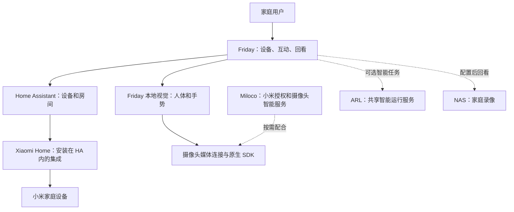

# Friday 用户使用文档

> 面向家庭使用者；按新版界面编写。Friday 示例截图采集于 2026-10-31；ARL 原生开发版演示图保留 2026-10-30 的阶段含义。真实家庭验收资料保存在本机私有版。

[在线手册](https://lijunfeng722.github.io/friday-user-guide/) · [项目索引](https://github.com/lijunfeng722/project-index)

## 阅读目录

1. [第一次打开 Friday](#guide-getting-started-quick-start)

2. [安装前先准备什么](#guide-getting-started-installation)

3. [连接自己的家](#guide-getting-started-connect-home)

4. [查看与操作设备](#guide-guides-devices)

5. [查看摄像头与识别](#guide-guides-cameras)

6. [完成第一条手势控制](#guide-tutorials-first-gesture)

7. [管理互动控制规则](#guide-guides-interactions)

8. [管理场景与自动化](#guide-guides-automations)

9. [连接录像并保护回看](#guide-guides-recordings)

10. [查看家庭事件的来源](#guide-guides-events)

11. [核对人物与待确认分组](#guide-guides-people)

12. [查看智能预警与本机画面复核](#guide-guides-safety)

13. [使用游戏库](#guide-guides-games)

14. [找到家庭资料预览](#guide-guides-files)

15. [用文字预览模拟规则变更](#guide-guides-dialogue)

16. [新版入口速查](#guide-reference-navigation)

17. [读懂页面状态](#guide-reference-status)

18. [十五个温度质量场景](#guide-reference-temperature-scenarios)

19. [这些程序分别做什么](#guide-explanation-components)

20. [怎样看待 ARL 管理界面](#guide-explanation-arl)

21. [2026-10-31 新版使用变化](#guide-releases-2026-10-31)

22. [按现象排查](#guide-troubleshooting-common-errors)

23. [常见问题](#guide-troubleshooting-faq)

24. [后续现场验证范围](#guide-)

<a id="guide-getting-started-quick-start"></a>

## 1. 第一次打开 Friday

完成后，你能确认自己打开了正确的服务、看懂设备来源，并找到日常操作入口。

**开始前：**部署人员已经在这台电脑安装并启动 Friday。全新电脑的安装可交由维护人员按[上游部署指南](https://github.com/Geeprox/Friday/blob/main/docs/deployment.md)准备；本手册从使用界面开始。

### 1. 打开本机页面

在部署 Friday 的电脑上打开 [Friday 本地控制台](http://127.0.0.1:8740/)。网页打不开时，先运行本次交付的启动入口，再刷新页面。不同部署可能使用自己的地址，以维护人员提供的入口为准。

`127.0.0.1` 表示“当前这台电脑”。把它复制到手机上，不会自动访问电脑上的 Friday。

### 2. 看顶部家庭来源

顶部显示“示例家庭”时，先阅读演示，不要把卡片数量当作你家实际设备数量。“家庭已连接 · 只读”可以查看信息；能够操作哪些设备仍由已配置的控制范围决定。


### 3. 打开设备页

点击“设备”，按房间或设备类型筛选。卡片的读数与按钮分别表达状态和可用操作；“暂时不可用”不是“已经关闭”。详见[查看与操作设备](#guide-guides-devices)。

### 4. 需要自己的家庭时再连接

打开“连接”，按“连接 Home Assistant → 让 Friday 读取你的家”完成必要步骤。摄像头与互动是可选项，可以稍后配置。

### 5. 确认你已完成

你能够重新打开页面、分清示例与真实来源，并找到设备页，就完成了本节。接下来按[连接自己的家](#guide-getting-started-connect-home)或[第一条手势控制](#guide-tutorials-first-gesture)继续。

**如果卡住：**网页打不开，先查[启动与连接问题](#guide-troubleshooting-common-errors)，不用先删除账号或重装。

<a id="guide-getting-started-installation"></a>

## 2. 安装前先准备什么

先运行示例，确认本机服务可打开，再逐项接入自己的家庭。已经完成部署的电脑可直接从[第一次打开](#guide-getting-started-quick-start)开始。

### 基础示例

需要受支持的 Python 3.11 以上版本和 [uv](https://docs.astral.sh/uv/getting-started/installation/)。维护人员可从 [Friday 源码仓库](https://github.com/Geeprox/Friday)取得代码，在仓库根目录执行上游提供的入口：

```sh
./scripts/install-home.sh
./bin/home doctor
./bin/home serve
```

打开终端显示的本机地址，默认是 `http://127.0.0.1:8740`。**预期结果：**顶部显示“示例家庭”，可以阅读模拟状态；这一步不要求小米账号、模型或真实硬件。

这些命令来自上游安装说明。本次手册核对使用已经部署的环境，并未把每种操作系统的全新安装都计作通过。新电脑仍需逐步确认依赖与服务状态。

### 接真实家庭前

准备一个可正常打开的 Home Assistant。优先复用已有服务；macOS 的 HA Container 使用 Linux 虚拟机或独立 HA 主机，具体安装按 [HA 官方指南](https://www.home-assistant.io/installation/)进行。

让维护人员在 HA 内安装 [Xiaomi Home 集成](https://github.com/XiaoMi/ha_xiaomi_home)，再由你在 HA 的官方页面完成小米账号、家庭和设备选择。它不是另一套需要独立启动的服务。

### 摄像头与可选能力

本地摄像头和识别环境需要另外安装依赖、原生组件、模型和自己的配置，按 [Friday 部署指南](https://github.com/Geeprox/Friday/blob/main/docs/deployment.md)准备。Miloco 若采用插件方案，按其固定版本的官方平台说明部署。

只接入家庭设备时可以暂不配置摄像头。音频、语音回复、云台、电视、NAS、ARL 与云端模型各自按需求准备，不由基础安装自动开启。

**完成标准：**示例服务可打开；若使用真实家庭，HA 本身可打开且已出现自己的目标设备。接下来做[家庭连接](#guide-getting-started-connect-home)。

<a id="guide-getting-started-connect-home"></a>

## 3. 连接自己的家

把已经接入 Home Assistant 的家庭设备显示到 Friday。连接过程先读取房间和设备，不会替你执行开关动作。

**开始前：**你已有可打开的 Home Assistant，并已在里面添加所需设备。没有服务时，请先让维护人员完成安装。

### 先分清三个位置

| 在哪里操作 | 负责什么 |
| --- | --- |
| Home Assistant | 接入设备和集成，管理真实家庭清单 |
| HA 里的 Xiaomi Home 集成 | 登录小米账号，选择家庭与设备 |
| Friday 的连接页 | 授权 Friday 读取 HA，并查看当前连接情况 |

**XiaoMi/ha_xiaomi_home 装在 HA 内部，是集成，不是另一套需要独立启动的服务。** Miloco 可用于其摄像头与智能功能，但不是 HA 小米登录的前置条件。详见[各程序的分工](#guide-explanation-components)。

### 1. 先在 HA 接入小米设备

在 HA 的“设置 → 设备与服务 → 添加集成”进入 Xiaomi Home，按官方页面完成区域、登录、家庭和设备选择。密码、验证码和授权结果只填在对应页面。

完成后，在 HA 集成页核对是否已经出现目标设备。一个物理设备可能对应多个状态项目，设备数与实体数不必相同。

### 2. 在 Friday 查找并连接

打开“连接”，点击“查找并连接”。找到多个地址时选自己的 HA；未找到时点击“填写地址”，填写浏览器可以打开的完整 HA 地址。


### 3. 完成登录，再读取家庭

在 HA 官方登录页完成授权，返回 Friday 后点击“连接并读取设备”。看到“家庭已连接”及自己的房间、设备后，读取接入完成。

服务离线时，先检查地址和服务状态再重试。不要反复删除已有授权，也不要把授权结果复制到聊天或文档仓库。

### 4. 分别检查控制和摄像头

“只读”时仍可查看设备。首次开放设备操作范围需要本机配置；这不等于每次都要逐台登录。现有范围可以暂停或恢复，新设备不会因被发现就自动获得控制权。

摄像头接入、画面识别与设备控制需要分别准备。完成读取后，可继续[设备操作](#guide-guides-devices)或[摄像头与识别](#guide-guides-cameras)。

**完成标准：**Friday 显示家庭已连接，能在设备页找到自己的目标。**有设备但按钮不可用：**查[只读与权限](#guide-troubleshooting-faq)。

<a id="guide-guides-devices"></a>

## 4. 查看与操作设备

按房间找到设备，分清当前状态与可用操作，再使用设备专属控件。

### 先找设备，再看状态

点击“设备”，选择房间、类型，或在“搜索设备”输入名称。新版会保留只读及暂时不可用的设备，不再因为没有控制按钮就隐藏整台设备。


“我的家”侧重家庭空间与房间入口；需要完整卡片列表时点“打开设备”或左侧“设备”。没有导入自己的户型时，空间区域留空，未定位设备仍可在列表中使用。

### 使用对应控件

| 设备类型 | 常见控件 | 操作前看什么 |
| --- | --- | --- |
| 灯 | 开关、亮度，受支持时可调色温 | 是目标房间的目标灯；哪些调节项已开放 |
| 窗帘 | 打开、关闭、停止、开合位置 | 当前开合程度与电机支持范围 |
| 空调 | 工作模式、设定温度，受支持时有风速 | 当前室温与设定温度不是同一个数 |
| 风扇 | 开关及受支持的风速 | 设备在线，当前动作可用 |
| 摄像头 | 镜头状态与查看画面 | 查看画面和主动打开镜头的含义不同 |

点击卡片名称可展开设备详情。具体出现哪些控件，由设备能力与本机控制范围共同决定；不能因为新版增加了某种控件，就认为所有设备已获得新权限。

### 核对操作结果

选择模式、点击开关或调节按钮可能直接执行已授权操作。先确认目标，再操作一次，观察页面提示和设备实际变化。

“暂时不可用”时先检查设备连接，不要把它当成“关闭”。传感器读数是设备报告；插座内部温度和空调回风温度不自动等于房间室温。

**完成标准：**找到正确设备，页面报告与实际效果一致。设备列表为空或按钮灰色，见[常见问题](#guide-troubleshooting-faq)。

<a id="guide-guides-cameras"></a>

## 5. 查看摄像头与识别

先确认镜头状态，再按需要查看普通画面或人体、手部识别结果。

### 看画面

1. 打开“摄像头”，查看目标镜头的状态。
2. 镜头已经打开时，点击“查看画面”。
3. 不再观看时关闭预览；这与暂停后台感知是两件事。


镜头在米家里关闭后，Friday 的自动重连不会替你强行打开它。需要画面时，由你在米家或摄像头的明确开关入口主动打开。

### 看人体与手部识别

展开“人物与手势检查”，在“识别调试”点击“查看识别”。时间应持续更新；骨架或手部提示只表示检测结果，设备有没有执行要去互动页核对。

“电视未连接”只说明没有电视端，不妨碍电脑上的实时查看。位置尚未标定主要影响空间指向和座位，不要求为了普通手势先填一套猜测户型。

### 分清三个开关

| 你想暂停什么 | 应在哪里操作 | 仍会发生什么 |
| --- | --- | --- |
| 只停止手势触发设备 | 互动控制 → 暂停手势控制 | 后台识别可以继续 |
| 停止 Friday 后台感知 | 摄像头或连接页 → 暂停摄像头感知 | 暂停状态重启后保留；按需手动查看选定镜头不代表恢复全部后台识别 |
| 让摄像头设备本身关闭镜头 | 米家镜头开关或明确的设备开关 | 以设备自己的录像和镜头设置为准 |

麦克风、语音回复和云台接管有独立配置。接通视频不表示这些功能也已开启。

**如果 Miloco 有画面而 Friday 未配置：**还需准备 Friday 自己的本地识别环境，请交由维护人员按上游部署指南完成。Miloco 播放成功不能替代这一步。

完成后可继续[第一条手势控制](#guide-tutorials-first-gesture)。

<a id="guide-tutorials-first-gesture"></a>

## 6. 完成第一条手势控制

把一个身体动作绑定到一台已授权设备，并分别核对识别、响应记录和设备实际效果。

**开始前：**Friday 摄像头和本地识别已准备好；目标设备在 Friday 中允许控制；你了解本次绑定会执行什么动作。

### 1. 先看到实时识别

打开“摄像头”，展开“人物与手势检查”，点击“查看识别”。确认时间持续变化，人体或手部提示能够跟随你。电视未连接不影响本机查看。


如果这里只显示未配置，先完成[摄像头接入](#guide-guides-cameras)，反复做动作不能补齐识别环境。

### 2. 选手势控制，而不是语音页

打开“互动控制”，切换到 **手势控制**。默认的“对镜头说话”是语音功能，打开页面不代表语音已经开启。

### 3. 保存一条完整规则

依次选择“使用范围 → 控制设备 → 动作 → 执行动作”。例如：在目标房间，双臂合上时关闭指定窗帘。核对后点击“保存手势控制”，再到“已设置的控制”确认规则已出现。


上方表单的默认选项不会自动修改已经保存的规则。修改旧规则要点击那条规则的“编辑”，再“保存修改”。

### 4. 开启总开关并完成动作

确认该规则的开关已启用，再点击“启用手势控制”。按钮显示“暂停手势控制”表示总开关正在运行。

站在镜头能清楚识别身体的位置，先保持稳定，再按所选动作说明完成连续变化。例如双臂合上应先张开，再向胸前合拢并短暂停留；一直保持合拢不等于新的动作。多人入镜时，先比 OK 选定操作者，再放下手开始。

### 5. 看记录，再看设备

展开“最近的手势响应”。出现记录后，再观察目标设备是否实际执行。“指令已发送”不能代替现场确认；设备本来已在目标状态，也可能没有新的可见动作。

### 6. 暂时不用时暂停

点击“暂停手势控制”会保留规则，阻止后续手势触发。它不会撤回已经发出的动作；关闭网页也不会自动停掉后台。

**完成标准：**规则已保存、总开关运行、最近响应出现对应目标，并且你确认设备实际效果。任一步缺失，按[手势不触发排查](#guide-troubleshooting-common-errors)逐层检查。

<a id="guide-guides-interactions"></a>

## 7. 管理互动控制规则

在同一页选择语音、手势或指向方式，修改已有规则，而不必删除后重建。

### 三种方式分别做什么

| 页签 | 用途 | 另外需要的准备 |
| --- | --- | --- |
| 对镜头说话 | 用设备和房间名称表达操作 | 所选镜头的声音输入、识别与语音处理已配置 |
| 手势控制 | 把明确动作绑定到设备 | 画面、本地识别与目标控制已配置 |
| 指向设备 | 在镜头画面标记目标，再按指向控制 | 镜头位置、设备点位和相应识别已核对 |


只想做手势时，直接切到“手势控制”。本地手势不要求你先开启语音。

### 新建、修改和暂停

1. 选择使用范围；有多房间镜头时核对自己选择的房间或全屋范围。
2. 选择设备、动作和执行动作，检查表单中的完整描述，再保存。
3. 修改旧规则时点它的“编辑”，检查回填内容，点击“保存修改”；不想改就“取消编辑”。
4. 单条规则的开关只影响这一条；页顶手势总开关暂停时，已启用的规则也不会触发。


移除规则后，页面提供撤销入口时可立即撤销。编辑草稿、设备失效提示和修复入口用于减少误改；最终以已保存卡片为准。重新发现同名设备不等于自动替换原来的目标。

### 指向设备前先核对点位

在“指向设备”选择目标，按当前画面标记位置或填写百分比。镜头移动后需要重新核对，不能把画面坐标当作永久房间坐标。


**完成标准：**保存卡片中的范围、手势、目标和动作都正确，并按[第一条手势控制](#guide-tutorials-first-gesture)完成现场验证。设备列表为空见[权限问题](#guide-troubleshooting-faq)。

<a id="guide-guides-automations"></a>

## 8. 管理场景与自动化

先确认规则来源，再决定运行一次、修改 Friday 自有规则，还是回到原平台管理。

### 三个分类

| 分类 | 你能做什么 |
| --- | --- |
| 一键场景 | 读取米家已有手动场景，核对后运行一次 |
| 自动运行 | 查看、暂停、编辑 Friday 自有自动化 |
| 其他平台的规则 | 查看外部来源及配置范围；不等于直接编辑上游规则 |


### 运行米家一键场景

选择场景后，先核对确认框中的名称和涉及设备数量，再决定是否运行。场景按米家保存的内容执行，可能同时操作多个设备。

**米家场景是独立执行入口，其范围与 Friday 设备页已开放的逐台控制范围不同。** 想只操作指定设备时，使用设备页或对应手势规则；不要把场景设备数当作已逐台验证的控制范围。“已发送”后仍要核对现场效果。

### 新建 Friday 自动化

1. 点击“新建自动化”，填写能说明用途的名称。
2. 选择触发设备与状态变化，再添加需要执行的设备动作。
3. 需要时设置附加条件。
4. 点击“核对并保存”，检查预览；确认无误后再“确认保存并启用”。


保存规则与立即操作设备不同，但启用后，后续条件满足就可能执行。已有规则可以“编辑”或暂停；“执行一次”是主动操作入口，不必等触发条件。

**完成标准：**自有规则出现在“自动运行”，来源与启用状态正确。外部规则需要重建或变更时，先处理原平台规则，避免保留两套相似联动。

<a id="guide-guides-recordings"></a>

## 9. 连接录像并保护回看

从你已配置的录像目录查找片段，播放本机生成的保护预览，并核对时间范围。

**开始前：**NAS 或录像来源已由你连接，目标目录允许读取。摄像头直播正常不代表已接入历史录像。

### 1. 先检查来源

打开“回看”。未能读取时，进入“登录与存储设置”检查网络、已保存登录和允许目录；原来已配置的连接会尝试恢复，不需要每次重复填写。


### 2. 选择镜头和日期

按录像来源、日期或“最新录像”找到片段，再点击播放。文件名时间、设备时钟和实际事件时间不一定完全相同，需要先核对录像来源。

### 3. 看懂保护预览

默认播放短时的整帧马赛克预览，保留原片。选择性遮挡需要另外安装和配置本机模型；未配置时不能承诺只遮住特定区域。生成保护预览失败时，不会自动改播未保护原片。

播放器默认静音。视觉遮挡并不清除原音轨中的个人信息，有声音的录像需要你按场景决定是否取消静音。


本图使用独立示例服务中的 **45 秒纯合成测试片**，用于演示播放器、保护状态和时间线，不代表真实 NAS 已连接或任何家庭录像已经验收。

### 4. 定位、继续播放与结束

可用时间线定位到片段内的位置。播放器按短片段准备后续内容，因此看到一个预览成功，不代表所有录像都已读取。来源变化或预览过期时，重新读取；结束查看后停止播放。

**完成标准：**能核对正确镜头、日期、时间范围，看到明确的保护状态，并成功定位到所需内容。没有录像、时间不符或准备失败时，见[回看问题](#guide-troubleshooting-common-errors)。

<a id="guide-guides-events"></a>

## 10. 查看家庭事件的来源

从设备状态变化查看已有记录、相关操作和录像引用，并分清“时间接近”与“原因已知”。

### 选择事件

1. 打开“回看”，展开“查看家庭事件”。
2. 选择房间、设备和时间范围，点击“刷新事件”。
3. 选择一条事件，查看“记录来源”“记录归属”“时间依据”和“物理效果”。


本图由独立示例服务明确注入一次模拟开门状态，不来自真实门锁、家人活动或家庭录像。

### 怎样理解为什么发生

来源明确记录的操作链、同组记录和仅仅时间相近的记录含义不同。页面显示“现有记录不能确定触发原因”时，不能据前后顺序推断某个手势或自动化造成了变化。

这里只展示本机保留的记录。外部平台规则和手动操作可能不可见；没有记录也不代表没有发生事件。

### 怎样查附近录像

只有摄像头、目录和事件时间范围能够可靠对应时，录像入口才有依据。时间未知或未核对时，先检查录像连接，不随意拼一个相近视频当作证据。

**完成标准：**你能说明这条记录来自哪里、哪些关联有依据、哪些仍未知。打开详情不会自动操作设备；继续看[保护回看](#guide-guides-recordings)。

<a id="guide-guides-people"></a>

## 11. 核对人物与待确认分组

把相似的匿名观察整理成可核对的候选组，再由你确认是否同一人、是否登记名字。

### 先核对，再登记

打开“人物”，查看实时人物、已登记人物和待确认组。绿色骨架或一次手势成功不表示已经完成姓名登记。


有候选照片时，逐张核对是否同一个人，再合并到同组、拆分错误观察，或归入已有家人。界面提供撤销时，可回退最近的整理操作；不要仅凭自动相似度就认定身份。

姓名登记用于资料整理与连续识别，不授予开门、账号访问或设备控制权限。没有登记人脸，也可在满足条件时使用单人动作控制；多人时按镜头提示选择操作者。

**完成标准：**照片和成员对应关系由你确认，错误分组已纠正。示例中没有人物资料，因此不能据截图认定人脸功能已完成现场验收。

<a id="guide-guides-safety"></a>

## 12. 查看智能预警与本机画面复核

分别检查监测、提醒和记录，不把一个开关当成整套能力已经准备好。

### 监测与语音提醒分别设置

打开“智能预警”，看清监测是否运行、语音提醒是否开启，以及播报音箱有没有选择。没有音箱时，不能因为存在提醒按钮就认为已经播报。


预警记录用于核对疑似异常。界面已说明可能漏报或误报，记录与现场情况仍需由你检查。

### 本机画面复核是额外能力

新版提供可选的本机短画面复核，例如补充查看可见变化。看到“模型尚未安装”时，该项不能开启；它不由基础部署自动下载，也不是普通手势识别的必要步骤。

按页面说明确认本机资源、模型和使用范围后，再由维护人员准备。摄像头隐私暂停时，后台待处理画面会停止或清空。没有实际验证过的提醒效果，不计作已经通过。

**完成标准：**监测、提醒、输出设备和记录的状态都能分别说明。只想停止手势，使用互动页开关；想停全部后台感知，见[摄像头开关](#guide-guides-cameras)。

<a id="guide-guides-games"></a>

## 13. 使用游戏库

先检查识别与显示条件，再选择游戏和玩家。

页面提供林间滑雪、双人网球、动作闯关、运动闯关、座位指认与全屋互动等入口。每项需要的玩家人数和动作不同。


1. 先在摄像头页确认可用画面与识别。
2. 在游戏库选择游戏与镜头，按提示绑定玩家。
3. 确认显示位置，再开始；需要结束时使用游戏自己的结束入口。

电视是单独的显示端。没有电视不妨碍电脑查看识别，但不能因此认定电视投放已经接通。

**完成标准：**游戏画面、玩家识别与实际动作响应都正确。普通手势控制成功一次，并不能替代每种游戏的验收。

<a id="guide-guides-files"></a>

## 14. 找到家庭资料预览

新版将家庭资料放到实验功能中，用于搜索已索引的 NAS 资料和核对整理建议。

打开“连接 → 实验功能与调试 → 打开资料索引预览”。旧版左侧的“文件”不再是当前默认导航入口。


| 入口 | 用途 |
| --- | --- |
| 已索引资料 | 查看已经建立索引的资料 |
| 待提取 | 查看待补充提取的内容 |
| 搜索内容 | 在已有可用内容中搜索 |
| 整理建议 | 核对建议后再决定如何处理 |

来源未就绪时，先“设置资料来源”或“核对连接”。这不表示电脑中没有文件，也不表示 Friday 扫描了你的个人目录。

**完成标准：**你明确选择了资料来源，页面显示的索引范围和资料状态可核对。没有 NAS 或没有扫描时，不把空页面当作文件数量证明。

<a id="guide-guides-dialogue"></a>

## 15. 用文字预览模拟规则变更

在独立示例环境练习“先看差异、再批准、必要时恢复”，理解文字操作的范围。

**仅用于示例：**下面截图来自独立的示例家庭。不要为了照图练习，把已经连接真实家庭的服务改成模拟来源。

### 找到入口

打开“连接 → 实验功能与调试 → 文字指令调试”。旧版“对话”菜单已移动到这里。

### 1. 生成差异

输入“以后回家不开空调”，点击“发送”。检查保留的灯动作与移除的空调动作，以及本次预览的范围和有效期。


### 2. 批准这一份预览

在有效期内点击“批准变更”。示例返回“自有模拟规则配置已读取验证”，只证明示例规则配置完成，不证明实际空调已经关闭。


### 3. 需要时恢复

点击“恢复配置”，核对原模拟规则已恢复。配置回滚不能撤回此前已发生的设备动作。


不能识别的文字会要求更明确的命令。不要把文字输入框当作可以任意删改所有规则的通用助手；结构化的“查看依据”适合核对已有家庭记录。

**完成标准：**你能够读懂预览、批准范围和恢复结果，并分清模拟配置与真实设备效果。理解不同读数时，可继续[温度场景图解](#guide-reference-temperature-scenarios)。

<a id="guide-reference-navigation"></a>

## 16. 新版入口速查

按你要完成的任务找页面，避免沿用旧截图中的菜单名称。

| 你要做什么 | 新版入口 |
| --- | --- |
| 看家庭空间和房间 | 我的家 |
| 找完整设备卡片、开关与设定 | 设备 |
| 看镜头、暂停后台感知 | 摄像头 |
| 看骨架或手部识别 | 摄像头 → 人物与手势检查 → 查看识别 |
| 配置身体动作 | 互动控制 → 手势控制 |
| 使用声音输入 | 互动控制 → 对镜头说话 |
| 给画面中的设备标点位 | 互动控制 → 指向设备 |
| 看手势结果 | 互动控制 → 最近的手势响应 |
| 手动场景或自有自动化 | 自动化的三个分类 |
| 查历史录像与家庭事件 | 回看 |
| 登记或核对人物 | 人物 |
| 配置服务、账号与静音 | 连接 |
| 家庭资料预览 | 连接 → 实验功能与调试 → 打开资料索引预览 |
| 文字操作与结构化查询 | 连接 → 实验功能与调试 → 文字指令调试 |
| 系统状态和调试场景 | 开发工具 → 勾选显示调试 |


“对镜头说话”是互动页默认页签，不表示语音已经开启。只想使用动作绑定，切换到“手势控制”即可。

<a id="guide-reference-status"></a>

## 17. 读懂页面状态

同一设备可能同时有“读取正常”和“控制不可用”。先看状态描述的是哪件事。

| 页面文字 | 表示什么 | 接下来怎么做 |
| --- | --- | --- |
| 示例家庭 | 使用模拟数据 | 学习界面；不要当作自己的家庭 |
| 家庭已连接 | 已切到家庭来源 | 核对设备和当前控制范围 |
| 只读 | 当前只能查看，不能执行真实控制 | 如需控制，检查已有范围或首次配置 |
| 暂时不可用 | 当前条件不足以操作或确认状态 | 检查在线状态和连接，避免反复点击 |
| 识别运行 | 本地识别进程在处理画面 | 看提示是否跟随你，再检查规则 |
| 已启用（规则旁） | 这一条规则允许参与运行 | 仍需手势总开关开启 |
| 指令已发送 | 已产生或发送请求 | 观察实际设备，不直接认定完成 |
| 状态已更新 | 读回的设备报告符合目标 | 仍区分现场效果和设备报告 |
| 读数已过期 | 不能当作当前有效测量 | 等新测量或检查来源 |
| 暂不可确认 | 当前依据不足 | 不把它当作零、关闭或损坏结论 |

### 几个常见词

- **设备**：一台实际产品；它可以提供多个状态和操作。
- **实体或状态项目**：同一设备的一项能力，例如当前温度、设定温度或工作模式。
- **房间**：你在家庭平台里分配的位置，不一定等于设备测量所在位置。
- **规则**：何时、在什么条件下，对哪个设备做什么。
- **后台感知**：Friday 在后台接收画面并识别，不等于你正打开预览窗口。
- **保护预览**：为观看临时生成的保护画面，不是覆盖原录像。

更多实际例子见[温度场景图解](#guide-reference-temperature-scenarios)。

<a id="guide-reference-temperature-scenarios"></a>

## 18. 十五个温度质量场景

这些图来自独立、明确标为“示例家庭”的运行环境，用于学习读数含义。日常真实家庭无需切换来源或加载模拟场景。

### 怎样阅读

在示例环境打开“连接 → 实验功能与调试 → 文字指令调试”，房间选“客厅”，点击“只读查询”。同时看设备自身温度、房间室温、测量时间和质量说明。

读数来源位置不同，空调内部或插座内部的温度不自动代表房间室温。

### 01. 正常状态

温度计与空调都有有效测量，房间室温选择已配置的主来源，不能简单平均两种设备读数。


### 02. 相对校准演示

成对模拟样本用于说明校准过程；示例样本不证明你家的设备已经校准。


### 03. 主源过期，备用未校准

主温度计只返回旧记录，空调虽有读数但未通过相对校准，因此室温暂不可确认。


### 04. 使用相对校准备源

备用来源符合当前校准条件，室温显示推算区间；这个区间不是绝对真值保证。


### 05. 读数冻结

一个来源不变，独立来源持续变化时，冻结来源会暂时退出室温判断。


### 06. 读数不一致

不同来源互相矛盾，系统保留无法确认的结论，不随意选一个数。


### 07. 所有来源异常

没有可用依据时保持暂不可确认，而不是把旧数当作当前室温。


### 08. 连接恢复，观察不足

恢复连接不等于测量已经可信，还要等待足够的新测量和观察时间。


### 09. 暂缓切回主源

恢复期间继续使用已经可信的备用来源，避免在主备之间反复切换。


### 10. 恢复后仍返回缓存

刷新旧记录不等于产生了新测量，不能据更新时间认定已经恢复。


### 11. 样本够，时间还不够

短时间内多个样本不能代替跨过完整观察期。


### 12. 电量读数过期

旧电量记录不能证明当前设备健康；温度仍有效与电量过期可以同时出现。


### 13. 空调模式不符

工作模式未知或不符合原校准条件时，不继续套用旧的室温推算。


### 14. 校准过期

校准范围或有效期已经失效，备用温度存在也不能继续当作合格室温。


### 15. 连接中断

连通性不足时，需要重新核对状态，不能把上次测量当作现在仍有效。


遇到自己家庭的异常时，先看[页面状态](#guide-reference-status)与[按现象排查](#guide-troubleshooting-common-errors)。

<a id="guide-explanation-components"></a>

## 19. 这些程序分别做什么

Friday 是你日常打开的家庭界面。其他程序提供设备接入、摄像头或智能服务，各自需要自己的准备。



### 为什么 Miloco 有画面，Friday 还可能没有识别

视频播放与人体、手部识别是两套准备。Friday 的视觉代码就在 Friday 仓库里，但运行时还需要本地依赖、模型、原生组件和自己的摄像头配置。

本地确定性手势不需要先配置 ARL 模型服务，也不需要先启用语音。Miloco 的画面理解、语音和云端模型是其他能力，不能因摄像头能播放就视为全部可用。

### 为什么设备数不相同

Miloco、HA 和 Friday 读取或展示的范围可能不同；一个设备还有多个状态项目。新版 Friday 会保留只读和暂不可用的设备；仍需看清统计的是物理设备、状态项目还是可控制目标。

### 为什么要区分连接和控制

账号接通先让设备可读取；控制范围还需要明确配置。规则保存后，还需要对应总开关、识别条件和设备连接都满足。它们分别显示，方便你判断卡在哪一步。

进一步了解项目之间的仓库关系，可查看[项目索引元仓库](https://github.com/lijunfeng722/project-index)。

<a id="guide-explanation-arl"></a>

## 20. 怎样看待 ARL 管理界面

ARL 为应用提供共享智能运行服务。日常家庭操作仍从 Friday 开始，不需要把 ARL 的所有页面都配置好，才使用本地手势。

### 各页看什么

| 页面 | 主要用途 | 不能直接据此认定什么 |
| --- | --- | --- |
| 运行概览 | 看后台是否可读、运行情况与基础状态 | 不能因此认定模型任务可执行 |
| 模型 | 看模型来源、连接与加载情况 | 有模型选项不表示已安装、已授权或正在调用 |
| 服务连接 | 查看日历、提醒、NAS 等独立服务能力 | 不表示已授予所有个人资料权限 |
| 应用接入 | 查看应用身份与接入状态 | 没有应用会话不能认定正式应用已经接通 |
| 性能、运行记录、诊断 | 查服务状态与问题线索 | 不替代家庭设备现场验收 |


本图保留 **2026-10-30** 的原生开发版演示界面；本轮没有升级 ARL 源码，Friday 的界面图则于 10 月 31 日重新采集。图中“源码候选、待授权”和灰色按钮表达的是开发版边界，不是已经加载模型。

### 为什么服务可读，界面仍待核对

后台可被读取，与模型来源、任务决策、应用会话及外部工具都准备好不同。Friday 的“连接”卡与“系统状态”也可能分别表达这些层次，按具体功能核对即可。

**完成标准：**能分清服务状态、模型状态与可执行任务。不需要为了让本地手势工作，开放日历、消息、模型或其他不相关服务。仓库关系见[项目索引](https://github.com/lijunfeng722/project-index)。

<a id="guide-releases-2026-10-31"></a>

## 21. 2026-10-31 新版使用变化

本页说明这版用户手册覆盖的重要界面与使用方式。功能可用性仍取决于你的部署、设备能力和已配置权限。

| 更新 | 对日常使用的影响 | 阅读 |
| --- | --- | --- |
| 分步连接向导 | 查找、登录、读取分别显示；摄像头可稍后设置 | [连接自己的家](#guide-getting-started-connect-home) |
| 设备专属控件与完整列表 | 按类型操作；只读和暂不可用设备也保留 | [查看设备](#guide-guides-devices) |
| 新版互动配置 | 三种方式分开；规则可编辑、暂停、移除和撤销 | [互动控制](#guide-guides-interactions) |
| 场景和自有规则管理 | 分清米家一键场景、Friday 自动运行与外部规则 | [自动化](#guide-guides-automations) |
| 保护录像回看 | 默认整帧保护、静音、时间线与分段准备 | [回看](#guide-guides-recordings) |
| 事件来源说明 | 分清已知操作链、时间接近和未知原因 | [家庭事件](#guide-guides-events) |
| 人物候选分组 | 核对、归组、拆分和撤销，仍由你确认身份 | [人物](#guide-guides-people) |
| 摄像头隐私与恢复 | 尊重镜头开关；后台感知暂停重启后保留 | [摄像头](#guide-guides-cameras) |
| 可选本机画面复核 | 缺少模型时明确不可开启，不自动下载 | [智能预警](#guide-guides-safety) |
| 预览功能入口收纳 | 旧“文件”“对话”移入连接页实验功能 | [入口速查](#guide-reference-navigation) |

### 这版文档怎样验证

主要入口、规则编辑界面、模拟规则预览与恢复、15 个温度质量场景，以及合成视频保护预览都通过本地运行的产品界面核对。合成测试不是每台真实设备的现场验证。

升级前一次真实手势的成功，也不代表新版全部设备、游戏、语音和智能预警均已验收。自己开始使用时，按任务指南分别确认结果。

### 维护与反馈

本手册由独立文档仓库维护。产品行为参考 [Friday 源码](https://github.com/Geeprox/Friday)，相关依赖见[元仓库索引](https://github.com/lijunfeng722/project-index)。反馈时说明手册页、产品版本与实际可见行为。

<a id="guide-troubleshooting-common-errors"></a>

## 22. 按现象排查

先定位卡住的环节，再处理对应设置；不要一次重装所有服务。

### 网页打不开

确认在部署服务的电脑上，地址和端口正确。先启动交付的环境，再刷新。关闭网页与停止后台不同，刷新不能启动已经停止的服务。

### 家庭连接失败

先在浏览器确认 HA 能正常打开，再回 Friday 核对地址。小米授权后，回原 HA 设置页看看是否已经进入家庭和设备选择。若没有，记录报错页面和时间，不必先删除已有集成。

### 设备或操作选项为空

先在 HA 确认设备已导入，再到 Friday 设备页找目标。若仍是只读，检查是否首次控制范围未配置，或已有操作被暂停。点击手势总开关不能替设备新增授权。

### Miloco 有画面，但 Friday 没有

检查 Friday 摄像头接入和本地识别环境。再看米家的镜头是否打开、设备是否在线。视频服务、识别环境和查看入口是不同环节。

### 手势不触发

按顺序检查：

1. 识别画面和时间持续更新。
2. 所需身体部位无遮挡，动作提示能跟随你。
3. 多人时已选定操作者。
4. 目标规则确实出现在“已设置的控制”，目标与设备动作正确。
5. 单条规则和手势总开关都已开启。
6. 完成连续动作，再看“最近的手势响应”，最后核对实际设备。

有骨架但没有记录，先检查识别和规则条件；有记录但设备没动，再检查目标、读回状态及现场。不要连续做动作催动可能仍在执行的设备。

### 录像不能播放

先分清“未连接录像来源”“没有找到文件”和“保护预览准备失败”。检查网络、来源目录、日期和设备时间；来源变更或预览过期后重新读取。不要为播放失败直接回退到未保护原片。

### ARL 待核对或按钮灰色

服务可以被读取，与模型、应用会话和工具能力全部就绪不同。本地手势可以独立运行，不要把 ARL 的所有可选能力当作手势前提。

### 提供什么信息便于协助

记录时间、页面、你的操作、可见提示和设备实际有没有变化。保留必要截图；账号密码、验证码和模型密钥只在对应服务页面填写。真实家庭画面只在你认可的范围内分享。

完整问答见[常见问题](#guide-troubleshooting-faq)。

<a id="guide-troubleshooting-faq"></a>

## 23. 常见问题

从使用者角度回答日常问题。需要按步骤定位时，先看[按现象排查](#guide-troubleshooting-common-errors)。

### Q01. 我每天应该打开哪个页面？

主要打开 Friday。添加集成或核对家庭清单时进入 Home Assistant；检查小米摄像头相关服务时再进入 Miloco，不必每天在三个页面重复登录。

### Q02. 网页打不开，第一步做什么？

确认在部署服务的电脑上，使用交付的启动入口启动环境，再打开 Friday。把本机地址复制到手机并不能访问电脑上的服务。

### Q03. 怎样判断是真实设备还是演示数据？

看顶部：“示例家庭”是模拟数据，“家庭已连接”是家庭来源。本文示例图中的英文设备不是自动发现的真实设备。

### Q04. 为什么几个页面的设备数量不同？

它们支持和展示的范围不同；同一物理设备还有多个状态项目。新版 Friday 会保留只读和暂不可用设备。核对时先确认统计的是设备、状态项目还是可控制目标。

### Q05. Xiaomi Home 要单独启动吗？

不用作为独立服务启动。它安装在 Home Assistant 内部，在 HA 的设备与服务里完成设置。Miloco 不是 HA 小米登录的前置条件。

### Q06. 小米授权后报错，需要重新安装吗？

先回原 HA 页面看看是否已经进入家庭和设备选择。仍未完成时，记录错误页面与时间再排查；不要先删除已有家庭或把授权结果发到聊天。

### Q07. 显示只读时能做什么？

可以查看已接入信息，不能从 Friday 发出真实设备控制。已有控制范围可暂停或恢复；首次开放范围需要在本机配置。

### Q08. 每次使用都要逐台设备重新授权吗？

日常不需要。已配置的范围会保留，你在规则里选择目标即可。新增设备不会因为被发现就自动取得控制权限。当前连接页可暂停或恢复已有范围；首次扩展仍需部署人员在本机设置，日常选设备不需要改代码。

### Q09. 规则里的设备列表为空怎么办？

先在设备页确认目标存在，再检查是否只读、操作是否暂停，以及该设备有没有支持的控制。启用手势总开关不会替设备增加权限。

### Q10. 选择了设备和手势，为什么没有规则？

还要选择执行动作并点击“保存手势控制”。以“已设置的控制”中的卡片为准，上方表单的临时选择不会自动保存。

### Q11. 怎样修改已经保存的规则？

在目标规则上点击“编辑”，核对回填的范围、动作、设备和执行动作，再点“保存修改”。没有打算改就“取消编辑”。

### Q12. 双臂打开可以绑定关闭窗帘吗？

可以。身体动作与设备动作由你绑定，核对完整描述即可，不能只看动作名称猜测设备会做什么。

### Q13. 为什么互动页首先显示语音？

新版默认打开“对镜头说话”。只想使用动作绑定，切到“手势控制”；打开语音页本身不表示声音输入已开启。

### Q14. Miloco 有画面，Friday 为什么还未配置？

视频服务与 Friday 的本地识别是分开的。需要先完成 Friday 这一侧的摄像头、识别环境和查看入口准备。

### Q15. 查看识别在哪里？

打开“摄像头”，展开“人物与手势检查”，再点击“查看识别”。确认时间持续更新，再观察人体或手部提示。

### Q16. 电视未连接会影响电脑上的手势吗？

不会。它只说明没有电视显示端连接。本机查看画面和手势不需要先连接电视。

### Q17. 有绿色骨架，为什么还没有控制设备？

骨架只表示检测结果。还需满足动作变化、操作者选择、规则启用、总开关运行与设备可用等条件，按排查页逐层检查。

### Q18. 一直保持双臂合上为什么没有反应？

它判断连续变化，先张开再合拢并短暂停留。一直保持同一姿势，不一定会产生新的动作事件。

### Q19. 旁边有人时怎样选操作者？

按镜头提示先比 OK 选择自己，放下手后再做动作。离开画面或追踪丢失后，可能需要重新选择。

### Q20. 必须先登记人脸吗？

单人动作控制不要求先登记姓名或人脸。人物登记用于资料整理与连续识别，不授予设备操作权限。

### Q21. 规则已启用，为什么页面还说暂停？

单条规则开关只控制这一条。手势总开关暂停时，规则即使已启用也不会触发。按钮显示“暂停手势控制”时，总开关正在运行。

### Q22. 没有身体动作文字提示，就一定没识别到吗？

不一定。识别页主要显示人体、手部和指向信息，不一定给每个动作显示独立文字。设备规则是否触发要看最近的手势响应。

### Q23. 指令已发送就是成功了吗？

还不能认定。需要看设备报告与实际效果；设备如果本来已在目标状态，也可能没有新的可见动作。

### Q24. 状态已更新与现场效果有什么区别？

前者说明设备回报符合目标，后者需要你在现场确认。两者都核对，才知道这一次操作是否满足预期。

### Q25. 一个手势成功后，其他设备也算验收了吗？

不算。其他目标、动作、光线、多人情况以及游戏，需要分别验证，不能由一次成功推定全部可用。

### Q26. 暂时不想让动作触发设备，怎么停？

在“手势控制”点击“暂停手势控制”。规则会保留，需要时再启用；暂停不会撤回已经发出的动作。

### Q27. 关闭预览或浏览器后还会继续运行吗？

后台与总开关仍运行时会继续。只停手势用手势总开关，停全部后台识别用“暂停摄像头感知”，停整套环境用交付的停止入口。

### Q28. 重启后需要重新登录和配置规则吗？

通常已保存设置会保留。先启动服务再核对来源、画面和开关；明确提示登录失效时再重新登录，迁移或清理私有数据后则需另行接入。

### Q29. 手势一定需要云端模型或语音吗？

已经准备好的本地身体和手部手势不要求先开启麦克风，也不要求先购买云端模型。语音、画面理解和智能任务是另外的能力。

### Q30. 一键场景和单设备控制是同一范围吗？

不是。米家场景按照米家保存的整组内容执行，可能涉及多台设备。运行前核对确认框的名称和数量；只操作指定设备时使用设备页或对应规则。

### Q31. 回看为什么全是马赛克，为什么没有声音？

默认是整帧保护预览并保持静音。选择性遮挡需要额外本机模型配置；视觉保护不去除原音轨里的个人信息。

### Q32. 摄像头直播正常，为什么没有历史录像？

历史回看需要单独连接 NAS 或录像来源，并核对目录、日期和时间。直播与历史录像接入是两件事。

### Q33. 需要别人协助时提供什么？

提供发生时间、页面、操作、提示和设备实际变化。不要发送密码、验证码或模型密钥；真实家庭画面只在你认可的范围内分享。

<a id="guide-"></a>

## 24. 后续现场验证范围

本文把已做的软件核对与需要各家庭自行完成的现场验证分开，便于维护手册。

### 已完成的手册核对

- [x] 新版主要页面与入口逐项核对。
- [x] 手势表单及既有规则编辑入口核对；未借此改动真实规则。
- [x] 模拟文字规则的预览、批准与恢复。
- [x] 15 个温度质量场景重新截图。
- [x] 45 秒纯合成视频的整帧保护、静音与分段时间线演示。
- [x] 合成状态事件的来源和未知原因展示。

### 使用各家庭时继续确认

- [ ] 按目标设备分别确认新增控件的实际效果。
- [ ] 多房间镜头的规则范围与多人情况。
- [ ] 自有 NAS 的格式、时钟、录像连续性与实际音画。
- [ ] 人物候选分组的现场核对、修正与撤销。
- [ ] 选择使用时，再准备语音、电视、智能预警或本机画面复核并分别验证。

图文依据分为实际界面核对、代码与合成测试核对、各家庭现场确认三个层次。可选功能未配置时明确写出，不能把一次旧版本的设备动作成功扩展为新版所有功能通过。
