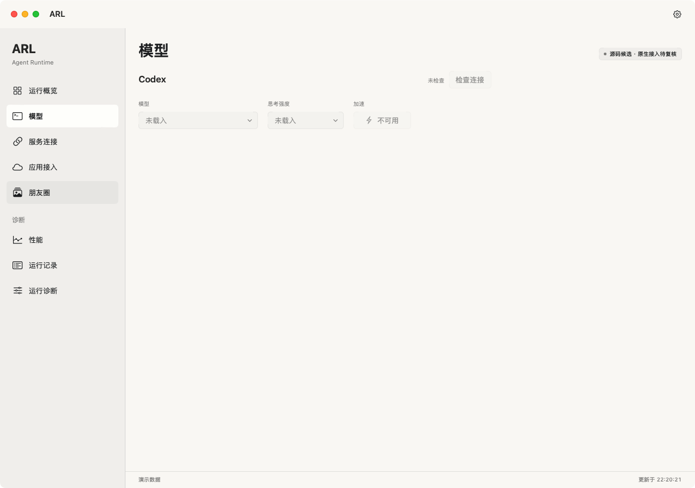

# 怎样看待 ARL 管理界面

ARL 为应用提供共享智能运行服务。日常家庭操作仍从 Friday 开始，不需要把 ARL 的所有页面都配置好，才使用本地手势。

## 各页看什么

| 页面 | 主要用途 | 不能直接据此认定什么 |
| --- | --- | --- |
| 运行概览 | 看后台是否可读、运行情况与基础状态 | 不能因此认定模型任务可执行 |
| 模型 | 看模型来源、连接与加载情况 | 有模型选项不表示已安装、已授权或正在调用 |
| 服务连接 | 查看日历、提醒、NAS 等独立服务能力 | 不表示已授予所有个人资料权限 |
| 应用接入 | 查看应用身份与接入状态 | 没有应用会话不能认定正式应用已经接通 |
| 性能、运行记录、诊断 | 查服务状态与问题线索 | 不替代家庭设备现场验收 |

本图保留 **2026-10-30** 的原生开发版演示界面；本轮没有升级 ARL 源码，Friday 的界面图则于 10 月 31 日重新采集。图中“源码候选、待授权”和灰色按钮表达的是开发版边界，不是已经加载模型。

## 为什么服务可读，界面仍待核对

后台可被读取，与模型来源、任务决策、应用会话及外部工具都准备好不同。Friday 的“连接”卡与“系统状态”也可能分别表达这些层次，按具体功能核对即可。

**完成标准：**能分清服务状态、模型状态与可执行任务。不需要为了让本地手势工作，开放日历、消息、模型或其他不相关服务。仓库关系见[项目索引](https://github.com/lijunfeng722/friday-project-index)。
