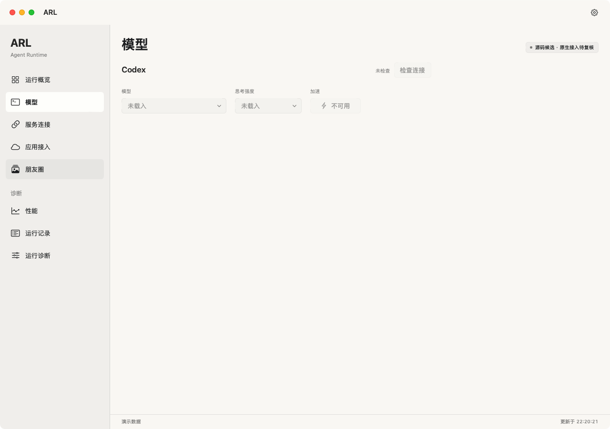
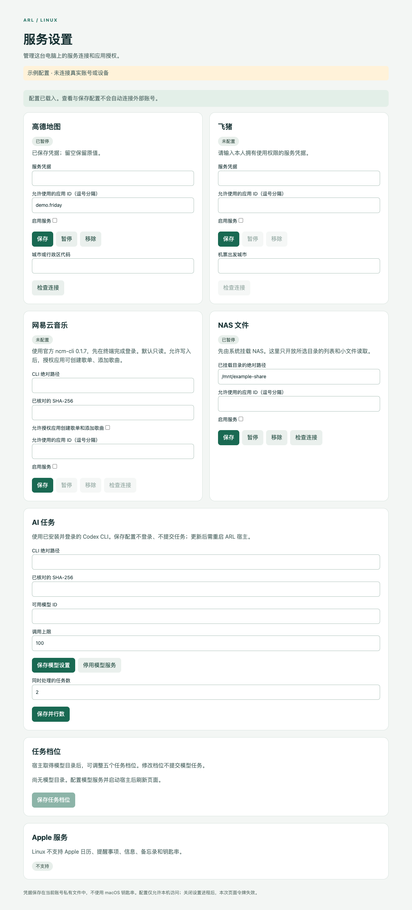

# 怎样看待 ARL 管理界面

Friday 也可选择自己的 OpenAI API，与 ARL 使用不同的凭据和用量。切换方式、每日上限、语音输入与歌曲背景见[智能服务与每日上限](../guides/intelligence.md)。ARL 不是本地设备按钮和 KTV 播放的必需前提。

ARL 为应用提供共享智能运行服务。日常家庭操作仍从 Friday 开始，不需要把 ARL 的所有页面都配置好，才使用本地手势。

## 各页看什么

| 页面 | 主要用途 | 不能直接据此认定什么 |
| --- | --- | --- |
| 运行概览 | 看后台是否可读、运行情况与基础状态 | 不能因此认定模型任务可执行 |
| 模型 | 看模型来源、连接与加载情况 | 有模型选项不表示已安装、已授权或正在调用 |
| 服务连接 | 查看日历、提醒、NAS 等独立服务能力 | 不表示已授予所有个人资料权限 |
| 应用接入 | 查看应用身份与接入状态 | 没有应用会话不能认定正式应用已经接通 |
| 性能、运行记录、诊断 | 查服务状态与问题线索 | 不替代家庭设备现场验收 |

本图保留 **2026-10-30** 的原生开发版演示界面；本轮没有升级 ARL 源码，Friday 的界面图则于 10 月 31 日重新采集。图中“源码候选、待授权”和灰色按钮表达的是开发版边界，不是已经加载模型。

## 为什么服务可读，界面仍待核对

后台可被读取，与模型来源、任务决策、应用会话及外部工具都准备好不同。Friday 的“连接”卡与“系统状态”也可能分别表达这些层次，按具体功能核对即可。

**完成标准：**能分清服务状态、模型状态与可执行任务。不需要为了让本地手势工作，开放日历、消息、模型或其他不相关服务。仓库关系见[项目索引](https://github.com/lijunfeng722/friday-project-index)。

## Linux 宿主

配套候选代码增加 Python 宿主和本机浏览器设置页，复用应用会话、AI 任务和回执。Linux 不需要 macOS 原生 ARL Control；Apple 专属服务显示“不支持”。范围与安装条件见 [Linux 开发预览](../getting-started/installation-linux.md#cpu-识别与-arl-开发预览)。

安装人员准备 ARL 的 Linux 环境后，在 ARL 仓库运行 `.venv-linux/bin/python -m arl.linux_settings serve`，打开终端显示的本机链接。此链接包含临时访问令牌，请勿分享；关闭设置进程后链接失效。

1. 在高德、飞猪、网易云音乐或 NAS 卡片中填写自己的连接信息。凭据留空会保留原值；不会回显已保存的凭据。
2. 填写允许使用服务的应用 ID，勾选“启用服务”，点击“保存”。没有应用授权的服务不会被自动使用。
3. 需要验证时单独点击“检查连接”。地图和机票检查要先填写查询城市；保存设置本身不会连接账号。
4. 用“暂停”撤销调用授权；“移除”删除该项配置。网易云创建歌单、添加歌曲还需单独勾选写入权限。
5. 在“AI 任务”配置已安装并登录的 CLI、核验摘要及模型；保存后按安装人员说明重启宿主。取得模型目录后可调整任务档位、并行数。

上图是只读示例，包含合成应用 ID 和示例挂载路径，不是已连接的家庭配置。NAS 先由系统挂载，ARL 只读取所选目录列表和小文件。Linux 的服务凭据保存在当前账号私有文件中，不使用 Apple 钥匙串，也不自动迁移 Mac 登录信息。完整部署与 CLI 操作见配套 ARL 仓库的 `docs/linux-host.md`。
