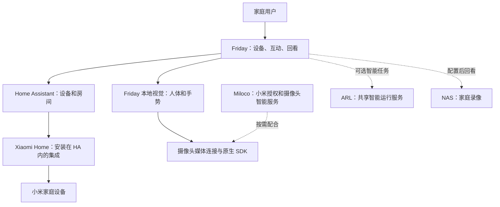

# 这些程序分别做什么

Friday 是你日常打开的家庭界面。其他程序提供设备接入、摄像头或智能服务，各自需要自己的准备。

## 为什么 Miloco 有画面，Friday 还可能没有识别

视频播放与人体、手部识别是两套准备。Friday 的视觉代码就在 Friday 仓库里，但运行时还需要本地依赖、模型、原生组件和自己的摄像头配置。

本地确定性手势不需要先配置 ARL 模型服务，也不需要先启用语音。Miloco 的画面理解、语音和云端模型是其他能力，不能因摄像头能播放就视为全部可用。

## 为什么设备数不相同

Miloco、HA 和 Friday 读取或展示的范围可能不同；一个设备还有多个状态项目。新版 Friday 会保留只读和暂不可用的设备；仍需看清统计的是物理设备、状态项目还是可控制目标。

## 为什么要区分连接和控制

账号接通先让设备可读取；控制范围还需要明确配置。规则保存后，还需要对应总开关、识别条件和设备连接都满足。它们分别显示，方便你判断卡在哪一步。

进一步了解项目之间的仓库关系，可查看[项目索引元仓库](https://github.com/lijunfeng722/project-index)。
