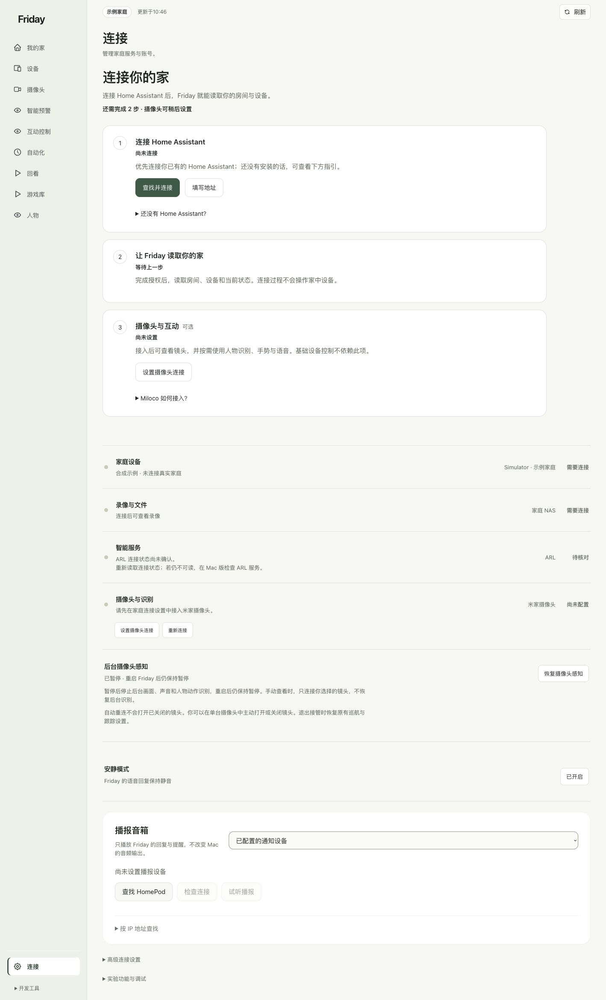

# 连接自己的家

把已经接入 Home Assistant 的家庭设备显示到 Friday。连接过程先读取房间和设备，不会替你执行开关动作。

**开始前：**你已有可打开的 Home Assistant，并已在里面添加所需设备。没有服务时，请先让维护人员完成安装。

## 先分清三个位置

| 在哪里操作 | 负责什么 |
| --- | --- |
| Home Assistant | 接入设备和集成，管理真实家庭清单 |
| HA 里的 Xiaomi Home 集成 | 登录小米账号，选择家庭与设备 |
| Friday 的连接页 | 授权 Friday 读取 HA，并查看当前连接情况 |

**XiaoMi/ha_xiaomi_home 装在 HA 内部，是集成，不是另一套需要独立启动的服务。** Miloco 可用于其摄像头与智能功能，但不是 HA 小米登录的前置条件。详见[各程序的分工](../explanation/components.md)。

## 1. 先在 HA 接入小米设备

在 HA 的“设置 → 设备与服务 → 添加集成”进入 Xiaomi Home，按官方页面完成区域、登录、家庭和设备选择。密码、验证码和授权结果只填在对应页面。

完成后，在 HA 集成页核对是否已经出现目标设备。一个物理设备可能对应多个状态项目，设备数与实体数不必相同。

## 2. 在 Friday 查找并连接

打开“连接”，点击“查找并连接”。找到多个地址时选自己的 HA；未找到时点击“填写地址”，填写浏览器可以打开的完整 HA 地址。

## 3. 完成登录，再读取家庭

在 HA 官方登录页完成授权，返回 Friday 后点击“连接并读取设备”。看到“家庭已连接”及自己的房间、设备后，读取接入完成。

服务离线时，先检查地址和服务状态再重试。不要反复删除已有授权，也不要把授权结果复制到聊天或文档仓库。

## 4. 分别检查控制和摄像头

“只读”时仍可查看设备。首次开放设备操作范围需要本机配置；这不等于每次都要逐台登录。现有范围可以暂停或恢复，新设备不会因被发现就自动获得控制权。

摄像头接入、画面识别与设备控制需要分别准备。完成读取后，可继续[设备操作](../guides/devices.md)或[摄像头与识别](../guides/cameras.md)。

**完成标准：**Friday 显示家庭已连接，能在设备页找到自己的目标。**有设备但按钮不可用：**查[只读与权限](../troubleshooting/faq.md#q07-显示只读时能做什么)。
