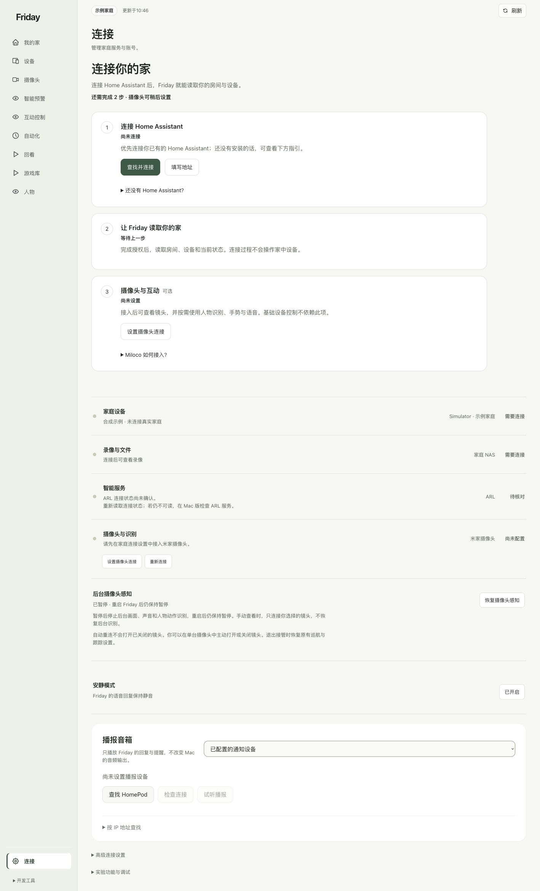
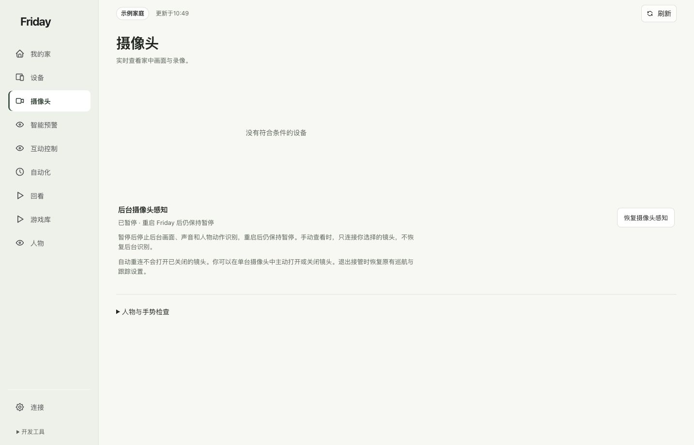

# 准备摄像头与本地识别（可选）

**本章目的：**准备摄像头连接和 Friday 本地识别所需的组件，逐步验证画面、人体与手部识别，再为手势控制提供输入。

## 为什么要分开准备视频、识别和控制

| 部分 | 负责什么 | 你为什么需要 |
| --- | --- | --- |
| Miloco 及所选插件宿主 | 本方案中的小米账号绑定、摄像头与相关服务 | 建立所选摄像头方案的账号和服务条件 |
| Friday 视觉环境 | SDK、视频解码、Apple Vision 与本地模型等组件 | 连接画面，得到人体、手部关键点及场景信息 |
| 手势规则与设备控制范围 | 把识别到的动作关联到允许控制的目标 | 让你选定的动作能触发正确设备 |

三部分分别配置和验收：先确认画面，再看识别结果，最后验证规则和真实设备效果。Miloco 能播放视频后，仍需准备 Friday 的识别环境；看到骨架后，也要核对规则和控制范围。

**适用与跳过：**需要摄像头或手势的读者继续；只查看或操作 HA 设备时可跳过。已经接通的用户直接看[摄像头使用指南](../guides/cameras.md)。

**开始前与完成标志：**先让摄像头在官方应用中正常工作；本章按阶段核对安装、登录、画面、识别和动作效果。完整识别还需要所选部署版本提供摄像头注册与后台启动组件，具体见第 7 步。

## 先确认平台与目标

| 目标 | macOS | Linux |
| --- | --- | --- |
| 安装 Miloco、绑定账号、查看支持的摄像头 | 选择官方支持的系统与芯片包 | 选择官方支持的架构包 |
| Friday 原生人体、手部识别 | 需要 Apple Vision、匹配 SDK、模型与后台装配 | 当前原生程序依赖 Apple Vision，不能照搬 macOS 编译步骤 |
| 普通 HA 设备控制 | 完成家庭接入和控制范围配置即可 | 完成家庭接入和控制范围配置即可 |

摄像头画面正常，不表示 Friday 已具备识别环境；识别可见，也不表示规则已允许执行。Intel Mac 如没有匹配的 SDK 发行包，同样不能使用 arm64 包替代。

## 1. 先检查摄像头与账号

在米家或摄像头官方应用确认：目标属于自己的账号、设备在线、镜头已由你主动打开、画面能播放。记下目标名称供本机选择，不将设备标识或家庭画面放进公开仓库。

HA 的 Xiaomi Home 登录与 Miloco 的小米绑定各自保存授权，一边完成不能代替另一边。普通本地手势不要求先购买云端模型服务。

## 2. 准备 Miloco 的插件宿主

Miloco v2026.10.16 的安装入口提供 OpenClaw、Hermes 平台指南。这里以 OpenClaw 为例；已有兼容宿主可以复用，先确认原配置，不新建覆盖原账号。

从 [Node.js 官方发行目录](https://nodejs.org/dist/v24.22.1/)选择 Node 24.22.1 对应系统、架构的安装包，并按同目录的校验清单核对。Mac 可下载 `.pkg` 安装器，按系统窗口完成安装后重开终端。

Linux 先按 `uname -m` 的结果二选一：

```sh
# x86_64 使用这一行
friday_node_archive=node-v24.22.1-linux-x64.tar.xz
```

```sh
# aarch64 / arm64 使用这一行
friday_node_archive=node-v24.22.1-linux-arm64.tar.xz
```

接着在同一个终端下载、校验和解压：

```sh
mkdir -p "$HOME/friday-home/downloads" "$HOME/friday-home/tools"
cd "$HOME/friday-home/downloads"
curl -fLO "https://nodejs.org/dist/v24.22.1/$friday_node_archive"
curl -fLsS https://nodejs.org/dist/v24.22.1/SHASUMS256.txt -o node-SHASUMS256.txt
sha256sum --check --ignore-missing node-SHASUMS256.txt
tar -xf "$friday_node_archive" -C "$HOME/friday-home/tools"
friday_node_folder="${friday_node_archive%.tar.xz}"
export PATH="$HOME/friday-home/tools/$friday_node_folder/bin:$PATH"
```

**应看到：**下载文件的校验结果为 `OK`。需要新终端继续使用时，把实际解压目录的 `bin` 路径加入自己的 shell 配置，例如 x64 对应 `$HOME/friday-home/tools/node-v24.22.1-linux-x64/bin`。随后确认：

```sh
node --version
npm --version
```

**应看到：**Node `v24.22.1` 和 npm 版本。需要详细平台操作时见 [Node 官方下载入口](https://nodejs.org/en/download)。不要用系统里一个过旧的 Node 继续安装。

在个人目录安装选定宿主版本：

```sh
mkdir -p "$HOME/friday-home/tools/openclaw"
npm install --prefix "$HOME/friday-home/tools/openclaw" openclaw@2026.10.9
export PATH="$HOME/friday-home/tools/openclaw/node_modules/.bin:$PATH"
openclaw --version
openclaw configure --section gateway
```

按本机向导配置本地网关及其认证，再安装、检查服务：

```sh
openclaw gateway install
openclaw gateway status
```

**应看到：**网关可用。需要后续终端继续找到 openclaw 时，把同一条 PATH 配置加入自己的 shell 配置。网关认证信息保存在自己的本机配置；本阶段不必配置 IM，也不把网关启动当作模型任务已经可用。[OpenClaw 官方入门](https://docs.openclaw.ai/start/getting-started)

## 3. 安装固定版本 Miloco

先阅读[固定版本平台选择入口](https://github.com/XiaoMi/xiaomi-miloco/blob/v2026.10.16/scripts/install-guide.md)，确认选择 OpenClaw 路线。下载该版本官方安装器：

```sh
curl -fLsS https://github.com/XiaoMi/xiaomi-miloco/releases/download/v2026.10.16/install.sh -o /tmp/friday-install-miloco.sh
bash /tmp/friday-install-miloco.sh --agent-prepare
```

**应看到：**环境准备、核心包和服务状态结果，或明确的失败步骤。安装器可能准备自己的 Python 和依赖，这不需要把 Friday 的 Python 3.12 替换掉。系统出现本地网络权限提示时，按自己要使用的本地设备功能选择。

按输出打开本机 Miloco 页面，默认入口为 `http://127.0.0.1:1810/`。自己完成小米登录与绑定；授权结果只填回对应页面，不放进聊天、命令历史或文档。

账号绑定后，按同版本平台指南完成剩余安装：

```sh
bash /tmp/friday-install-miloco.sh --agent-finish
openclaw gateway restart
miloco-cli service status
miloco-cli device list
```

**应看到：**服务运行，设备清单中能找到自己的摄像头。若终端找不到 miloco-cli，核对安装器输出及 `$HOME/.local/bin`。没有模型 Key 时，服务与账号、摄像头接入分别验收；不把未配置的多模态智能功能计为完成。

## 4. 在 Friday 记录摄像头连接

在“连接 → 摄像头与互动”按页面选择安装或已有服务入口。兼容服务地址必须是本机入口；填写自己的摄像头并检查服务和绑定状态。



服务检查成功只说明连接和账号条件，接下来还需 Friday 自己的视觉环境。

## 5. macOS：准备独立视觉环境

以下是源码部署的进阶准备。使用统一的默认目录 `data/embodied`，不要把另一台机器的私有目录、会话或绝对路径复制进来。

```sh
cd "$HOME/friday-home/Friday"
mkdir -p data/embodied
uv venv --python 3.12 data/embodied/runtime
uv export --locked --no-dev --extra vision --extra camera-media --no-emit-project --format requirements.txt --output-file data/embodied/requirements-vision.txt
uv pip install --python data/embodied/runtime/bin/python --require-hashes -r data/embodied/requirements-vision.txt
```

**应看到：**锁定依赖安装到独立的 `runtime`，与 Web 的 `.venv` 分开。不要对已有且正在使用的视觉环境重复创建。

SDK 不随 Friday 分发。从 [Miloco 固定发行版](https://github.com/XiaoMi/xiaomi-miloco/releases/tag/v2026.10.16)及其官方说明取得与系统、芯片、Python 匹配的 SDK wheel，在本机指定实际下载路径：

```sh
printf '请输入匹配 SDK wheel 的完整本机路径：'
read -r friday_sdk_wheel
uv pip install --python data/embodied/runtime/bin/python "$friday_sdk_wheel"
data/embodied/runtime/bin/python -c 'import av, cv2, onnxruntime, miot.camera; print("视觉依赖与摄像头 SDK 可导入")'
```

**应看到：**依赖和 SDK 可导入。下载了 Miloco 服务或在 Web 环境装了 PyAV，不能替代这个检查。

## 6. macOS：编译原生程序并准备模型

先检查编译器，再编译当前源码：

```sh
xcrun --find swiftc
xcrun --find clang
.venv/bin/python scripts/embodied/runtime.py --build-native
```

**应看到：**`data/embodied/bin` 下生成 `friday-vision` 与 `camera-sockets.dylib`，命令返回文件摘要。它不会下载模型、注册账号或启动摄像头。

另外准备 `data/embodied/models/yolov8n.onnx`。可使用对应部署版本提供、来源和摘要明确的模型；自行导出时，使用 [Ultralytics 官方权重](https://github.com/ultralytics/assets/releases/tag/v8.3.0)和[官方 ONNX 导出方式](https://docs.ultralytics.com/integrations/onnx/)，在独立导出环境生成，不在生产视觉环境临时升级依赖。

交给部署者核对的参数包括：所用权重及许可、导出器版本、ONNX opset、输入尺寸、是否动态尺寸和实际 SHA-256。一个采用 opset 17、640×640、静态输入的导出产物，也必须核对当前程序兼容性；不能直接把它标成参考清单中另一个文件的摘要。

## 7. 初始化自己的摄像头与后台入口

这一阶段仍需要对应版本的部署组件或部署维护者完成注册。当前公开基础命令 `./bin/home serve` 默认不启动识别后台；安装上面的包并不自动补齐这一阶段。

| 必须准备 | 要核对的内容 |
| --- | --- |
| 摄像头私有配置 | 来自自己账号的设备、匹配设备描述、稳定 camera ID、默认镜头 |
| 当前登录会话 | 有效的访问会话和过期时间；由原登录服务持有刷新职责 |
| 本机查看和控制配置 | 私有密钥、页面 origin、查看地址和端口，文件权限受限 |
| 一致的运行目录 | 安装、构建、模型、私有配置、主进程与 worker 读取同一目录 |
| 后台启动 | 所选入口启用 supervisor、真实家庭来源和识别策略，并恢复已保存的暂停状态 |
| 设备控制范围 | 与自己的 HA 实例和选定设备绑定；不因打开摄像头自动扩大 |

使用部署版本提供的正式注册、启动入口。没有这些入口或匹配组件时，先停在准备阶段，把缺项交给部署维护者；不要复制别人的私有 JSON 或猜测设备属性。基础 CLI 没有一个“安装全部识别环境”的通用开关，手册也不会把某台电脑的私有修复脚本当作公开安装器。

可先运行不会打开硬件的缺项检查：

```sh
.venv/bin/python scripts/embodied/runtime.py --check
```

本文公开基线的检查包含额外语音 / 决策资源，只检查预期文件，不等于实际连接、推理或物理动作成功。它没有 `--profile gestures` 参数；不要照抄其他本机修复版本才有的参数。普通手势的准备范围应按所用部署版本说明逐项核对。

## 8. 分层验收

1. 先保持手势触发暂停，确认自己的摄像头画面持续更新。
2. 在 Friday“摄像头 → 人物与手势检查 → 查看识别”查看骨架或手部提示。
3. 核对镜头、房间、设备控制范围，再保存规则。
4. 明确这条规则的实际效果后恢复手势控制。
5. 同时查看“最近响应”和目标设备的实际变化。



按[第一条手势控制](../tutorials/first-gesture.md)完成现场验证。“电视未连接”不妨碍电脑预览；语音、云台、电视、人脸登记和房间标定按自己的需求分别准备。

**完成标准：**安装、登录、画面、识别、规则响应与物理效果分别有依据。Linux 完成 Miloco 接入后仍不因此具备当前 Apple Vision 手势链路。
