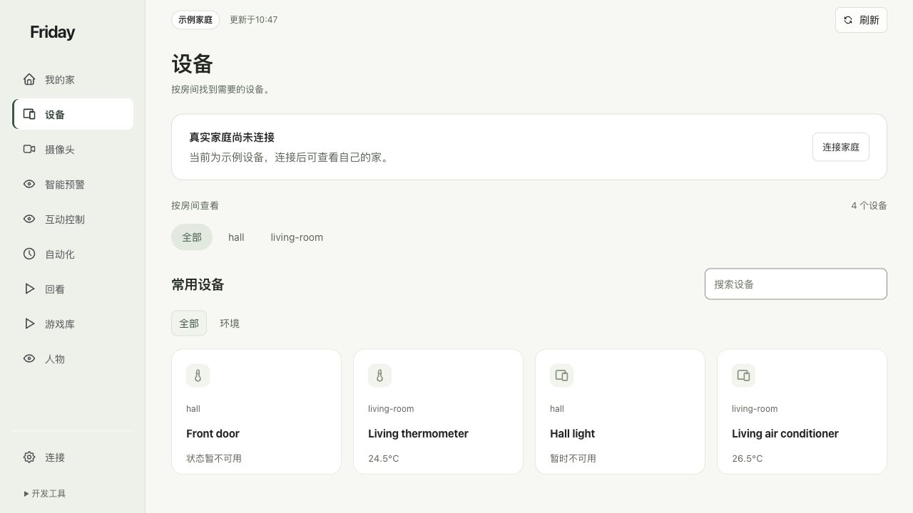

# macOS 从零准备

**本章目的：**在自己的 Mac 准备 Friday 的运行环境，下载程序并打开第一个示例页面。需要在同一台 Mac 新建 HA 时，再准备后半章的 Linux 容器环境。

## 为什么需要这些工具

Friday 的源码需要 Python 和依赖包才能运行。HA Container 则需要 Linux 容器主机，所以 Mac 的基础 Web 与 HA 容器环境分两段准备。

| 组件 | 本章用它做什么 | 你为什么需要 |
| --- | --- | --- |
| Command Line Tools、Git | 提供源码下载工具；后续原生构建也会使用编译工具 | 取得指定版本的 Friday |
| uv、Python | 为 Friday 创建独立运行环境并安装依赖 | 让 Web 服务能在自己的 Mac 启动 |
| Colima、Lima | 在 Mac 运行 Linux 虚拟机 | 仅在这台 Mac 新建 HA Container 时使用 |
| Docker 客户端、Compose | 管理虚拟机中的 HA 容器及其配置 | 创建并维护这套 HA 服务 |

**完成标志：**浏览器可打开 Friday，并看到明确标记的“示例家庭”；选择本机新建 HA 时，Docker 服务端也应可用。

**可以跳过什么：**已有可用 HA 的读者只需完成基础 Web，跳过本章的容器安装，转到[HA 与小米接入](installation-home-assistant.md)。已有 Friday 服务可直接看[第一次打开](quick-start.md)。

## 1. 查看电脑并打开终端

点击苹果菜单 →“关于本机”，记录系统版本和芯片。在“应用程序 → 实用工具”打开“终端”，输入：

```sh
sw_vers -productVersion
uname -m
```

**应看到：**系统版本及 `arm64`（Apple 芯片）或 `x86_64`（Intel）。下载软件时选择对应架构。

## 2. 准备 Git 和命令行工具

```sh
xcode-select --install
```

在 Apple 的窗口完成安装。提示已经安装时，继续检查：

```sh
xcode-select -p
git --version
```

**应看到：**开发工具目录和 Git 版本。工具还在下载时，等安装完成再继续。[Apple 开发工具说明](https://developer.apple.com/xcode/resources/)

## 3. 安装 uv，再准备 Python

uv 负责下载 Python 和管理项目环境。先下载官方安装器，再运行：

```sh
curl -fLsS https://astral.sh/uv/0.13.6/install.sh -o /tmp/friday-install-uv.sh
sh /tmp/friday-install-uv.sh
export PATH="$HOME/.local/bin:$PATH"
uv --version
uv python install 3.12
uv python find 3.12
```

**应看到：**uv 版本和 Python 3.12 的路径。无需先升级系统自带 Python，也不使用 `sudo pip install`。[uv 官方安装说明](https://docs.astral.sh/uv/getting-started/installation/)

若重开终端后找不到 uv，用 `nano ~/.zshrc` 将下一行加入自己的配置；保存按 Control+O、回车，退出按 Control+X，再打开新终端：

```sh
export PATH="$HOME/.local/bin:$PATH"
```

使用其他 shell 时按安装器显示的对应提示处理。

## 4. 下载 Friday 并安装基础环境

```sh
mkdir -p "$HOME/friday-home"
git clone https://github.com/Geeprox/Friday.git "$HOME/friday-home/Friday"
cd "$HOME/friday-home/Friday"
git switch --detach b069e20584e4d68f4a7fb9b3731a2f35fc87d29e
UV_PYTHON=3.12 ./scripts/install-home.sh
./bin/home doctor
```

**应看到：**依赖安装完成，doctor 返回状态信息，基础模式为 `simulator`。ARL、摄像头等可选能力未就绪，不阻止运行示例。`detached HEAD` 表示使用选定提交，不是安装失败。

已有同名目录时不要重复 clone 或删除 `data/`，先看[维护章节](installation-maintenance.md)。

## 5. 打开示例

```sh
cd "$HOME/friday-home/Friday"
./bin/home serve
```

保持终端运行，在同一台 Mac 打开 [Friday](http://127.0.0.1:8740/)。**应看到：**“示例家庭”和产品菜单。按 Control+C 停止前台服务；停止后网页暂时打不开属于正常现象。



只体验页面可到这里结束，继续[第一次打开](quick-start.md)。已有 HA 可直接进入[家庭接入](installation-home-assistant.md)。

## 6. 没有 HA 时，准备 Linux 容器环境

HA Container 使用 Linux Docker Engine。Mac 通过 Colima / Lima 提供 Linux 虚拟机，Docker 客户端负责向里面发送命令。[Colima 官方说明](https://github.com/abiosoft/colima/tree/v0.10.3)

先执行 `command -v brew`。没有结果时，按 [Homebrew 官网](https://brew.sh/)安装，也可下载官方脚本后运行：

```sh
curl -fLsS https://raw.githubusercontent.com/Homebrew/install/HEAD/install.sh -o /tmp/friday-install-brew.sh
/bin/bash /tmp/friday-install-brew.sh
```

按安装器末尾的 **Next steps** 设置环境，再打开新终端执行 `brew --version`。官网当前支持 macOS 15 及更新版本；较旧系统可按 [Colima 的其他安装方式](https://github.com/abiosoft/colima/blob/v0.10.3/docs/INSTALL.md)选择匹配发行包，或复用已有 / [Linux HA 主机](installation-linux.md)。基础 Friday 不依赖 Homebrew。

在 Homebrew 支持的系统上执行：

```sh
brew install colima docker docker-compose
colima version
docker --version
docker-compose version
```

**应看到：**三个工具的版本。这一步尚未安装 HA 或完成账号接入。

## 7. 让 Docker 找到 Compose

若 `docker compose version` 已有结果，跳过本步；否则注册已安装的插件：

```sh
mkdir -p "$HOME/.docker/cli-plugins"
if [ ! -e "$HOME/.docker/cli-plugins/docker-compose" ]; then
  ln -s "$(command -v docker-compose)" "$HOME/.docker/cli-plugins/docker-compose"
fi
docker compose version
```

**应看到：**Compose 版本。若设置过 `DOCKER_CONFIG`，插件应放到该目录下的 `cli-plugins`，保留已有插件。[Homebrew Compose 说明](https://formulae.brew.sh/formula/docker-compose)

## 8. 创建专用虚拟机并检查 Docker

```sh
colima start --profile friday-home --runtime docker --cpus 2 --memory 4 --disk 32 --mount "$HOME/friday-home:w"
colima status --profile friday-home
docker context show
docker info
```

**应看到：**虚拟机运行，Docker 返回服务端信息。2 核、4 GiB 内存、32 GiB 虚拟磁盘是示例分配，可按负载调整，不是整机最低配置。可写挂载用于保存 HA 数据。

有其他 Docker / Colima 实例时，核对当前 context 对应本教程的 `friday-home` 再操作。保持虚拟机运行，继续[安装 HA 与小米接入](installation-home-assistant.md)。

## 9. 常见安装问题

| 现象 | 下一步 |
| --- | --- |
| 找不到 uv | 核对安装器输出、`$HOME/.local/bin` 和当前终端的 PATH |
| 下载中断或证书错误 | 检查系统时间、网络和代理，重试官方源或固定发行包；保留证书校验 |
| Homebrew 不支持当前系统 | 采用 Colima 官方发行方式或已有 / Linux HA；基础 Friday 不依赖 Homebrew |
| `docker info` 失败 | 先启动 Colima，检查 context，再看虚拟机日志和网络 |
| HA 容器已启动，Mac 的 8123 仍打不开 | 按 [Mac 端口转发](installation-home-assistant.md#mac-的-8123-打不开时)处理 |
| 8740 已占用 | 先确认是否已有 Friday；并行示例可用 `./bin/home serve --port 8741`，正式连接另核对回调地址 |

**完成标准：**Friday 示例可打开；新建 HA 时，Colima 与 Docker 服务端也可用。摄像头另按[可选章节](installation-camera.md)准备。
