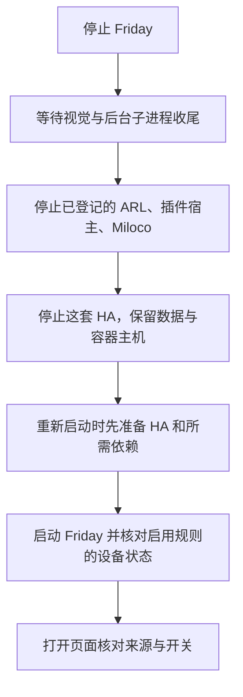
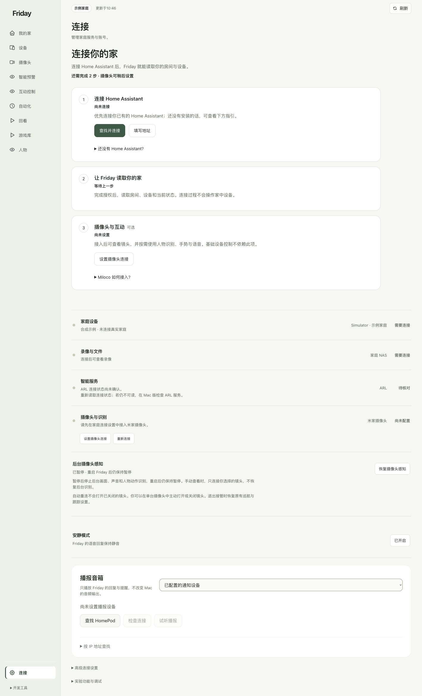

# 启动、备份与安装排障

**本章目的：**让首次安装好的环境能够持续使用：你会知道怎样启动、正常停止、重新检查、备份，并在出错时找到对应环节。

## 为什么安装后还需要维护步骤

Friday、HA、Miloco 等组件分别运行，也分别保存账号连接、家庭配置和规则。关闭终端、电脑重启或升级软件后，需要逐项确认服务和状态；提前保存配置与版本信息，才能恢复自己的设置。

本章把日常操作和安装排障放在一起，帮助你判断当前应启动哪个服务、保留哪些数据，以及应向维护者提供什么信息。

**适用与跳过：**所有已完成安装的读者都应了解启动与备份。没有安装 Miloco、OpenClaw、摄像头或回看功能时，跳过对应小节。Friday 尚未安装成功时，先返回自己的 [macOS](installation-macos.md)或 [Linux](installation-linux.md)章节。

**完成标志：**你能重新打开正确的服务、确认真实家庭来源和暂停状态，知道备份位置，并能按症状定位下一步。操作前先确认正在管理自己的哪台电脑、哪套服务。

## 1. 日常启动与停止

你可以选择部署时已经配好的整套入口，或为基础源码安装准备通用脚本。**先确认脚本管理哪些服务，再执行。** 停止服务会让网页暂时不可用，但会保留账号连接、规则、模型和家庭数据。

重启会恢复原部署中已启用的后台和规则。暂时不希望手势触发设备时，先在 Friday“互动控制”暂停互动，再停止服务；脚本会保留这个暂停设置。

### 已有整套部署脚本：直接使用

如果部署人员已经为你的电脑准备了脚本及 `services.local.json`，在这份交付目录中操作。需要停止时执行：

```sh
./stop-friday.sh
```

需要重新启动时执行：

```sh
./restart-friday.sh
```

macOS 交付包也可提供“优雅停止.command”“重新启动.command”：在 Finder 双击对应文件即可。保留同目录的管理程序、辅助程序和配置文件；这些入口使用的是同一份配置。

**不需要重新初始化、重新安装依赖或逐台设备登录。** 已配置的视觉、ARL、Miloco、插件宿主等组件，只有被登记在这份部署配置里，才会由脚本管理。换电脑、移动运行环境或重建 HA 容器后，先核对配置中的路径和服务归属。

### 基础源码安装：先准备通用脚本

适用于已按本手册安装好 Friday 的 macOS / Linux 用户。下载版默认管理基础 Web；初始化时可以加上**本教程创建的 HA 容器**。它不自动装配摄像头、ARL 或 Miloco；完整部署应使用上一节对应的专属配置。

下载文件：[管理程序](../assets/scripts/friday-services.py)、[停止脚本](../assets/scripts/stop-friday.sh)、[重启脚本](../assets/scripts/restart-friday.sh)、[文件校验清单](../assets/scripts/SHA256SUMS)。也可在终端下载到自己的目录：

```sh
mkdir -p "$HOME/friday-home/service-tools"
cd "$HOME/friday-home/service-tools"
friday_script_url="https://lijunfeng722.github.io/friday-user-guide/assets/scripts"
for friday_script_file in friday-services.py stop-friday.sh restart-friday.sh SHA256SUMS; do
  curl -fL "$friday_script_url/$friday_script_file" -o "$friday_script_file"
done
```

核对下载是否完整。macOS 执行：

```sh
shasum -a 256 -c SHA256SUMS
```

Linux 执行：

```sh
sha256sum -c SHA256SUMS
```

**应看到：**三个脚本均为 `OK`。校验失败时先重新下载，不继续执行。然后赋予执行权限：

```sh
chmod +x stop-friday.sh restart-friday.sh
```

接下来**选择一种**初始化方式。此步只保存本机服务清单，不启动或停止服务；已有 `services.local.json` 时拒绝覆盖。

只管理 Friday Web：

```sh
"$HOME/friday-home/Friday/.venv/bin/python" friday-services.py init \
  --project "$HOME/friday-home/Friday" --config "$PWD/services.local.json"
```

同时管理本教程创建且已经运行过的 HA 容器，macOS 或不需要 sudo 的 Docker 用户执行：

```sh
"$HOME/friday-home/Friday/.venv/bin/python" friday-services.py init \
  --project "$HOME/friday-home/Friday" --with-ha --config "$PWD/services.local.json"
```

Linux 按本手册使用 sudo 管理 Docker 时，改用：

```sh
sudo -v
"$HOME/friday-home/Friday/.venv/bin/python" friday-services.py init \
  --project "$HOME/friday-home/Friday" --with-ha --docker-sudo --config "$PWD/services.local.json"
```

`--with-ha` 通过本教程的 Compose 配置查找唯一的既有 HA 容器，记录其标识；不会新建 HA，也不管理其他家庭的 HA。使用其他安装方式或远程 HA 时，选只管理 Web，并按原服务的维护方式管理 HA。

**应看到：**`configuration / created_no_service_started`，本目录生成仅自己可读的 `services.local.json`。这份配置属于你的电脑，不上传公开仓库。初始化失败时，先确认 Friday 的 `.venv` 存在、Docker 服务端可用，以及自己的 HA 已经按前章启动。

### 每天怎样停止和重新启动

在脚本目录执行。若使用 `--docker-sudo`，先运行 `sudo -v`；macOS 的 HA 位于 Colima 时，先确认专用实例运行、当前 Docker 连接仍指向该实例，必要时执行 `colima start --profile friday-home`。

先预览将管理的服务，不实际停止：

```sh
FRIDAY_PYTHON="$HOME/friday-home/Friday/.venv/bin/python" ./restart-friday.sh --dry-run
```

需要停止时：

```sh
FRIDAY_PYTHON="$HOME/friday-home/Friday/.venv/bin/python" ./stop-friday.sh
```

需要重新启动时：

```sh
FRIDAY_PYTHON="$HOME/friday-home/Friday/.venv/bin/python" ./restart-friday.sh
```

完整部署的专属入口也遵循同样的顺序：按配置顺序启动，倒序停止。例如：



| 输出 | 你应怎样理解 |
| --- | --- |
| `would_stop` / `would_start` | 预览计划，没有改变服务 |
| `would_prepare` | 重新启动前会先确认已登记的容器主机可用 |
| `stopping` / `waiting` | 正在等待正常退出或启动，保持终端运行 |
| `stopped` | 这一项已完成停止检查 |
| `ready` / `already_running` | 这一项的进程或服务及配置的就绪检查已通过 |
| `kept_running` | 明确保留的容器主机等依赖继续运行 |
| `deployment / stop_complete` | 本次配置中需要停止的服务均已完成检查 |
| `deployment / restart_complete` | 本次配置中的启动顺序与就绪检查已完成 |
| `deployment / failed:…` | 没有完成；按后面的错误说明处理 |

管理程序向归属核对通过的 Friday 进程请求正常退出，等待已记录的子进程收尾；HA 使用不自动升级为强制结束的停止请求。退出超时或摄像头恢复检查未通过时，脚本报错，保留尚未关闭的依赖，也不会继续启动下一轮。Miloco 等外部服务仍由对应官方维护命令执行停止，遵循其自身的退出策略。[Docker 停止行为说明](https://docs.docker.com/reference/cli/docker/container/stop/)

**完成标志：**先看最终的 `stop_complete` 或 `restart_complete`。重启后再打开 [Friday](http://127.0.0.1:8740/)，按第 3 节检查自己的家庭来源、开关和画面。`ready` 表示配置的服务检查通过，不等于手势准确率、设备实际动作或摄像头画面已经完成现场验收。

新版初始化生成的配置会额外检查：当前启用的手势规则所绑定的设备，是否仍在允许控制范围内，且有正常、未过期的设备状态。设备仅出现在列表里不能通过这项检查；HA 返回“不可用”时，会继续等待，超时后报告未就绪。已经暂停的互动会保留暂停状态。完整部署维护者也应在 Friday 的 `ready` 配置中启用 `verify_saved_gestures: true`。

基础源码默认入口仍可能打开“示例家庭”。这时到“连接”读取已授权家庭；脚本保留数据，但不会把基础示例入口替换为完整视觉部署入口。



### 脚本报错时怎么办

| 错误片段 | 处理方法 |
| --- | --- |
| `config_already_exists` | 已有配置不会被覆盖；直接使用原配置，不反复初始化 |
| `pid_identity_mismatch` / `service_pid_identity_mismatch` | PID 记录与预期服务不符；先查看状态，请维护者核对，不随意结束进程 |
| `port_in_use` / `port_still_in_use` | 同一端口还有服务；若原来在另一个终端前台启动，回到原终端按 Control+C，再使用本套入口 |
| `descendants_still_running` / `cleanup_pending` | 收尾或恢复尚未完成；保留依赖，等待后重试停止；不要跳到重新启动 |
| `status_unavailable` / `command_timeout` | 检查 Docker 连接、sudo 有效期、对应服务和本机私有日志，不把状态未知当作已停止 |
| `start_not_ready` / `not_ready` | 查看绑定设备在 HA 中是否为“不可用”，按第 3 节恢复集成连接后再核对；服务进程存在并不代表设备可用 |
| `executable_missing` / `cwd_missing` | 原运行环境被移动或缺失；核对路径和所用 Python，不重建一套空环境替代 |
| `another_lifecycle_command_is_running` | 另一条启停命令仍在执行；等待结束，不同时双击多份脚本 |

查看当前服务状态：

```sh
"$HOME/friday-home/Friday/.venv/bin/python" friday-services.py status --config "$PWD/services.local.json"
```

完整部署的 macOS 交付包可直接使用“查看服务状态.command”。状态页可能显示某些项目已停、某些仍运行；失败后的实际状态以逐项输出为准。

### 尚未使用管理脚本时

基础 Web 仍可在安装目录前台启动 `./bin/home serve`，回到该终端按 Control+C 停止。第一次改用管理脚本前，先停止原前台服务；脚本不会凭端口接管已有进程。

HA 仍可使用原 Compose 参数执行 `stop`，并保留数据。Docker / Colima 宿主默认不由通用停止脚本关闭；若它还承载其他容器，按那些服务自己的维护要求处理。安装依赖不等于配置了开机自启动。

Miloco / OpenClaw 可能使用各自的后台服务。检查：

```sh
miloco-cli service status
openclaw gateway status
```

它们启动成功不代表 Friday 也已经启动。未登记到服务清单的组件继续使用自己的正式维护入口。

## 2. 记住几个入口

| 地址 / 位置 | 含义 |
| --- | --- |
| `http://127.0.0.1:8740/` | 当前电脑上的 Friday，或已建立转发的 Linux 服务 |
| `http://127.0.0.1:8123/` | 当前电脑可访问的 HA 入口 |
| `http://127.0.0.1:1810/` | Miloco 默认本机页面，以实际安装输出为准 |
| Friday 的“查看识别” | 通过已配置入口查看视觉预览，不需要公开查看密钥 |

手机、浏览器电脑、Linux 服务器和虚拟机各自有自己的 127.0.0.1。更换电脑访问时先配置相应入口或转发，不把同一地址当成自动共享。

## 3. 重启后检查什么

1. 依次确认容器主机、HA、需要的 Miloco 和 Friday 是否运行。
2. 看 Friday 顶部是“示例家庭”还是自己的真实来源。
3. 基础源码入口可能从示例启动，已有授权时重新读取家庭；不要因为来源未激活就删除账号。
4. 核对目标设备状态、控制范围、摄像头感知与手势总开关。
5. 验证部署版本提供的恢复机制后，再安排自启动。

用户手册里的截图或一次历史动作成功，不代表当前重启后的全部设备已经验收。

### 重启后有手势记录，设备却没动

如果“最近的手势响应”已有记录，却显示“操作未完成”，先检查该设备在 HA 中是否为“不可用”。这时规则可能已经识别到动作，但设备状态不满足执行条件，Friday 会拒绝发送指令；重新添加规则不能恢复上游设备连接。

1. 打开 HA，在目标设备页确认当前状态。
2. 小米设备集中变为“不可用”时，检查 HA 的 Xiaomi Home 集成连接与系统日志。
3. 网络恢复后，可在 HA“设置 → 设备与服务 → Xiaomi Home”的菜单中重新加载原集成。这会重新连接现有集成，账号和设备选择仍沿用原配置。[HA 官方重新加载说明](https://www.home-assistant.io/actions/homeassistant.reload_config_entry/)
4. 等绑定设备恢复正常状态，再回到 Friday 刷新，做一次已配置的动作，同时核对页面回执和设备实际效果。

重新加载后仍不可用，继续检查 HA 所在主机访问小米服务的网络，以及集成是否明确提示重新认证。保留现有规则和授权，不把反复重建家庭当作排障方法。

### 脚本已验证的范围

2026-10-31 已核对：macOS 实际完整部署的正常停止、重复停止、重新启动和配置保留；通用基础源码入口的初始化、运行中重启及停止；macOS 与隔离 Linux 环境各 15 项进程和错误路径检查。隔离检查包括端口冲突、PID 不符、退出超时、子进程收尾、并发执行、容器主机准备顺序，以及绑定设备不可用、状态过期或控制范围缺失时不能被判为就绪。

现场曾出现“HA 页面可访问、设备列表存在，但小米设备状态不可用”的情况；重新加载原 Xiaomi Home 集成后恢复，由使用者再次完成手势与窗帘实体验收。因此新增了绑定设备状态检查，进程检查与配置保留不再作为互动可用的全部依据。

Linux 检查使用临时容器与合成服务，不代表全新 Linux 系统、所有 HA 安装方式或 Linux 本地视觉已经验收。通用脚本也不替你创建、迁移或重新授权外部服务。

## 4. 备份自己的配置与数据

备份前先停止对应写入服务：Friday 正常退出，HA 使用 Compose `stop`；Miloco、OpenClaw 按各自官方维护方式停止或做一致性备份。不要把运行中的数据库直接当作可靠备份。

在个人备份目录保存 Friday 的 `data/`：

```sh
mkdir -p "$HOME/friday-home/backups"
friday_backup="$HOME/friday-home/backups/friday-data-$(date +%Y%m%d-%H%M%S).tgz"
umask 077
```

macOS：

```sh
tar -czf "$friday_backup" -C "$HOME/friday-home/Friday" data
chmod 600 "$friday_backup"
```

Linux：HA 配置可能由容器账号拥有，需要权限读取时使用：

```sh
sudo tar -czf "$friday_backup" -C "$HOME/friday-home/Friday" data
sudo chown "$(id -u):$(id -g)" "$friday_backup"
chmod 600 "$friday_backup"
```

**应看到：**备份文件成功生成，没有读取失败。`data/` 可能包含账号授权、HA 配置、规则、模型和视觉运行环境，文件可能较大，保存在自己的私有备份位置，不上传到文档仓库。Miloco / OpenClaw 安装器使用的外部状态目录另按其官方说明备份。

还需记录源码提交、依赖锁文件、所用 extras、模型来源与摘要、启动入口及路径。恢复时先保留当前数据，在停止状态下核对备份和版本，再恢复；不把覆盖正在运行的目录当作恢复步骤。

## 5. 更新时保留哪些环境

| 环境 | 日常确认方式 | 更新时注意 |
| --- | --- | --- |
| Web `.venv` | `.venv/bin/python --version` | 使用对应 `uv.lock` 和原先选择的 extras |
| 视觉 `data/embodied/runtime` | 使用该目录自己的 Python | SDK、模型和原生程序单独核对 |
| Miloco 安装环境 | 安装器及 `miloco-cli service status` | 不用 Friday 的 uv sync 替它升级 |
| 可选 ARL | 按自己的 ARL 部署说明检查 | 本地额外安装的 SDK 不一定在 Friday 锁文件中 |

更新前运行 `git status --short` 和 `git rev-parse HEAD`，备份后选择目标版本再切换。不要用清理源码目录的命令清掉私有数据。`uv sync` 会按选择的依赖集合同步环境；重新安装时保留所需 extras，并重新核对另外安装的 SDK。

## 6. 可选：准备保护回看的媒体工具

macOS 在 Homebrew 支持的系统上执行 `brew install ffmpeg`；Ubuntu / Debian 执行 `sudo apt-get install ffmpeg`。然后检查：

```sh
ffmpeg -version
ffprobe -version
```

**应看到：**两项都有版本输出。只有 PyAV 不代表所有录像检查工具都已齐全。后台或桌面进程需要能定位受信的媒体程序；终端的 PATH 与桌面启动环境可能不同，应在所用部署入口配置工具路径。

再安装所需依赖，并保留此前已经使用的 extras：

```sh
cd "$HOME/friday-home/Friday"
uv sync --locked --python 3.12 --no-dev --extra nas-connection --extra privacy-playback --extra privacy-model
```

上面的命令展示回看所需集合；若同一 Web 环境还需要其他 extras，一并写在这次同步命令中。之后配置自己的 NAS 或录像来源，按[保护录像回看](../guides/recordings.md)验证。模型权重和真实录像来源不由此命令自动生成。

## 7. 按症状排查安装

| 现象 | 先检查 |
| --- | --- |
| 命令找不到 | 当前终端 PATH、工具是否安装、是否进入正确目录 |
| Python 版本不符 | 使用 `.venv/bin/python` 或指定的 uv Python，不看另一个环境的版本 |
| 下载 / 镜像拉取失败 | 包源、证书、系统时间；Mac 还需检查虚拟机内的 DNS 和代理 |
| HA 容器运行但网页打不开 | 8123、端口转发、容器日志及正确 Docker context |
| 小米确认授权后出错 | 浏览器电脑能否通过回调主机名访问正确 HA，见[回调处理](installation-home-assistant.md#小米确认授权后返回失败) |
| HA 有设备，Friday 仍是示例 | Friday 当前来源是否已连接并读取；HA 登录与来源激活分别检查 |
| 设备可见但无可选动作 | 首次控制范围、目标实体能力和已有范围是否暂停 |
| Miloco 有视频，Friday 尚未配置 | 独立视觉 Python、SDK、原生程序、模型、私有注册和后台入口 |
| 查看识别点不开 | 查看地址、服务监听、私有查看配置与部署版本是否匹配 |
| 画面或骨架可见但规则不触发 | 保存卡片、目标、使用范围、总开关、操作者与识别条件 |
| 重启后又未配置 | 运行目录是否一致，是否用了不同的 Python 或启动入口 |
| ffprobe 在终端可用但回看报错 | Friday 实际进程的工具定位和文件权限 |

## 8. 给维护者提供什么

提供系统与芯片、源码提交、工具版本、出错阶段、错误码，以及不含私人信息的界面状态。诊断导出使用产品提供的脱敏入口，并先在本机检查内容。

密码、Token、授权码、完整查看链接、家庭导出和原始视频不放进聊天或公开 issue。可继续查[常见问题](../troubleshooting/faq.md)或[按现象排查](../troubleshooting/common-errors.md)。
