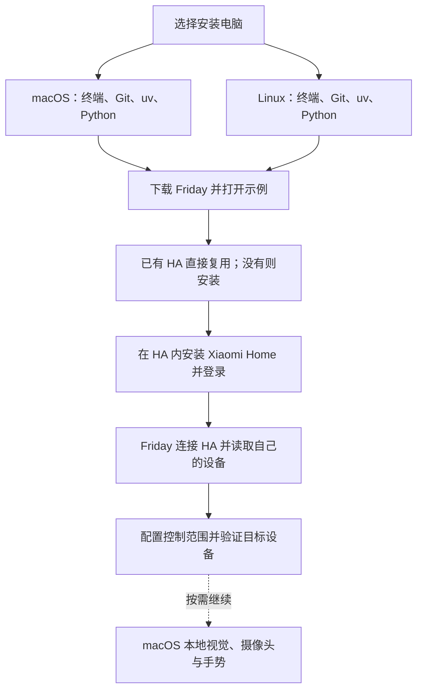
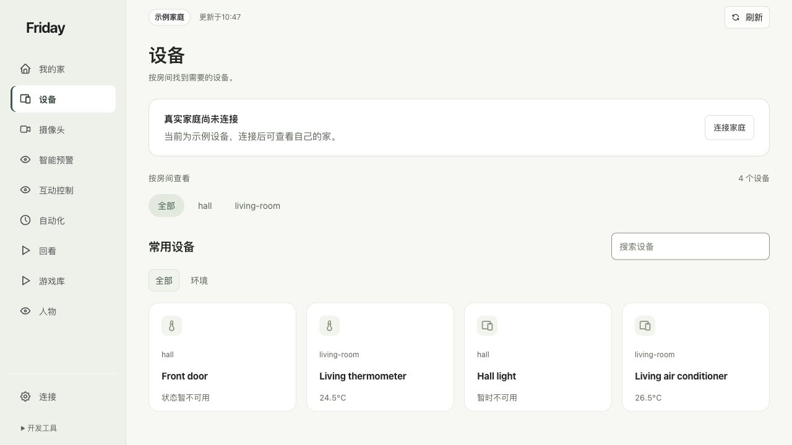

# 从零开始安装 Friday

**本章目的：**帮你选好安装路线，知道接下来要准备哪些软件，以及每一步完成后能做什么。即使电脑还没有 Python、uv、Docker 或 Home Assistant，也可以从这里开始。

**为什么先看安装路线：**Friday 提供日常使用的家庭界面，真实设备由接入服务提供，摄像头与识别还需要另一组组件。先按自己的目标选择，才能分阶段得到可用结果：先打开示例，再连接设备，最后按需要增加摄像头和互动。

**读完后：**你应能选定 macOS 或 Linux 路线，分清基础安装、真实家庭接入和可选功能，并知道各阶段的验收标准。

已经能打开 Friday 的读者，可直接进入[第一次打开](quick-start.md)；已有运行环境且准备接设备的读者，可进入[连接自己的家](connect-home.md)。

## 1. 选择你要完成的目标

| 你的目标 | 需要完成的章节 | 完成标志 |
| --- | --- | --- |
| 先体验页面 | 选择 macOS 或 Linux 章节，完成基础安装 | 8740 页面显示“示例家庭” |
| 查看自己的设备 | 基础安装 → HA 与小米接入 → Friday 连接 | 显示自己的房间、设备和实际状态 |
| 操作灯、窗帘等 | 设备接入 → 首次配置控制范围 | 目标控件可用，现场确认动作 |
| 使用摄像头手势 | 上述步骤 → 摄像头与识别准备 → 手势教程 | 画面与关键点可见，规则有响应且设备实际执行 |

**安装路线：**[macOS 从零准备](installation-macos.md) · [Linux 从零准备](installation-linux.md) → [HA 与小米接入](installation-home-assistant.md) → [可选摄像头与识别](installation-camera.md) → [启动、备份与排障](installation-maintenance.md)。

## 2. 先看平台差异

| 能力 | macOS | Linux |
| --- | --- | --- |
| Friday Web、示例、HA 设备接入 | 本机 Python 环境 | 本机 Python；本文详述 Ubuntu / Debian |
| 同机运行 HA Container | 先建立 Linux 虚拟机；本文使用 Colima | 直接使用 Linux Docker Engine |
| 连接其他主机的 HA | 填写 Friday 主机可访问的地址 | 填写 Friday 主机可访问的地址 |
| Miloco | 按发行包支持的系统与芯片选择 | 按发行包支持的系统与芯片选择 |
| 当前原生人体、手部识别 | 需要 Apple Vision、兼容 SDK 与编译工具 | 当前这套原生入口不能直接运行，没有等价的 Linux 安装命令 |
| 保护录像回看 | 另装媒体工具并配置录像来源 | 另装媒体工具并配置录像来源 |

不要把 Miloco 的平台支持范围理解为 Friday 的 Apple Vision 程序也支持这些平台。Intel Mac、Apple Silicon、Linux x86_64 和 Linux ARM64 的二进制包不能混用。

## 3. 安装前准备

准备可下载 GitHub 源码、Python 软件包和容器镜像的网络，以及保存项目和数据的磁盘空间。安装系统软件时可能需要自己的管理员密码，它只填写在系统提示中。

接真实设备需要已正常使用的小米账号和设备；接摄像头前，先确认米家或对应官方应用能正常查看它。只体验示例时可暂不准备账号和硬件。

本文把项目放在 `$HOME/friday-home/Friday`。`$HOME` 会展开为你自己的主目录，不需要替换成作者电脑的路径。`cd` 用来进入目录；以 `#` 开头的行是说明，不用输入命令提示符 `$`。

先完成一组命令，核对“应看到什么”，再进入下一步。报错时保留错误文字，按对应章节处理，再继续。

## 4. 各工具分别负责什么

| 名称 | 用途 | 何时需要 |
| --- | --- | --- |
| Git | 下载、记录源码版本 | 基础安装 |
| uv、Python | 准备项目独立运行环境 | 基础安装 |
| Docker Engine、Compose | 运行 HA 容器和读取容器配置 | 新建 HA |
| Colima、Lima | 在 Mac 提供 Linux 容器主机 | Mac 单机运行 HA |
| Home Assistant（HA） | 独立的家庭设备接入平台，管理房间、设备、状态和服务，供 Friday 连接 | 接入自己的家庭；已有 HA 可以复用 |
| [Xiaomi Home 集成（ha_xiaomi_home）](https://github.com/XiaoMi/ha_xiaomi_home) | 安装在 HA 内，让 HA 登录小米账号并接入受支持的小米设备 | 通过 HA 接入小米设备 |
| [Miloco（xiaomi-miloco）](https://github.com/XiaoMi/xiaomi-miloco) | 独立的小米智能家庭项目；本安装方案使用其账号绑定、摄像头与相关智能服务 | 选择 Miloco 摄像头或智能功能方案时 |
| Node.js | OpenClaw 使用的 JavaScript 运行环境 | 选择 OpenClaw 宿主方案时 |
| OpenClaw 或 Hermes | Miloco 插件的宿主平台，按官方指南选择其中一种 | 选择对应 Miloco 插件方案时 |
| 摄像头 SDK、Apple Vision、本地模型 | 视频连接、关键点与本地场景处理 | 兼容的本地识别方案 |
| FFmpeg、ffprobe | 媒体处理与录像信息检查 | 保护回看等媒体能力 |
| ARL、云端模型 | 可选智能任务 | 对应功能单独配置 |

**本手册中的 Xiaomi Home 指 HA 内的 `ha_xiaomi_home` 集成，和 Miloco 是两个不同项目。** 查看家庭设备的接入链路是 **Friday → Home Assistant → Xiaomi Home 集成 → 小米设备**；这条链路无需先安装 Miloco。选择 Miloco 方案时，需要另外安装并在其页面完成账号绑定。HA 中的小米授权与 Miloco 的账号绑定分别保存，一边完成不代表另一边也已完成。

更多分工见[这些程序分别做什么](../explanation/components.md)。

## 5. 版本与下载来源

基础命令按以下公开入口核对，方便安装后定位差异。系统软件采用各厂商支持当前系统的发行方式，安装时记录实际版本。

| 对象 | 本教程基线 / 来源 |
| --- | --- |
| Friday | [公开提交 e1e9c999](https://github.com/Geeprox/Friday/tree/e1e9c9997d0ad45ec75d1c81f3ffa602eac8f5b3)及该提交的 `uv.lock` |
| Python / uv | Python 3.12；示例使用 uv 0.13.6 的[官方安装器](https://docs.astral.sh/uv/getting-started/installation/) |
| HA / Xiaomi Home | 项目准备脚本固定为 HA `2026.10.4`、集成 `v0.4.3` |
| Miloco | [固定发行版 v2026.10.16](https://github.com/XiaoMi/xiaomi-miloco/releases/tag/v2026.10.16)，按平台完整指南安装 |

基础安装不会自动下载摄像头 SDK、模型、ARL，或替你配置设备控制范围。摄像头章节分别说明可执行的准备步骤和仍需匹配部署组件的部分；不会把某台电脑的私有启动器当作通用安装包。

## 6. 每一阶段怎样算完成

1. **示例可用**：明确显示“示例家庭”，能够查看模拟设备。
2. **家庭接入**：HA 和 Friday 都能找到自己的目标设备，按各自统计口径核对数量。
3. **控制可用**：目标动作已开放，页面有回执，并由你观察设备实际执行。
4. **识别可用**：真实画面持续更新、关键点可见；仍要单独验证手势触发。
5. **可以日常使用**：知道如何停止、启动和备份，重启后核对真实来源与暂停状态。

产品截图来自隔离示例，用于说明应核对的界面，不是操作系统安装过程的实机证明。各平台的新机安装、摄像头型号和真实动作按阶段分别验证，详见[验证范围](../TODO.md)。
