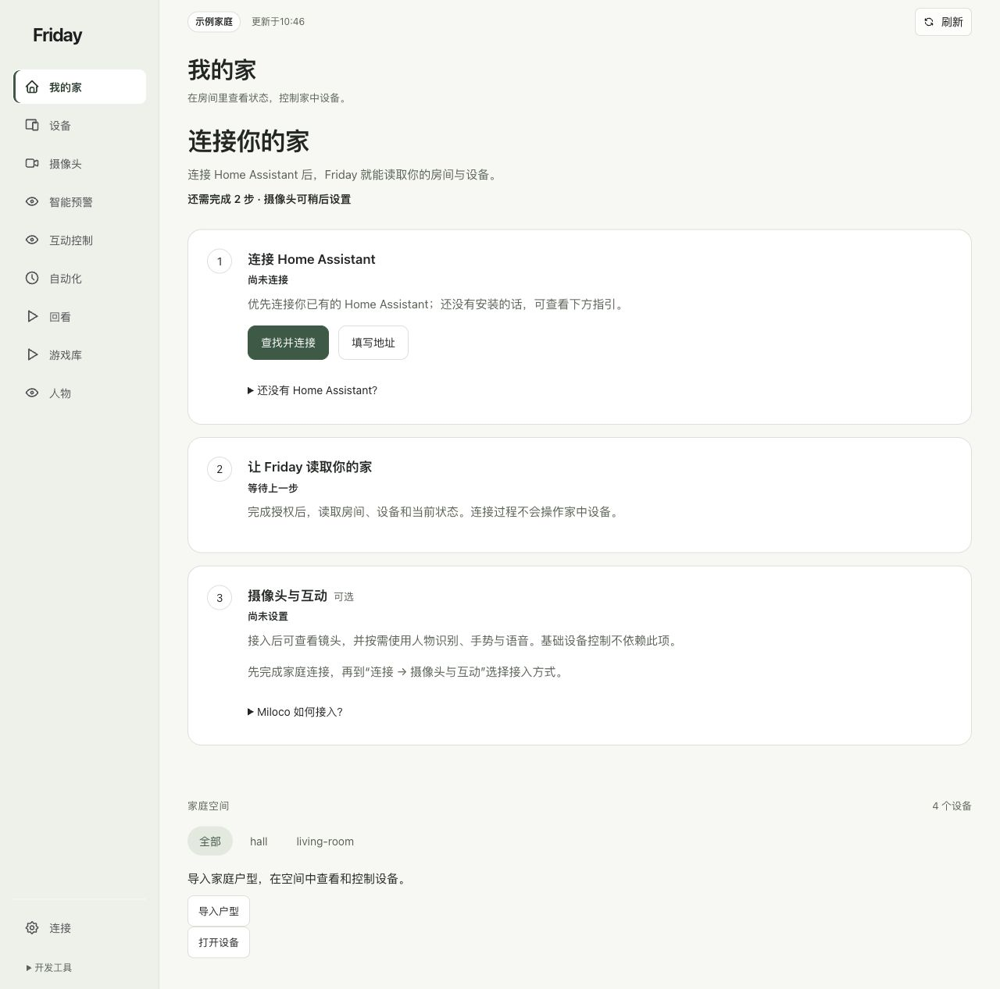

# 第一次打开 Friday

完成后，你能确认自己打开了正确的服务、看懂设备来源，并找到日常操作入口。

**开始前：**Friday 已经安装并启动。全新电脑先按[从零安装](installation.md)选择 macOS 或 Linux 路线，再回到本节。

## 1. 打开本机页面

在部署 Friday 的电脑上打开 [Friday 本地控制台](http://127.0.0.1:8740/)。网页打不开时，先按[启动与维护](installation-maintenance.md)运行服务，再刷新页面。Linux 远程部署先建立对应的 SSH 转发。

`127.0.0.1` 表示“当前这台电脑”。把它复制到手机上，不会自动访问电脑上的 Friday。

## 2. 看顶部家庭来源

顶部显示“示例家庭”时，先阅读演示，不要把卡片数量当作你家实际设备数量。“家庭已连接 · 只读”可以查看信息；能够操作哪些设备仍由已配置的控制范围决定。

## 3. 打开设备页

点击“设备”，按房间或设备类型筛选。卡片的读数与按钮分别表达状态和可用操作；“暂时不可用”不是“已经关闭”。详见[查看与操作设备](../guides/devices.md)。

## 4. 需要自己的家庭时再连接

打开“连接”，按“连接 Home Assistant → 让 Friday 读取你的家”完成必要步骤。摄像头与互动是可选项，可以稍后配置。

## 5. 确认你已完成

你能够重新打开页面、分清示例与真实来源，并找到设备页，就完成了本节。接下来按[连接自己的家](connect-home.md)或[第一条手势控制](../tutorials/first-gesture.md)继续。

**如果卡住：**网页打不开，先查[启动与连接问题](../troubleshooting/common-errors.md)，不用先删除账号或重装。
