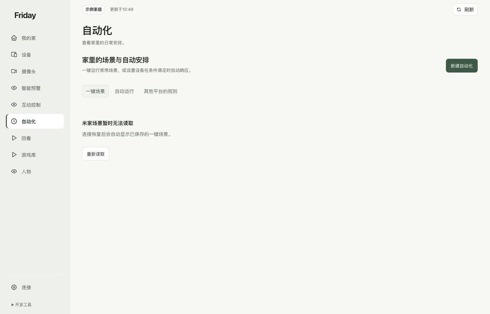
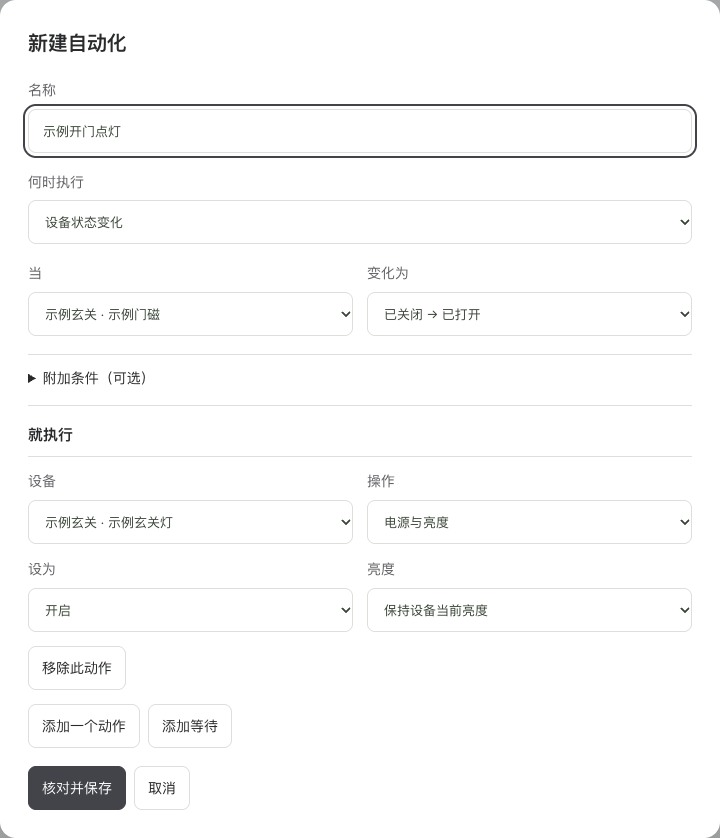
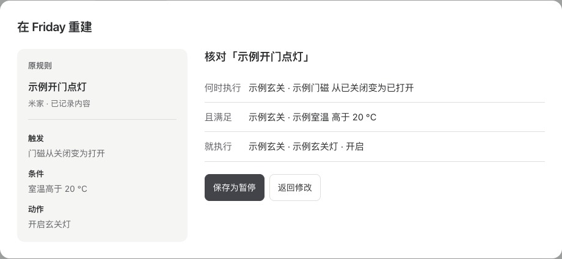

# 管理场景与自动化

先确认规则来源，再决定运行一次、修改 Friday 自有规则，还是回到原平台管理。

## 三个分类

| 分类 | 你能做什么 |
| --- | --- |
| 一键场景 | 读取米家已有手动场景，核对后运行一次 |
| 自动运行 | 查看、暂停、编辑 Friday 自有自动化 |
| 其他平台的规则 | 查看原规则记录，按当前家庭设备重建 |

## 运行米家一键场景

选择场景后，先核对确认框中的名称和涉及设备数量，再决定是否运行。场景按米家保存的内容执行，可能同时操作多个设备。

**米家场景是独立执行入口，其范围与 Friday 设备页已开放的逐台控制范围不同。** 想只操作指定设备时，使用设备页或对应手势规则；不要把场景设备数当作已逐台验证的控制范围。“已发送”后仍要核对现场效果。

## 新建 Friday 自动化

1. 点击“新建自动化”，填写能说明用途的名称。
2. 选择触发设备与状态变化，再添加需要执行的设备动作。
3. 需要时设置附加条件。
4. 点击“核对并保存”，检查预览；确认无误后再“确认保存并启用”。

保存规则与立即操作设备不同，但启用后，后续条件满足就可能执行。已有规则可以“编辑”或暂停；“执行一次”是主动操作入口，不必等触发条件。

## 重建其他平台的自动化

1. 打开「其他平台的规则」，展开要重建的规则，点「在 Friday 重新设置」。
2. 对照「原规则」选择当前家庭的触发设备、条件和动作。只有名称的记录需要回到原应用核对具体设置。
3. 点「核对规则」，检查「何时执行」「且满足」和「就执行」。点「保存为暂停」后，新规则会出现在「自动运行」。
4. 准备切换时，先到米家或极客版暂停原自动化，再回到「自动运行」启用新规则。让一个新的事件满足条件，并核对设备结果。

数值条件可指定传感器、比较方式和数值。例如「室温高于 20 °C」。收到读数不可用的提示时，先检查该传感器的读数，或选择当前可用的读数后再核对。原规则记录更新时，刷新列表并重新打开。
