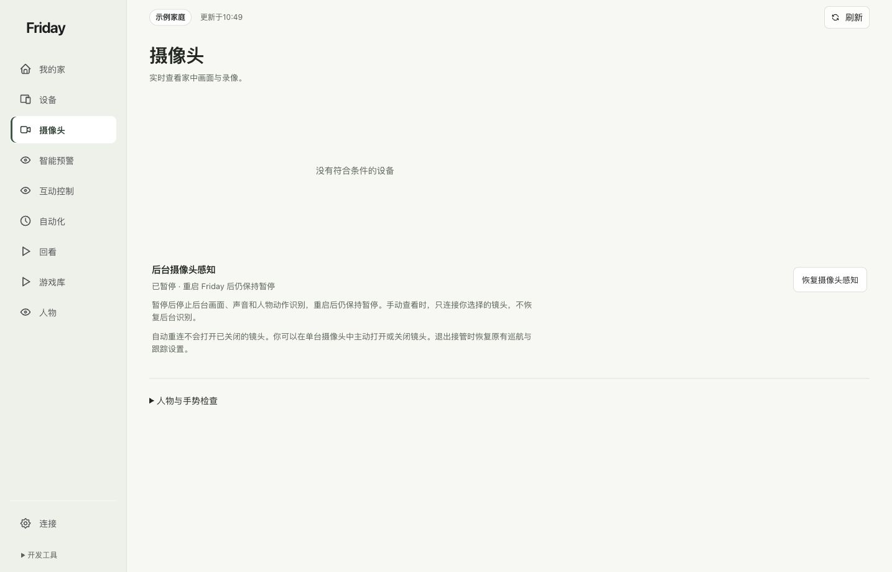
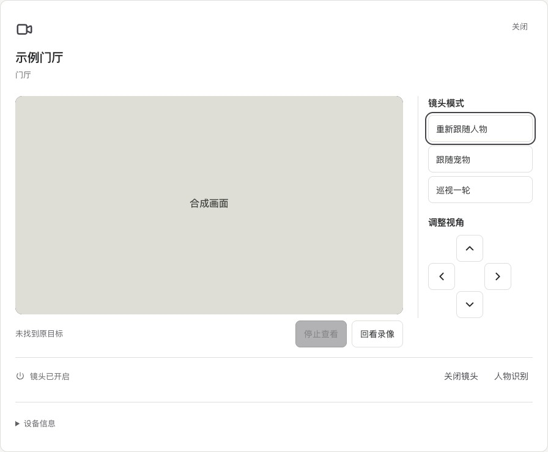
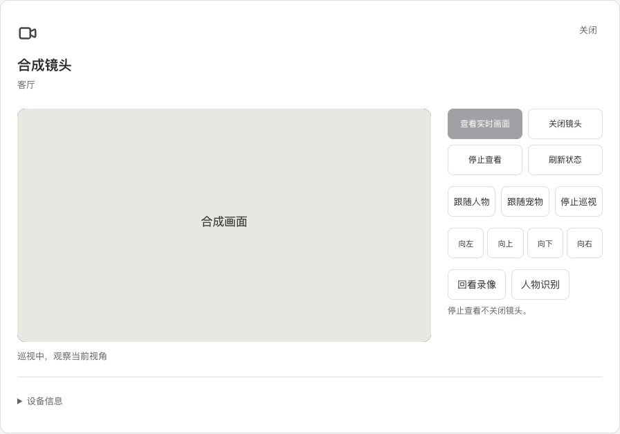
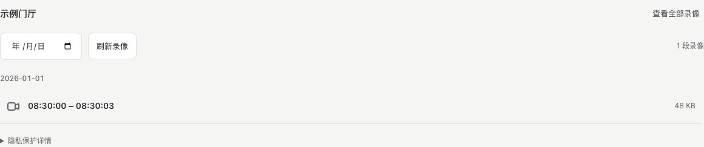

# 查看摄像头与识别

先确认镜头状态，再按需要查看普通画面或人体、手部识别结果。

## 看画面

1. 打开「摄像头」，选择要查看的镜头。
2. 在画面下方点「查看实时画面」。镜头已经关闭时，可以点「打开镜头并查看」。
3. 画面打开后，可用方向键调整视角，或选择跟随人物、跟随宠物和巡视。
4. 在同一位置点「停止查看」即可结束预览。要关闭设备镜头，使用详情底部的「关闭镜头」。

镜头在米家里关闭后，Friday 的自动重连不会替你强行打开它。需要画面时，由你在米家或摄像头的明确开关入口主动打开。

## 看人体与手部识别

展开“人物与手势检查”，在“识别调试”点击“查看识别”。时间应持续更新；骨架或手部提示只表示检测结果，设备有没有执行要去互动页核对。

“电视未连接”只说明没有电视端，不妨碍电脑上的实时查看。位置尚未标定主要影响空间指向和座位，不要求为了普通手势先填一套猜测户型。

## 跟随人物或宠物

查看实时画面后，选「跟随人物」或「跟随宠物」。宠物跟随需要当前镜头支持猫狗识别。

转动后，看到「正在确认原目标」时，等镜头核对新的画面。如果显示「未找到原目标」，让目标回到清楚的视野中，再点「重新跟随人物」或「重新跟随宠物」。多人或多只宠物无法区分时，镜头会等待目标明确。

## 镜头巡视

查看实时画面后，选「巡视一轮」。镜头会依次查看平视和较低的区域，每次转向都要等画面稳定。看到「本轮巡视完成」后，镜头会停留。你也可以在巡视中选择「停止巡视」，画面暂时中断时仍可提交停止。

有人在画面里时，选定的镜头仍按路线巡视。看到「巡视中，观察当前视角」时，镜头正在这一处观察。如果有需要复核的异常，镜头会短暂停留，再根据当前画面继续巡视。

如果视角无法确认或镜头重新连接，页面会显示「本轮巡视未完成」。画面恢复后，可以再巡视一轮。

## 回看这台镜头

点画面下方的「回看录像」进入该镜头的列表。选日期可以缩小范围，点片段开始保护播放。停止回放后会回到列表；点「查看全部录像」可查看其他镜头。

页面提示镜头尚无可用的对应关系时，点「设置录像对应」，为当前镜头选择实际的录像目录。

## 分清三个开关

| 你想暂停什么 | 应在哪里操作 | 仍会发生什么 |
| --- | --- | --- |
| 只停止手势触发设备 | 互动控制 → 暂停手势控制 | 后台识别可以继续 |
| 停止 Friday 后台感知 | 摄像头或连接页 → 暂停摄像头感知 | 暂停状态重启后保留；按需手动查看选定镜头不代表恢复全部后台识别 |
| 让摄像头设备本身关闭镜头 | 米家镜头开关或明确的设备开关 | 以设备自己的录像和镜头设置为准 |

麦克风、语音回复和云台接管有独立配置。接通视频不表示这些功能也已开启。

**如果 Miloco 有画面而 Friday 未配置：**按[摄像头与本地识别准备](../getting-started/installation-camera.md)分别核对 SDK、独立环境、原生程序、模型、私有注册和后台入口。当前原生识别依赖 macOS Apple Vision；Linux 的 Miloco 视频成功不表示同一套手势链路已可运行。

完成后可继续[第一条手势控制](../tutorials/first-gesture.md)。
