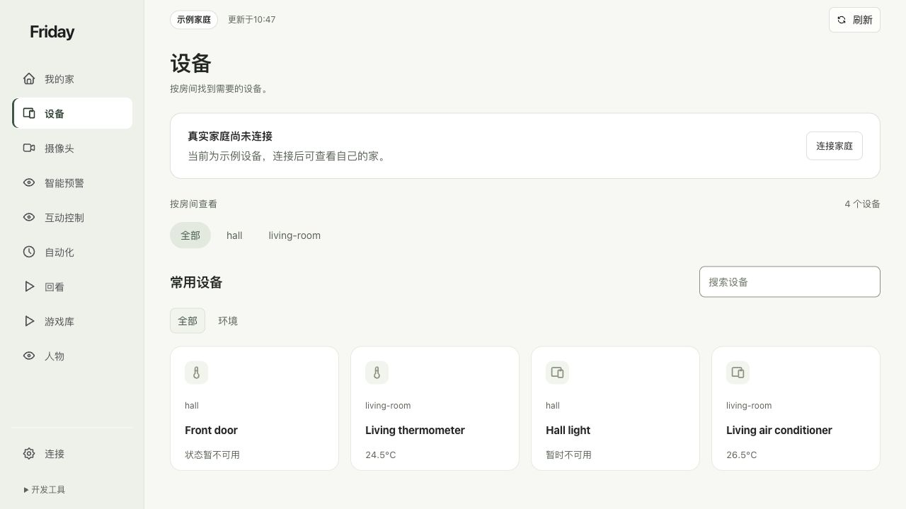
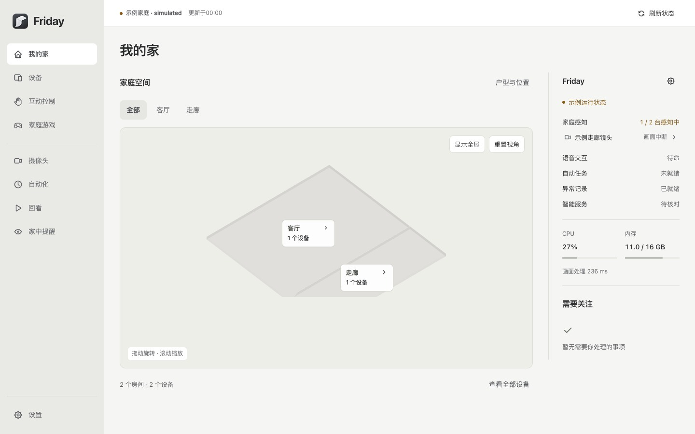
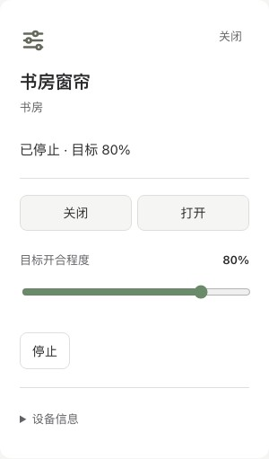
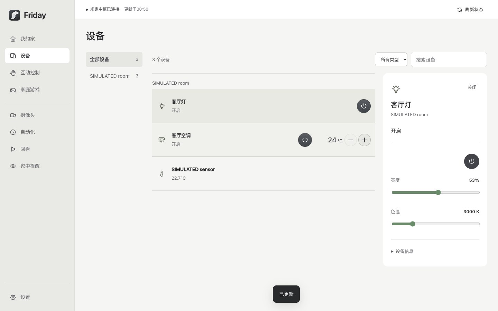

# 查看与操作设备

按房间找到设备，分清当前状态与可用操作，再使用设备专属控件。

## 先找设备，再看状态

点击“设备”，选择房间、类型，或在“搜索设备”输入名称。新版会保留只读及暂时不可用的设备，不再因为没有控制按钮就隐藏整台设备。

“我的家”侧重家庭空间与房间入口；需要完整卡片列表时点“打开设备”或左侧“设备”。没有导入自己的户型时，空间区域留空，未定位设备仍可在列表中使用。

桌面版会用已有米家授权检查同一家庭。「米家待接入」显示尚未接入的设备。新摄像头可[接入 Friday](cameras.md#接入米家新镜头)，普通设备在 Home Assistant 同步后进入主列表。

## 看全屋镜头状态

打开「我的家」，在 Friday 栏查看「家庭感知」。「1 / 2 台感知中」表示两台参与感知的镜头里，有一台当前有可用的识别画面。隐私关闭的镜头不计入分母。

画面中断时，Friday 会在后台尝试恢复。想查看情况时，点击状态下方的镜头名称。进入详情后，可以再点击「查看实时画面」。

「画面处理」显示最近有效画面从到达本机到完成处理的耗时。多台有读数时显示其中最慢的一台。过期后会撤下读数。

## 使用对应控件

| 设备类型 | 常见控件 | 操作前看什么 |
| --- | --- | --- |
| 灯 | 开关、亮度，受支持时可调色温 | 是目标房间的目标灯；哪些调节项已开放 |
| 窗帘 | 打开、关闭、停止、开合位置 | 当前开合程度与电机支持范围 |
| 空调 | 工作模式、设定温度，受支持时有风速 | 当前室温与设定温度不是同一个数 |
| 风扇 | 开关及受支持的风速 | 设备在线，当前动作可用 |
| 摄像头 | 镜头状态与查看画面 | 查看画面和主动打开镜头的含义不同 |

点击卡片名称可展开设备详情。具体出现哪些控件，由设备能力与本机控制范围共同决定；不能因为新版增加了某种控件，就认为所有设备已获得新权限。

如果家中已有支持米家本地控制的中枢，Friday 会优先通过局域网控制能核对状态的米家电源开关。照常用设备按钮或已设置的互动，设备回报后再确认结果。

已登记的米家窗帘在核对现有授权、规格和中枢后，可在 HA 断线时继续使用。第一次升级后，让 Friday 在原家庭连接正常时运行，等米家目录读完，再从原房间打开窗帘卡片核对按钮。照常使用已有语音和手势。显示「目标」时，百分比是设备回报的设置值，实际位置需现场核对。手动配置的叶片角度仍从原来的叶片调光滑块设置。

Friday 会在原连接正常时核对设备与米家属性。HA 断线后，米家中枢读到设备状态就会恢复可用控件，原设备、房间和手势绑定仍可使用。

- 电源开关直接在设备列表操作。也可以说「Friday，关掉客厅插座」。
- 灯亮起后，打开设备详情调节亮度和色温。调整会落在灯具支持的档位。
- 空调设备卡上可以改变设定温度。设备详情中的数值会随读回更新。
- 已接通的温度、湿度、电量和照度显示最近上报值。设备离线时显示暂不可用。依赖 HA 的自动化仍需原连接。

## 核对操作结果

选择模式、点击开关或调节按钮可能直接执行已授权操作。先确认目标，再操作一次，观察页面提示和设备实际变化。

“暂时不可用”时先检查设备连接，不要把它当成“关闭”。传感器读数是设备报告；插座内部温度和空调回风温度不自动等于房间室温。

**完成标准：**找到正确设备，页面报告与实际效果一致。设备列表为空或按钮灰色，见[常见问题](../troubleshooting/faq.md)。
