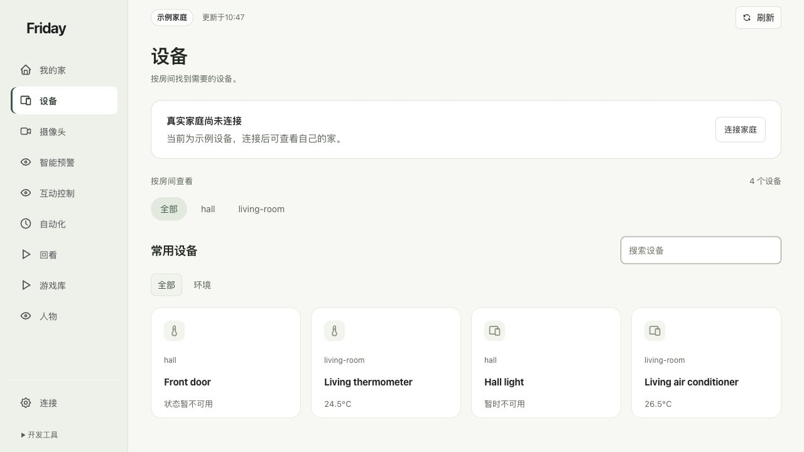

# 查看与操作设备

按房间找到设备，分清当前状态与可用操作，再使用设备专属控件。

## 先找设备，再看状态

点击“设备”，选择房间、类型，或在“搜索设备”输入名称。新版会保留只读及暂时不可用的设备，不再因为没有控制按钮就隐藏整台设备。

“我的家”侧重家庭空间与房间入口；需要完整卡片列表时点“打开设备”或左侧“设备”。没有导入自己的户型时，空间区域留空，未定位设备仍可在列表中使用。

## 使用对应控件

| 设备类型 | 常见控件 | 操作前看什么 |
| --- | --- | --- |
| 灯 | 开关、亮度，受支持时可调色温 | 是目标房间的目标灯；哪些调节项已开放 |
| 窗帘 | 打开、关闭、停止、开合位置 | 当前开合程度与电机支持范围 |
| 空调 | 工作模式、设定温度，受支持时有风速 | 当前室温与设定温度不是同一个数 |
| 风扇 | 开关及受支持的风速 | 设备在线，当前动作可用 |
| 摄像头 | 镜头状态与查看画面 | 查看画面和主动打开镜头的含义不同 |

点击卡片名称可展开设备详情。具体出现哪些控件，由设备能力与本机控制范围共同决定；不能因为新版增加了某种控件，就认为所有设备已获得新权限。

## 核对操作结果

选择模式、点击开关或调节按钮可能直接执行已授权操作。先确认目标，再操作一次，观察页面提示和设备实际变化。

“暂时不可用”时先检查设备连接，不要把它当成“关闭”。传感器读数是设备报告；插座内部温度和空调回风温度不自动等于房间室温。

**完成标准：**找到正确设备，页面报告与实际效果一致。设备列表为空或按钮灰色，见[常见问题](../troubleshooting/faq.md)。
