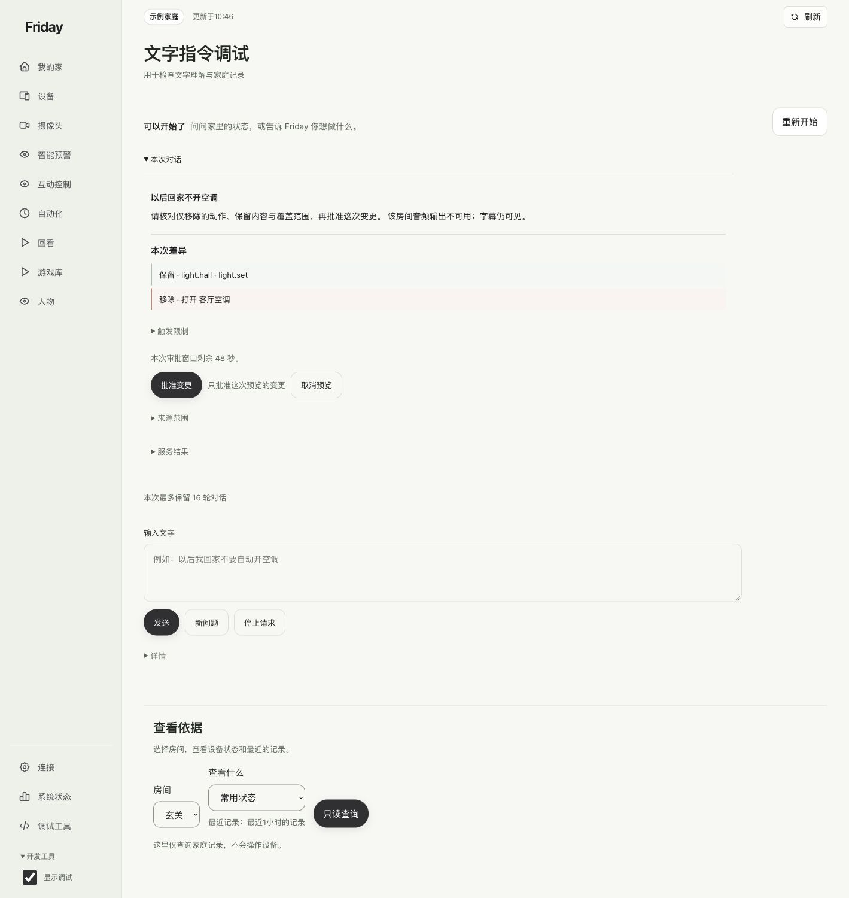
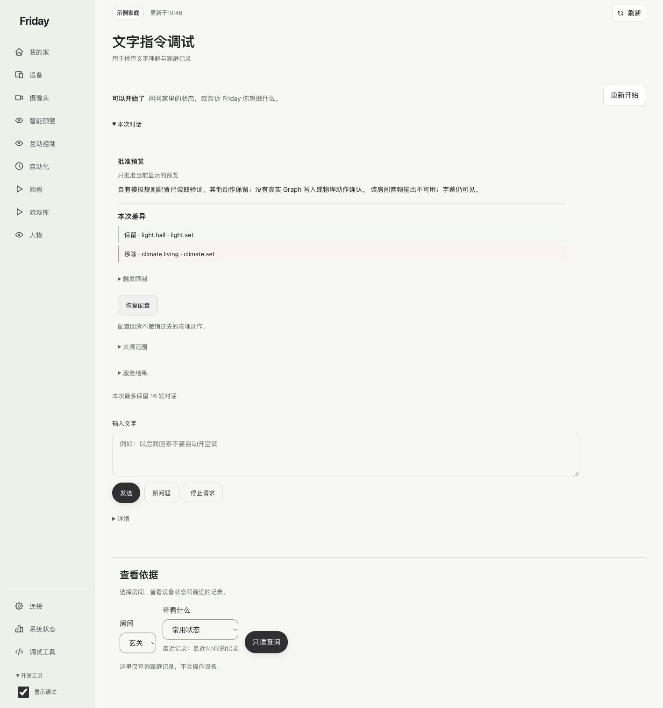
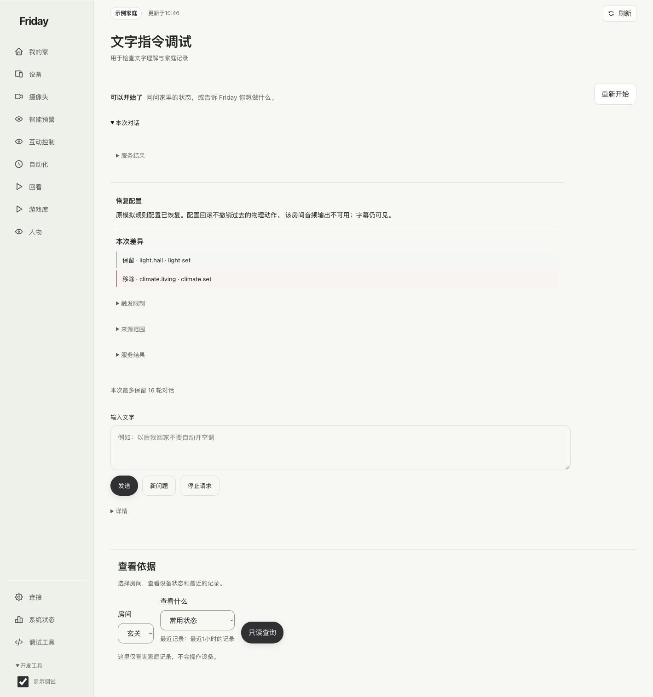

# 用文字预览模拟规则变更

在独立示例环境练习“先看差异、再批准、必要时恢复”，理解文字操作的范围。

**仅用于示例：**下面截图来自独立的示例家庭。不要为了照图练习，把已经连接真实家庭的服务改成模拟来源。

## 找到入口

打开“连接 → 实验功能与调试 → 文字指令调试”。旧版“对话”菜单已移动到这里。

## 1. 生成差异

输入“以后回家不开空调”，点击“发送”。检查保留的灯动作与移除的空调动作，以及本次预览的范围和有效期。

## 2. 批准这一份预览

在有效期内点击“批准变更”。示例返回“自有模拟规则配置已读取验证”，只证明示例规则配置完成，不证明实际空调已经关闭。

## 3. 需要时恢复

点击“恢复配置”，核对原模拟规则已恢复。配置回滚不能撤回此前已发生的设备动作。

不能识别的文字会要求更明确的命令。不要把文字输入框当作可以任意删改所有规则的通用助手；结构化的“查看依据”适合核对已有家庭记录。

**完成标准：**你能够读懂预览、批准范围和恢复结果，并分清模拟配置与真实设备效果。理解不同读数时，可继续[温度场景图解](../reference/temperature-scenarios.md)。
