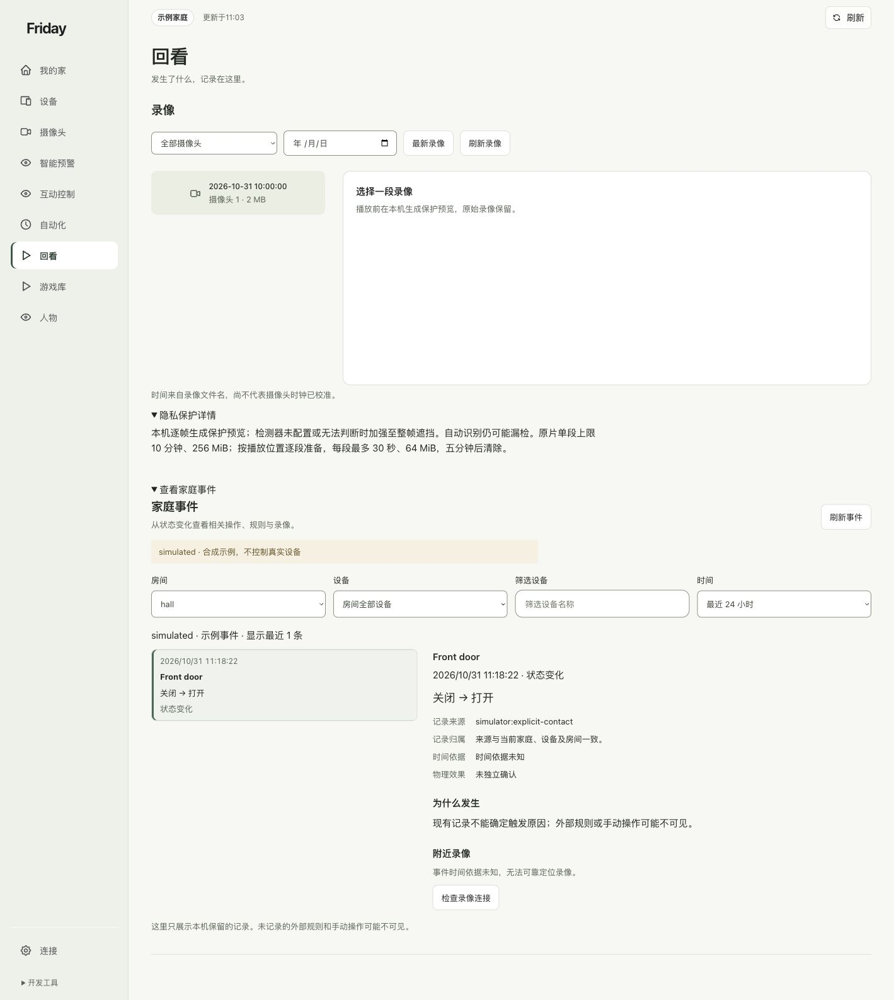

# 查看家庭事件的来源

从设备状态变化查看已有记录、相关操作和录像引用，并分清“时间接近”与“原因已知”。

## 选择事件

1. 打开“回看”，展开“查看家庭事件”。
2. 选择房间、设备和时间范围，点击“刷新事件”。
3. 选择一条事件，查看“记录来源”“记录归属”“时间依据”和“物理效果”。

本图由独立示例服务明确注入一次模拟开门状态，不来自真实门锁、家人活动或家庭录像。

## 怎样理解为什么发生

来源明确记录的操作链、同组记录和仅仅时间相近的记录含义不同。页面显示“现有记录不能确定触发原因”时，不能据前后顺序推断某个手势或自动化造成了变化。

这里只展示本机保留的记录。外部平台规则和手动操作可能不可见；没有记录也不代表没有发生事件。

## 怎样查附近录像

只有摄像头、目录和事件时间范围能够可靠对应时，录像入口才有依据。时间未知或未核对时，先检查录像连接，不随意拼一个相近视频当作证据。

**完成标准：**你能说明这条记录来自哪里、哪些关联有依据、哪些仍未知。打开详情不会自动操作设备；继续看[保护回看](recordings.md)。
