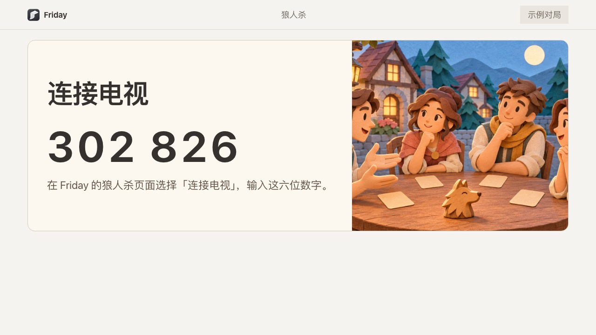

# 使用游戏库

先检查识别与显示条件，再选择游戏和玩家。

页面提供林间滑雪、双人网球、动作闯关、运动闯关、座位指认与全屋互动等入口。每项需要的玩家人数和动作不同。

1. 先在摄像头页确认可用画面与识别。
2. 在游戏库选择游戏与镜头，按提示绑定玩家。
3. 确认显示位置，再开始；需要结束时使用游戏自己的结束入口。

## 连接狼人杀公屏

1. 在家庭游戏选择「狼人杀」，选 6–12 人并创建房间。
2. 在主持端的「大屏同玩」点「连接电视」。用同一局域网内的电视浏览器打开窗口显示的地址。
3. 把电视上的六位连接码填入 Friday，点「确认连接」。看到「电视已连接」后，大屏会显示本局。

在电脑上显示时，直接选择「打开公共画面」。

## 从大屏加入狼人杀

每人用自己的手机扫大屏二维码，选座、填昵称，再点「准备好了」。坐满后大屏会收起邀请。

二维码暂不可用时，可在手机打开大屏显示的地址，输入房间号。也可以从主持端打开手机入口。全员准备后，主持人点击「发放身份」。玩家在自己的手机上确认身份后，主持人开始首夜。

## 换手机或找回狼人杀座位

1. 在 Friday 主持端点击「找回座位」，选中对应的玩家，再点「生成二维码」。
2. 让这位玩家用手机扫码，点击「继续对局」。如果正在认牌，照常按住查看身份，再点「我已看完」。
3. 手机回到当前环节，已经确认的身份和已经提交的行动仍然有效。原手机会退出该座位。

恢复二维码两分钟内有效，只交给对应的玩家。过期后由主持人重新生成。

## 狼人杀轮流发言

创建房间时，「发言方式」默认选中轮流发言，也可以改为自由发言。轮流发言时，Friday 按座位依次点名，每位 30 秒。大屏显示当前和下一位。轮到你时，手机会显示「发言完毕」。点它可以提前交给下一位，时间到也会自动换人。

主持端可以点「下一位」代为换人。暂停后会保留当前座位和剩余时间。最后一位完成后进入投票。平票发言时，只有平票玩家轮流发言。

## 局中恢复镜头座位

开房时勾选「使用已运行的摄像头辅助举手与指认」。白天发言和平票发言时，主持端可以从「镜头座位」调整人物编号，镜头恢复后也可以继续对应。

1. 点击「调整座位」，选中一位仍在场的玩家。
2. 在画面里找到这位玩家的编号，在「画面中的人物」中选中它，点击「确认对应」。
3. 对应完成后，座位旁会重新显示镜头识别到的举手与指向。点击「完成」收起画面。

调整座位时继续计时。预览只出现在本机主持端，进入投票时自动收起。

## 狼人杀连玩

一局结束后，主持人在结算页选择「再开一局」。

**大家需要重新扫码吗？** 手机留在原页面，看到「重新准备」后点击「准备好了」。大屏沿用原链接，主持人等全员准备后重新发牌。

如果上一局灯光还有待恢复，先在结算页选择「恢复灯光」。选择「关闭房间」会结束本房间，手机和大屏随即退出。

电视是单独的显示端。没有电视不妨碍电脑查看识别，但不能因此认定电视投放已经接通。

**完成标准：**游戏画面、玩家识别与实际动作响应都正确。普通手势控制成功一次，并不能替代每种游戏的验收。
