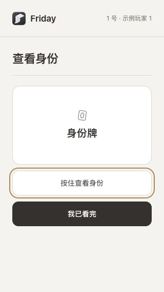
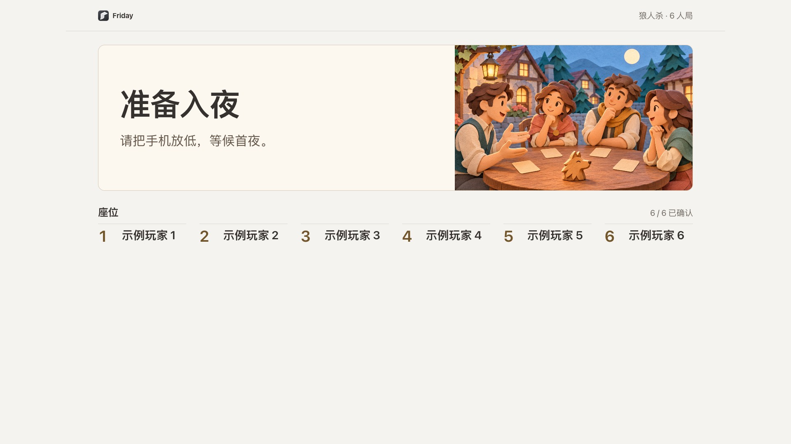
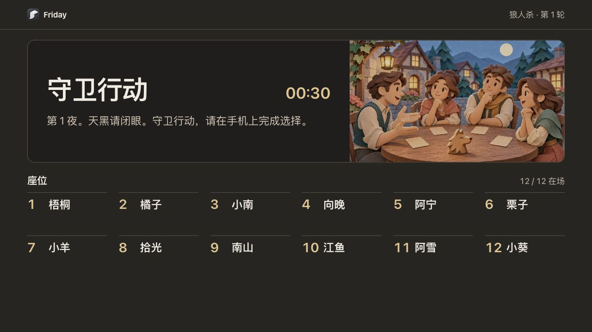
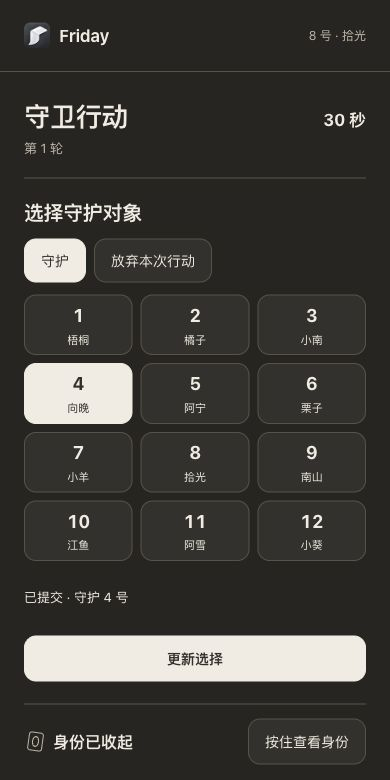
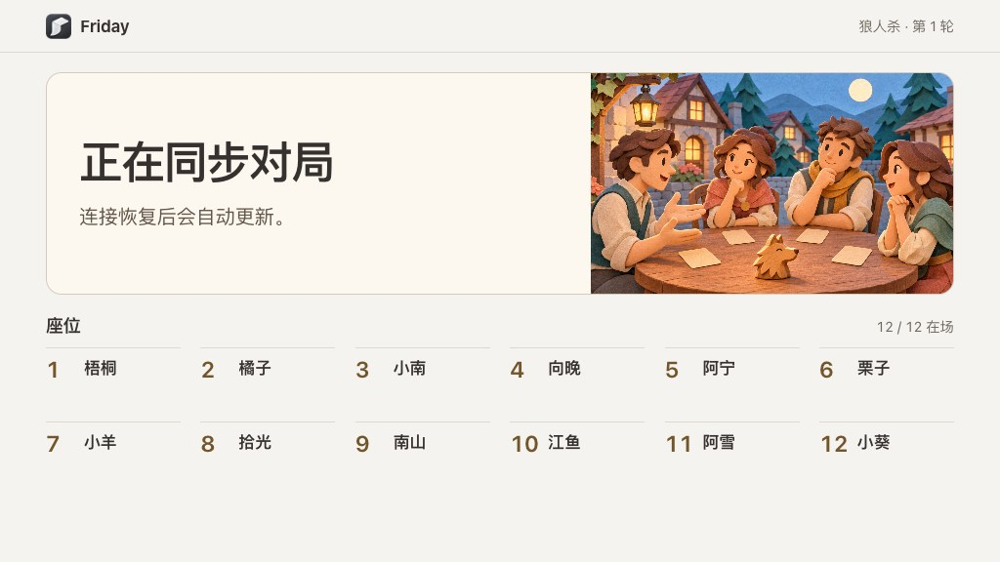

# 使用游戏库

先检查识别与显示条件，再选择游戏和玩家。

页面提供林间滑雪、双人网球、动作闯关、运动闯关、狼人杀与全屋互动等入口。每项需要的玩家人数和动作不同。

1. 先在摄像头页确认可用画面与识别。
2. 在游戏库选择游戏与镜头，按提示绑定玩家。
3. 确认显示位置，再开始；需要结束时使用游戏自己的结束入口。

电视是单独的显示端。没有电视不妨碍电脑查看识别，但不能因此认定电视投放已经接通。

**完成标准：**游戏画面、玩家识别与实际动作响应都正确。普通手势控制成功一次，并不能替代每种游戏的验收。

## 狼人杀

1. 在游戏库打开“狼人杀”，选择 6–12 人并点“创建房间”。手机与 Friday 需连到同一局域网。
2. 玩家各用自己的手机扫码入座，点“准备好了”。全员就绪后，主持端点“发放身份”。
3. 玩家按住“按住查看身份”查看自己的身份，松开收起，再点“我已看完”。公屏显示确认人数。
4. 全员确认后，公屏显示“准备入夜”。主持端点“开始首夜”，Friday 开始计时，已选的氛围灯切换到夜间。
5. 轮到你时，在手机选择行动和目标，再点“确认选择”。看到“已提交”或“已确认”即已收到。阶段结束前可以更新选择。

从主持端点“打开公共画面”可以在电视上查看。阶段、倒计时和主持提示在座位上方。暂停时，公屏提示等待恢复。

### 发牌后有人的手机无法恢复怎么办？

主持端可以在首夜开始前点“返回入座”。移除无法恢复的旧座位后，请该玩家重新扫码。大家重新准备、发牌并确认身份。

### 手机或大屏掉线后怎么办？

看到“正在同步对局”时，等连接恢复。电视保留座位列表，并在恢复后显示最新环节和倒计时。
手机回到同一标签页或刷新后，会核对刚才的提交。若看到“上次提交尚未确认”，且仍在同一环节，可以重新选择并确认。

### 为什么电视上没有投票按钮或我的身份？

手机用于查看自己的身份、投票和夜间行动。共用屏幕显示公开阶段、座位和已公布的票型，身份在本局结束后统一揭晓。启用镜头辅助时，举手和指向可以作为主持提示，提交投票仍在各自手机上完成。
