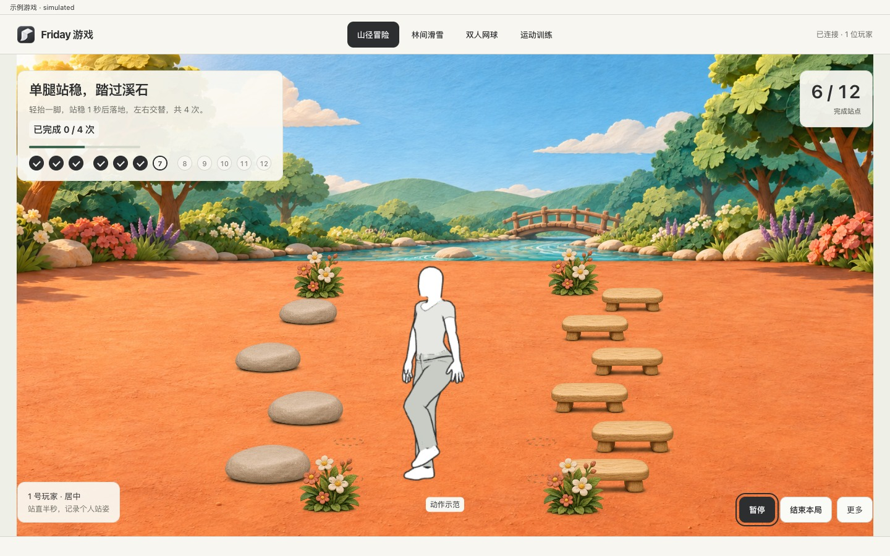

# 使用游戏库

先检查识别与显示条件，再选择游戏和玩家。

页面提供林间滑雪、双人网球、体感闯关、座位指认与全屋互动等入口。每项需要的玩家人数和动作不同。

1. 先在摄像头页确认可用画面与识别。
2. 在游戏库选择游戏与镜头，按提示绑定玩家。
3. 确认显示位置，再开始；需要结束时使用游戏自己的结束入口。

## 体感闯关

在游戏库打开「体感闯关」，可选 12 站的「山径冒险」或 10 关的「运动训练」。让双手和双脚完整入镜，跟着角色做动作。开始前可以在「互动控制」里选对应的动作，点「试一试」。

- **单腿站立**。轻抬一脚，站稳 1 秒再落地，落地后计一次。下一次换脚。
- **交叉触膝**。抬起一侧膝盖，用另一侧的手靠近膝盖。回到站姿后计一次，接着换侧。

动作没计数时，先回到自然站姿，确认双手和双脚都在画面里，再从动作开头做一次。

电视是单独的显示端。没有电视不妨碍电脑查看识别，但不能因此认定电视投放已经接通。

**完成标准：**游戏画面、玩家识别与实际动作响应都正确。普通手势控制成功一次，并不能替代每种游戏的验收。
