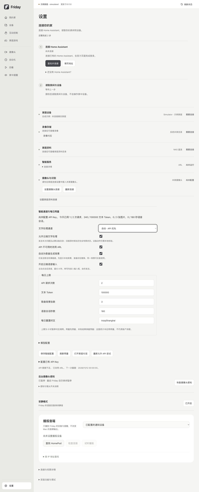

# 选择智能服务与每日上限

Friday 可以通过 ARL 调用 Codex，也可以使用自己的 OpenAI API。已经准备好的设备按钮、规则和 KTV 播放不要求先购买 API 用量。

## 1. 选择文字处理方式

打开 **设置 → 智能服务**，找到“智能通道与每日用量”。

| 选择 | 适合的情况 |
| --- | --- |
| ARL · Codex | 继续使用已经接通的 ARL 共享运行服务 |
| OpenAI API | 使用自己的 API 项目处理家庭问题与任务草稿 |
| 自动 · API 优先 | 先尝试 API，需要时改用 ARL |
| 仅本地功能 | 暂停云端增强，继续使用已准备好的本地功能 |

选择 API 时还需勾选“允许云端文字处理”。如需备用通道，勾选“API 不可用时改用 ARL”，并确保 ARL 本身可用。最后点击“保存智能配置”。

文字处理会发送本次问题和必要的设备目录。旧版即时规划还包含开关状态、亮度和温度等有限属性。模型只解释意图或提出草稿，实际读数与设备动作继续由 Friday 核对；任务仍要经过原有的预览和确认。

截图来自隔离的示例服务，显示合成用量；不代表真实账户余额或现场设备验收。

## 2. 配置已有 API Key

展开“配置已有 API Key”，在自己电脑上的 Friday 页面填写已有 Key，点击“保存已有 Key”。页面只显示是否已配置，不回显内容。不要把 Key 发到聊天、截图或公开仓库。

在 Codex 或其他应用里连接了 OpenAI，不代表 Friday 已经取得同一 Key。也可以让安装人员为 Friday 服务配置现有 Key。保存成功不代表账户余额或模型权限已经核验，Friday 不会因为保存设置就调用付费模型。

文字、歌曲背景与云端语音是独立开关；只保存 Key 不会自动开启它们。

## 3. 设置每日用量

在“每日上限”分别填写请求次数、文本 Token、歌曲背景张数和语音会话秒数，再保存。**0 表示暂停对应调用。**“模型配置”还可调整文字、图片与语音模型、单次文字输出上限、背景保留张数和是否为已有 MV 的歌曲生成背景。

页面显示 Friday 今天已经使用的量与下一次重置时间。文字 Token 不包含图片和语音的计费 Token；图片按张数限制，语音按会话时间限制。这些限制只管理本机 Friday，不是整个 OpenAI 账户的金额余额或账单上限。

每次请求先预留用量，收到可靠结果后结算。超时、取消或结果未知时会保留预留，所以数字可能比自己数到的成功次数多。重启程序不会清空本日用量；更改重置时区也不会立即恢复额度。

## 4. 达到上限或 API 不可用时

- 允许 ARL 备用时，Friday 在剩余等待时间内尝试 ARL。
- 未允许备用或 ARL 也不可用时，保留本地功能；复杂文字可能需要改成明确输入或稍后再试。
- 云端语音失败时保留原输入草稿，可继续打字发送。
- 歌曲背景失败时使用本地主题；已经缓存的图仍可使用，点歌与音频播放继续。

API 余额不足、限流、超时、Key 未被接受或模型无权限时，页面给出原因并暂缓新尝试。处理好原因后可点击“重新允许 API 尝试”；它不会清空每日用量，也不会重新执行设备动作。

## 主动语音输入

先单独开启“开启云端语音输入”并保存，再点击“打开家庭对话”。点击语音输入并允许本轮麦克风访问，最多录 8 秒；可提前结束或取消。

转写插入输入框的光标位置，**核对后由你点击发送**。取消、切换离开或隐藏页面会停止本轮录音；已有本地语音识别仍按原设置工作。API Key 留在本机服务，不发给网页。

## KTV 自动配背景

在智能服务中单独开启“自动为歌曲生成背景”。Friday 只把歌名和演唱者用于生成，不发送歌曲音频、歌词或家庭画面。

待唱歌曲先使用本地主题，图片准备好后再显示；同一歌曲的相同背景可以复用。默认跳过已有可用 MV 的歌曲，需要时可在“模型配置”开启“已有 MV 时也生成背景”。

API 达到上限、下载失败或图片校验失败都不会阻止音源准备、歌词和伴奏。背景保留张数达到上限后停止生成；已经缓存的图仍可使用。电视显示效果需在自己的电视上单独核对。

**完成标准：**能切换通道、看懂本机用量并设置上限；关闭云端增强后，自己已配置的设备按钮、规则与 KTV 播放仍可使用。
