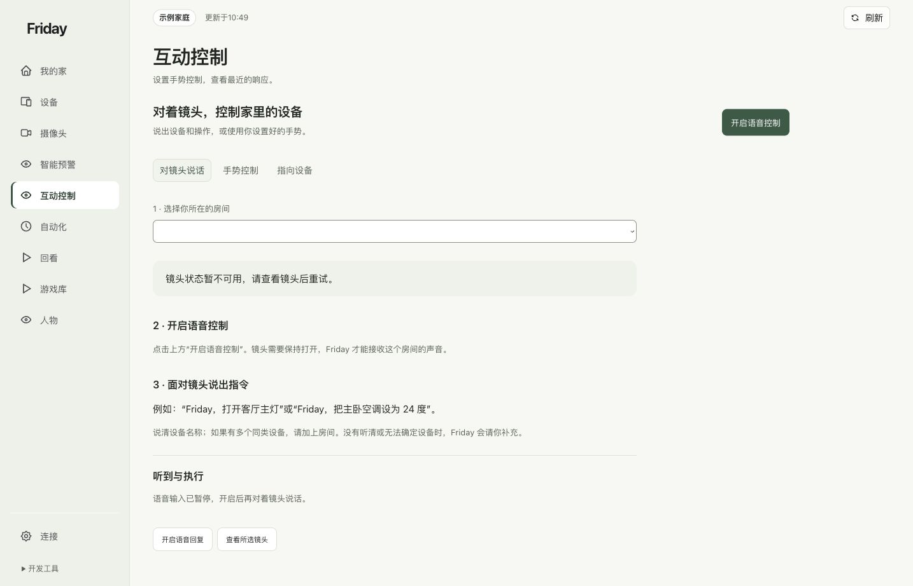
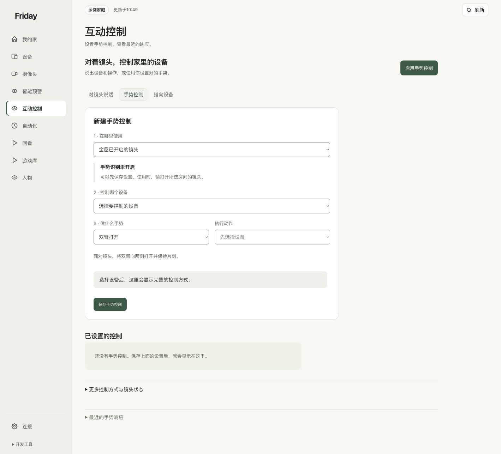
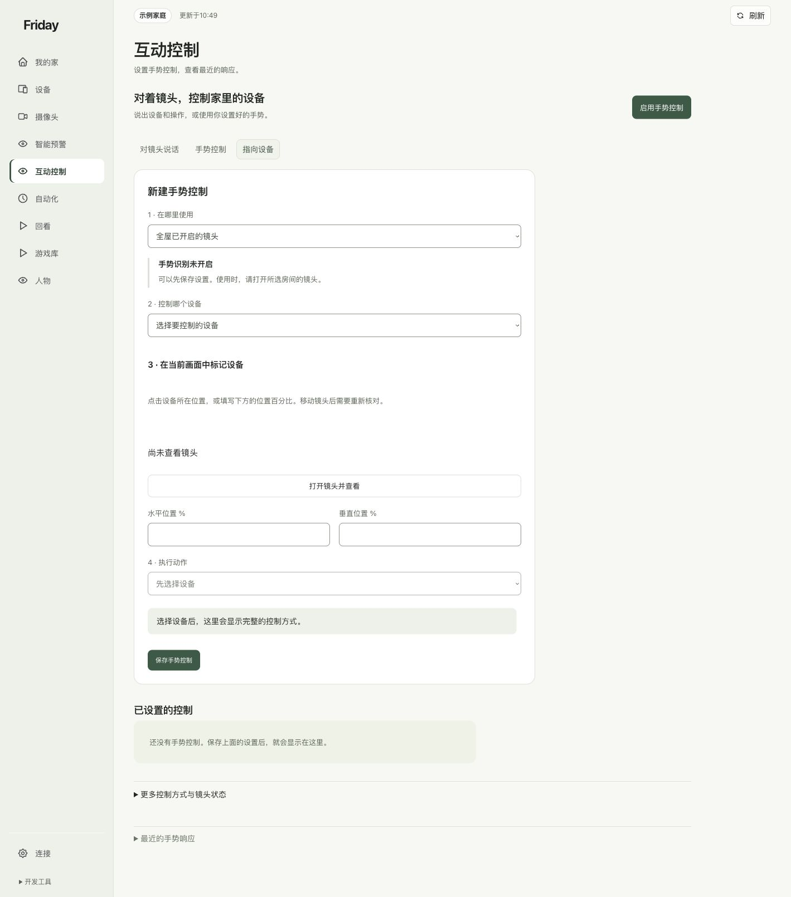

# 管理互动控制规则

在同一页选择语音、手势或指向方式，修改已有规则，而不必删除后重建。

## 三种方式分别做什么

| 页签 | 用途 | 另外需要的准备 |
| --- | --- | --- |
| 对镜头说话 | 用设备和房间名称表达操作 | 所选镜头的声音输入、识别与语音处理已配置 |
| 手势控制 | 把明确动作绑定到设备 | 画面、本地识别与目标控制已配置 |
| 指向设备 | 在镜头画面标记目标，再按指向控制 | 镜头位置、设备点位和相应识别已核对 |

只想做手势时，直接切到“手势控制”。本地手势不要求你先开启语音。

## 新建、修改和暂停

1. 选择使用范围；有多房间镜头时核对自己选择的房间或全屋范围。
2. 选择设备、动作和执行动作，检查表单中的完整描述，再保存。
3. 修改旧规则时点它的“编辑”，检查回填内容，点击“保存修改”；不想改就“取消编辑”。
4. 单条规则的开关只影响这一条；页顶手势总开关暂停时，已启用的规则也不会触发。

移除规则后，页面提供撤销入口时可立即撤销。编辑草稿、设备失效提示和修复入口用于减少误改；最终以已保存卡片为准。重新发现同名设备不等于自动替换原来的目标。

## 多人时选择或切换操作者

镜头里只有一人持续可见时，系统可自动选择；之后有人进入画面，需要控制设备的人面向镜头比 OK，保持约 2 秒，放下手后再做绑定动作。即使已经选中了另一人，也可以用这个方式接管。两人同时比 OK 时，不会据此切换。

用于选择操作者的这次 OK 不执行设备动作。需要用 OK 触发已配置的控制时，先放下手，再重新做一次。重启识别服务或追踪丢失后，临时操作者需要重新确认；设备规则和允许控制范围仍会保留。

已有操作者时允许接管的修复包含在 Friday 提交 [5961567](https://github.com/Geeprox/Friday/commit/5961567d3ed897eed20fb161be6dfa49d522df3d)。旧版可能一直保留最先选中的人；更新 Friday 后重启识别服务，再按上述步骤验证。

## 指向设备前先核对点位

在“指向设备”选择目标，按当前画面标记位置或填写百分比。镜头移动后需要重新核对，不能把画面坐标当作永久房间坐标。

**完成标准：**保存卡片中的范围、手势、目标和动作都正确，并按[第一条手势控制](../tutorials/first-gesture.md)完成现场验证。设备列表为空见[权限问题](../troubleshooting/faq.md#q09-规则里的设备列表为空怎么办)。
