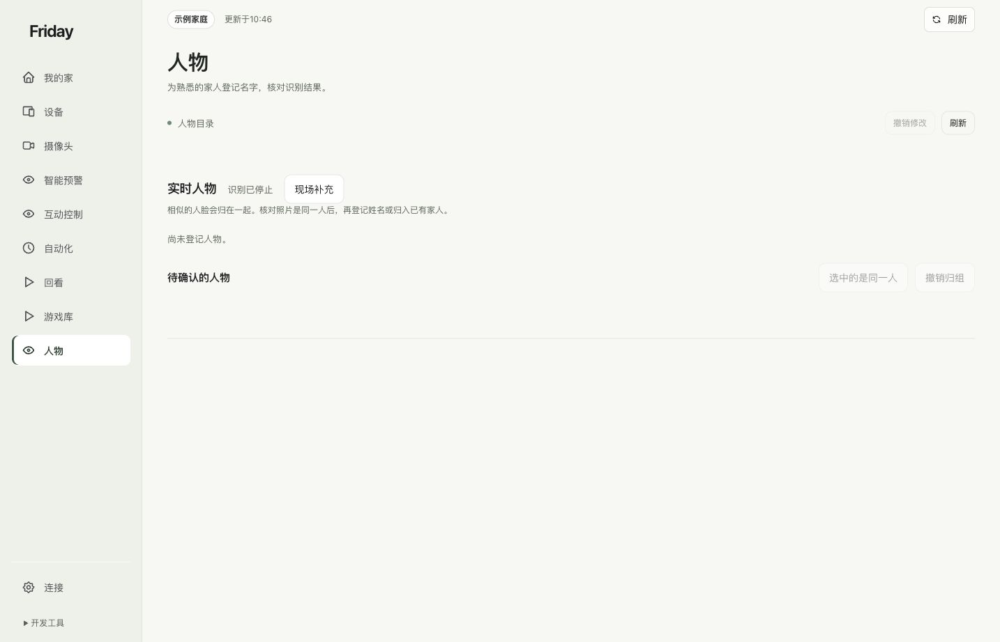

# 核对人物与待确认分组

把相似的匿名观察整理成可核对的候选组，再由你确认是否同一人、是否登记名字。

## 先核对，再登记

打开“人物”，查看实时人物、已登记人物和待确认组。绿色骨架或一次手势成功不表示已经完成姓名登记。

有候选照片时，逐张核对是否同一个人，再合并到同组、拆分错误观察，或归入已有家人。界面提供撤销时，可回退最近的整理操作；不要仅凭自动相似度就认定身份。

姓名登记用于资料整理与连续识别，不授予开门、账号访问或设备控制权限。没有登记人脸，也可在满足条件时使用单人动作控制；多人时按镜头提示选择操作者。

**完成标准：**照片和成员对应关系由你确认，错误分组已纠正。示例中没有人物资料，因此不能据截图认定人脸功能已完成现场验收。
