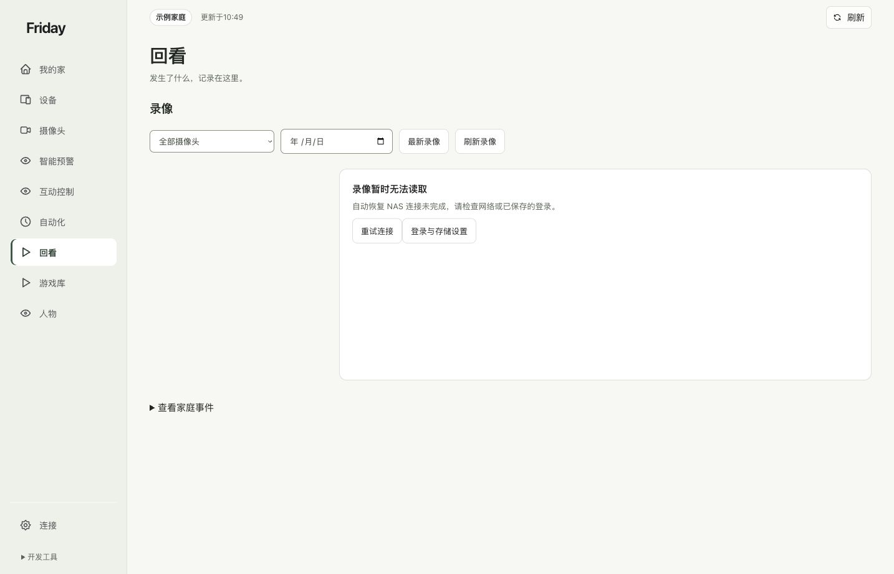
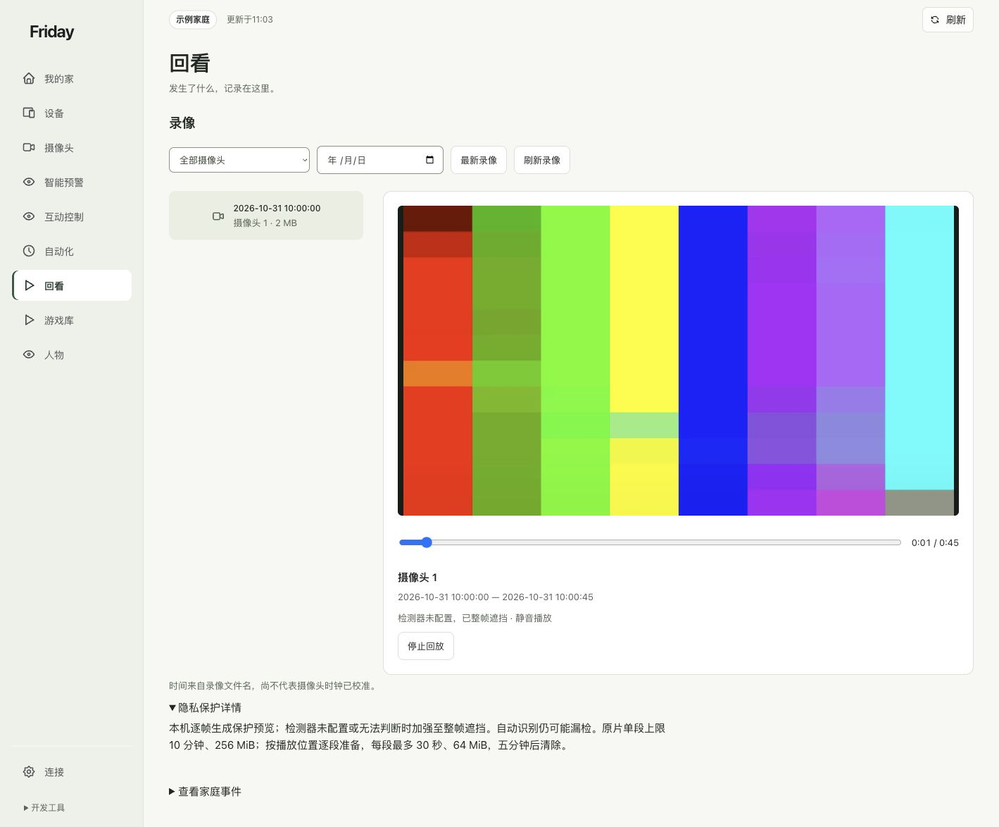

# 连接录像并保护回看

从你已配置的录像目录查找片段，播放本机生成的保护预览，并核对时间范围。

**开始前：**NAS 或录像来源已由你连接，目标目录允许读取。摄像头直播正常不代表已接入历史录像。

## 1. 先检查来源

打开“回看”。未能读取时，进入“登录与存储设置”检查网络、已保存登录和允许目录；原来已配置的连接会尝试恢复，不需要每次重复填写。

## 2. 选择镜头和日期

按录像来源、日期或“最新录像”找到片段，再点击播放。文件名时间、设备时钟和实际事件时间不一定完全相同，需要先核对录像来源。

## 3. 看懂保护预览

默认播放短时的整帧马赛克预览，保留原片。选择性遮挡需要另外安装和配置本机模型；未配置时不能承诺只遮住特定区域。生成保护预览失败时，不会自动改播未保护原片。

播放器默认静音。视觉遮挡并不清除原音轨中的个人信息，有声音的录像需要你按场景决定是否取消静音。

本图使用独立示例服务中的 **45 秒纯合成测试片**，用于演示播放器、保护状态和时间线，不代表真实 NAS 已连接或任何家庭录像已经验收。

## 4. 定位、继续播放与结束

可用时间线定位到片段内的位置。播放器按短片段准备后续内容，因此看到一个预览成功，不代表所有录像都已读取。来源变化或预览过期时，重新读取；结束查看后停止播放。

**完成标准：**能核对正确镜头、日期、时间范围，看到明确的保护状态，并成功定位到所需内容。没有录像、时间不符或准备失败时，见[回看问题](../troubleshooting/common-errors.md#录像不能播放)。
