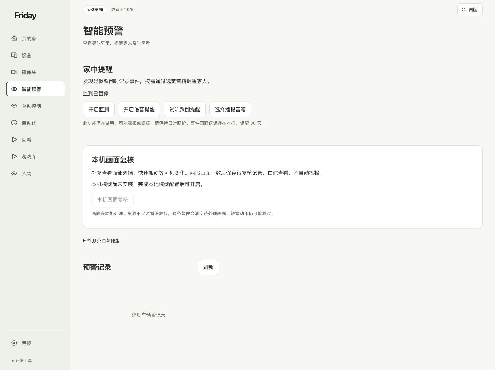
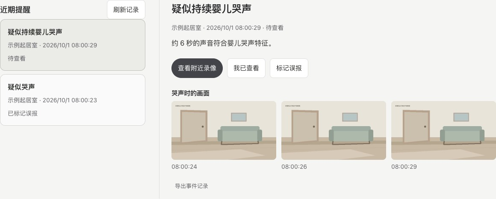
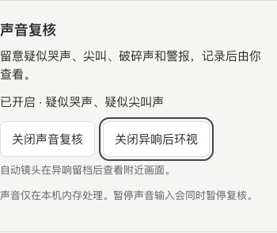
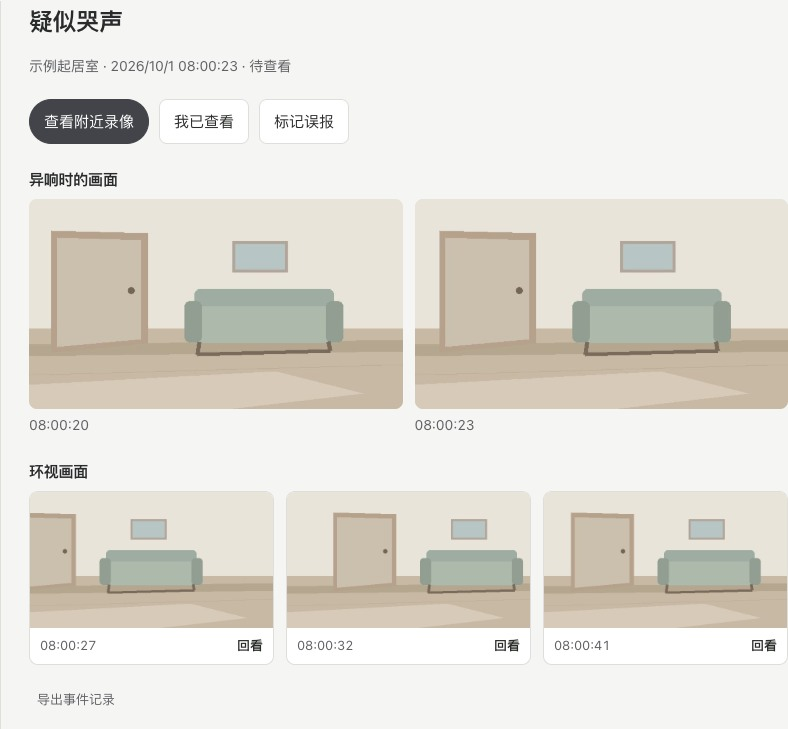

# 查看智能预警与本机画面复核

分别检查监测、提醒和记录，不把一个开关当成整套能力已经准备好。

## 监测与语音提醒分别设置

打开「家中提醒」，看清监测是否运行、语音提醒是否开启，以及播报音箱有没有选择。没有音箱时，不能因为存在提醒按钮就认为已经播报。

预警记录用于核对疑似异常。界面已说明可能漏报或误报，记录与现场情况仍需由你检查。

## 查看疑似跌倒提醒

监测开启后，看到有人快速倒卧时，镜头可短暂停留以继续观察。肩部或髋部短暂被挡住时，如果同一人仍可辨认，Friday 会等清楚的画面恢复后继续确认。

收到「疑似跌倒」时，打开对应的「家中提醒」，查看关键帧和摄像头，及时核对现场情况。

## 本机画面复核是额外能力

新版提供可选的本机短画面复核，例如补充查看可见变化。看到“模型尚未安装”时，该项不能开启；它不由基础部署自动下载，也不是普通手势识别的必要步骤。

按页面说明确认本机资源、模型和使用范围后，再由维护人员准备。摄像头隐私暂停时，后台待处理画面会停止或清空。没有实际验证过的提醒效果，不计作已经通过。

## 查看疑似持续婴儿哭声

在「家中提醒 → 监测设置」开启「声音复核」。本机分类器支持婴儿哭声时，三段连续的同源声音证据可以产生「疑似持续婴儿哭声」提醒。打开提醒后，按时间核对「哭声时的画面」。已对应录像的镜头还可选择「查看附近录像」，从这条提醒的时间定位。

此前已有「疑似哭声」时，三段符合条件的新证据仍会生成一条独立提醒。原记录及其查看或误报标记继续保留。

## 异响后查看附近画面

打开「家中提醒 → 监测设置」，开启「声音复核」，再选择「开启异响后环视」。把希望自动环视的摄像头设为「自动」。

异响留档后，如果来源镜头画面无人，Friday 会短时查看起始视角两侧。确认画面有人后，会交回视觉跟随。打开同一条提醒，可查看「异响时的画面」和「环视画面」。环视画面来自已核实的新视角，按采集时间排列，最多保留三张。

点击某张环视画面的「回看」，查看该画面采集前后的录像。查看异响发生时的录像，可用详情顶部的「查看附近录像」。录像需要事先对应到这台摄像头。

监测状态暂时无法读取时，仍可打开已保存的提醒和关键帧。

**听到声音就会马上转向吗？** 镜头会先保存复核结果。正在使用手动停留、玩体感游戏或复核画面时，优先保留原视角。摄像头声音只用于确定是哪一台镜头收到异响，声源方位需结合画面核对。

关闭「异响后环视」可只保留声音复核。关闭声音复核也会同时关闭环视。

**完成标准：**监测、提醒、输出设备和记录的状态都能分别说明。只想停止手势，使用互动页开关；想停全部后台感知，见[摄像头开关](cameras.md)。
