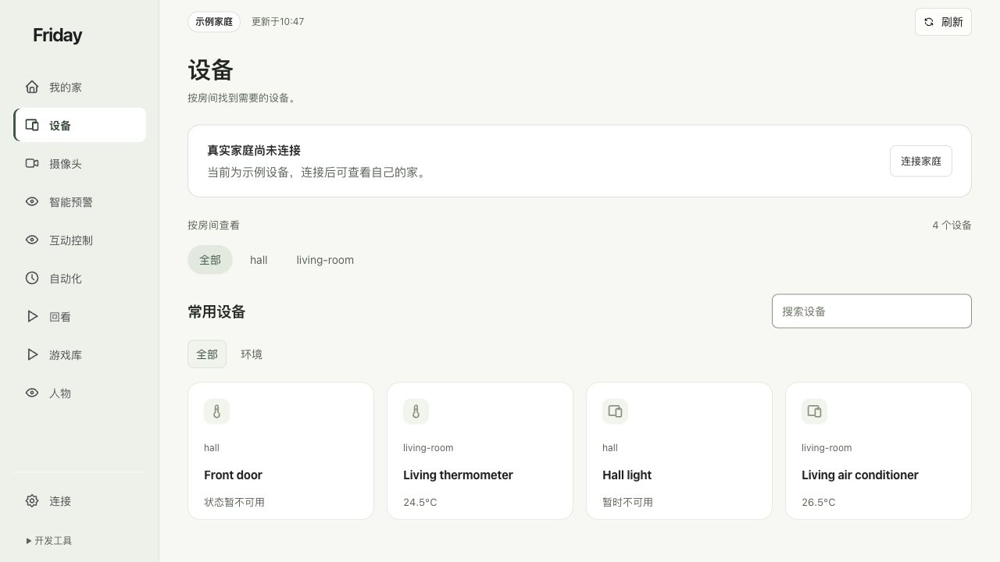

# Friday 用户手册

从看懂家庭状态开始，逐步学会连接设备、配置手势、检查响应和管理录像。

本手册面向第一次使用 Friday 的家庭用户，按 **2026 年 10 月 31 日检查的新版界面**编写。示例截图来自独立的“示例家庭”，不会展示任何真实家庭画面或账号资料。菜单出现不代表相应服务已经接通，请以自己页面的连接与权限状态为准。

点击截图可查看原尺寸。

## 从这里开始

| 你想做什么 | 阅读入口 |
| --- | --- |
| 电脑还没有任何运行环境 | [从零安装：macOS / Linux](getting-started/installation.md) |
| 第一次打开，分清示例和真实家庭 | [快速上手](getting-started/quick-start.md) |
| 连接 Home Assistant 与小米设备 | [连接自己的家](getting-started/connect-home.md) |
| 做一个手势，让指定设备响应 | [完成第一条手势控制](tutorials/first-gesture.md) |
| 有骨架但设备没有动 | [按现象排查](troubleshooting/common-errors.md) |
| 找到新版入口，了解主要更新 | [新版变化](releases/2026-10-31.md) |

## 先记住三件事

- **示例家庭**是演示数据；**家庭已连接**才是你已接入的家庭来源。
- **看得到设备、允许操作设备、手势正在运行**是三个不同状态。
- **指令已发送**后仍要观察实际设备；页面状态与现场效果要分别核对。

无需先开通语音或购买云端模型服务，才能使用已经准备好的本地手势识别。各服务之间的分工见[这些程序分别做什么](explanation/components.md)。
