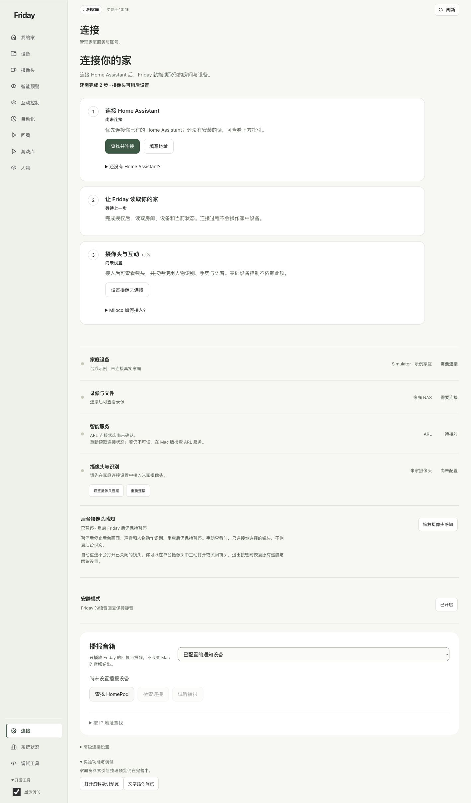

# 新版入口速查

按你要完成的任务找页面，避免沿用旧截图中的菜单名称。

| 你要做什么 | 新版入口 |
| --- | --- |
| 看家庭空间和房间 | 我的家 |
| 找完整设备卡片、开关与设定 | 设备 |
| 看镜头、暂停后台感知 | 摄像头 |
| 看骨架或手部识别 | 摄像头 → 人物与手势检查 → 查看识别 |
| 配置身体动作 | 互动控制 → 手势控制 |
| 使用声音输入 | 互动控制 → 对镜头说话 |
| 给画面中的设备标点位 | 互动控制 → 指向设备 |
| 看手势结果 | 互动控制 → 最近的手势响应 |
| 手动场景或自有自动化 | 自动化的三个分类 |
| 查历史录像与家庭事件 | 回看 |
| 登记或核对人物 | 人物 |
| 配置服务、账号与静音 | 连接 |
| 家庭资料预览 | 连接 → 实验功能与调试 → 打开资料索引预览 |
| 文字操作与结构化查询 | 连接 → 实验功能与调试 → 文字指令调试 |
| 系统状态和调试场景 | 开发工具 → 勾选显示调试 |

“对镜头说话”是互动页默认页签，不表示语音已经开启。只想使用动作绑定，切换到“手势控制”即可。
