# 十五个温度质量场景

这些图来自独立、明确标为“示例家庭”的运行环境，用于学习读数含义。日常真实家庭无需切换来源或加载模拟场景。

## 怎样阅读

在示例环境打开“连接 → 实验功能与调试 → 文字指令调试”，房间选“客厅”，点击“只读查询”。同时看设备自身温度、房间室温、测量时间和质量说明。

读数来源位置不同，空调内部或插座内部的温度不自动代表房间室温。

## 01. 正常状态

温度计与空调都有有效测量，房间室温选择已配置的主来源，不能简单平均两种设备读数。

## 02. 相对校准演示

成对模拟样本用于说明校准过程；示例样本不证明你家的设备已经校准。

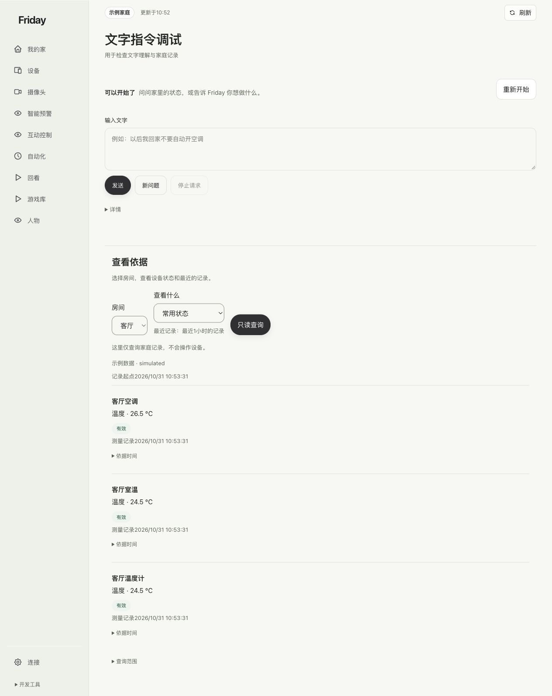

## 03. 主源过期，备用未校准

主温度计只返回旧记录，空调虽有读数但未通过相对校准，因此室温暂不可确认。

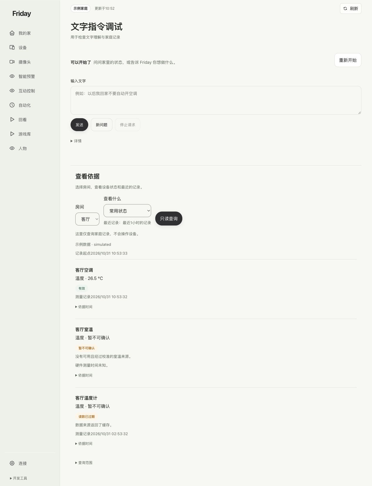

## 04. 使用相对校准备源

备用来源符合当前校准条件，室温显示推算区间；这个区间不是绝对真值保证。

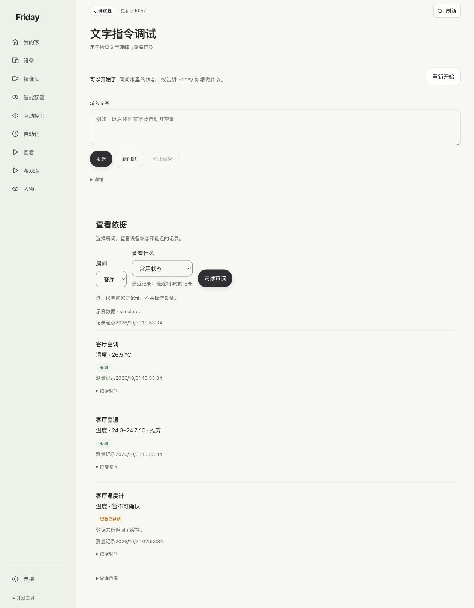

## 05. 读数冻结

一个来源不变，独立来源持续变化时，冻结来源会暂时退出室温判断。

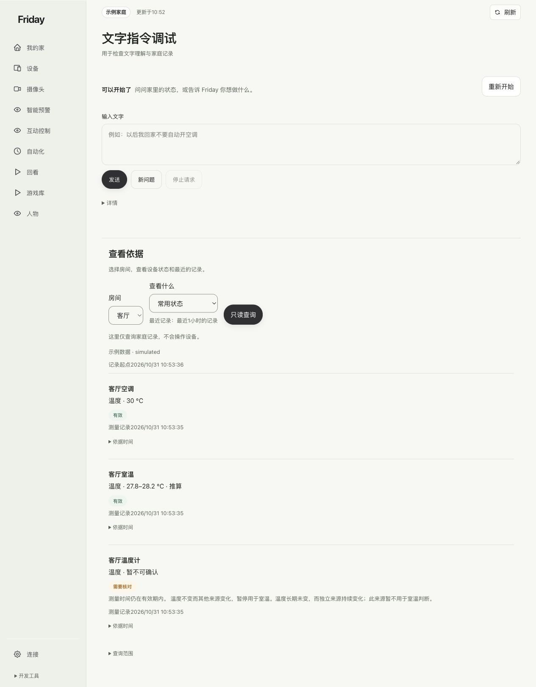

## 06. 读数不一致

不同来源互相矛盾，系统保留无法确认的结论，不随意选一个数。

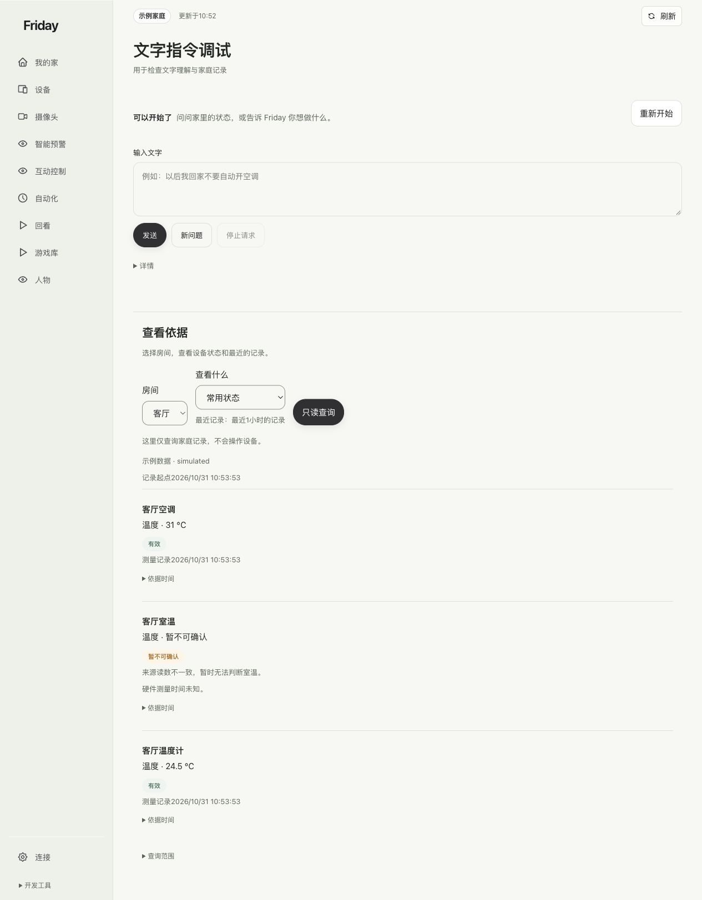

## 07. 所有来源异常

没有可用依据时保持暂不可确认，而不是把旧数当作当前室温。

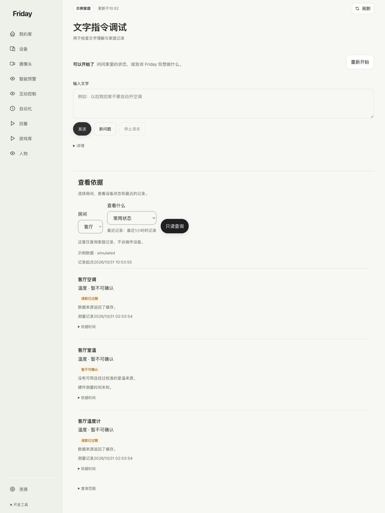

## 08. 连接恢复，观察不足

恢复连接不等于测量已经可信，还要等待足够的新测量和观察时间。

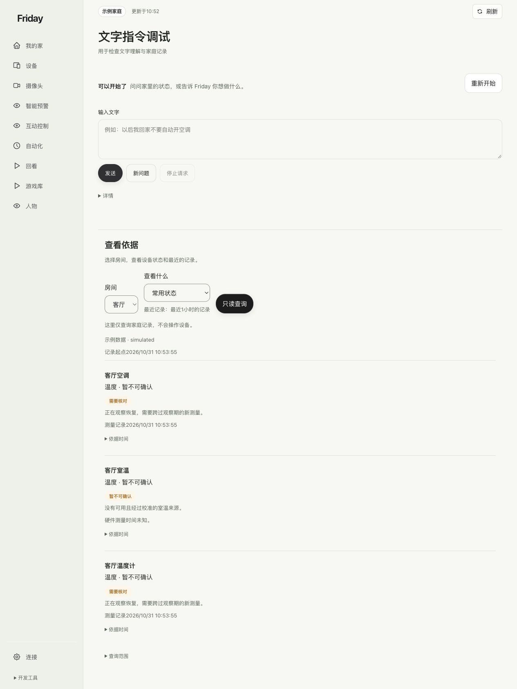

## 09. 暂缓切回主源

恢复期间继续使用已经可信的备用来源，避免在主备之间反复切换。

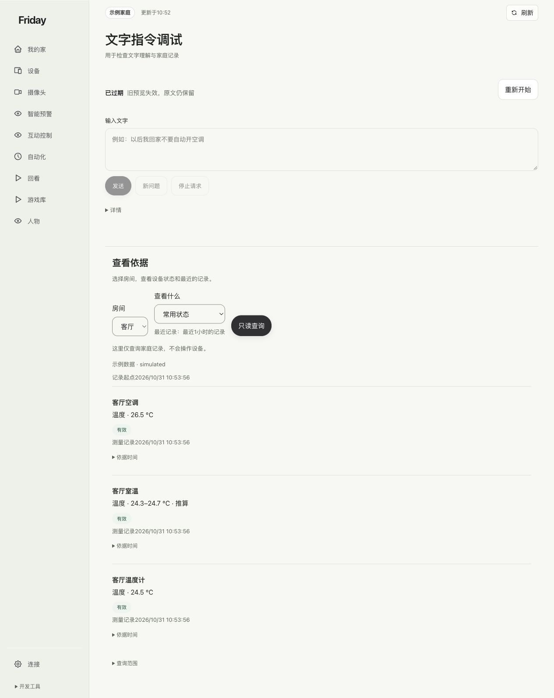

## 10. 恢复后仍返回缓存

刷新旧记录不等于产生了新测量，不能据更新时间认定已经恢复。

## 11. 样本够，时间还不够

短时间内多个样本不能代替跨过完整观察期。

## 12. 电量读数过期

旧电量记录不能证明当前设备健康；温度仍有效与电量过期可以同时出现。

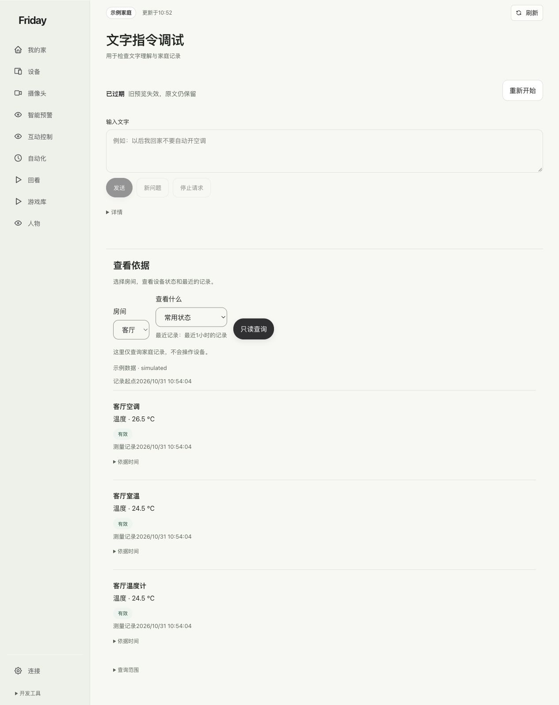

## 13. 空调模式不符

工作模式未知或不符合原校准条件时，不继续套用旧的室温推算。

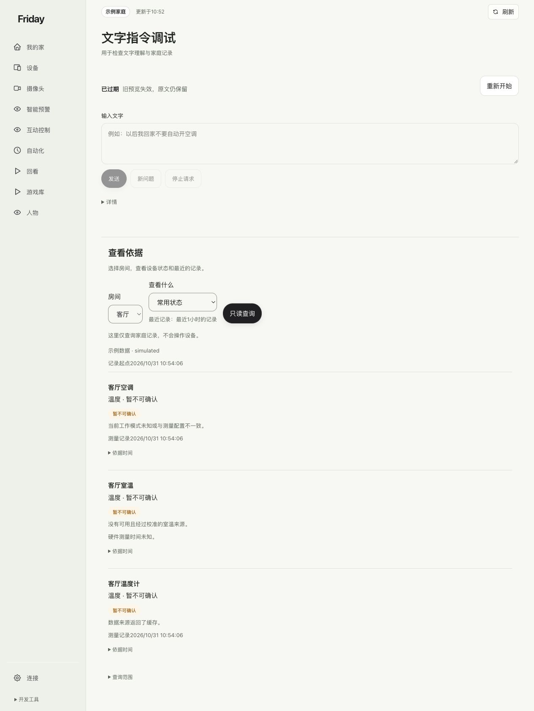

## 14. 校准过期

校准范围或有效期已经失效，备用温度存在也不能继续当作合格室温。

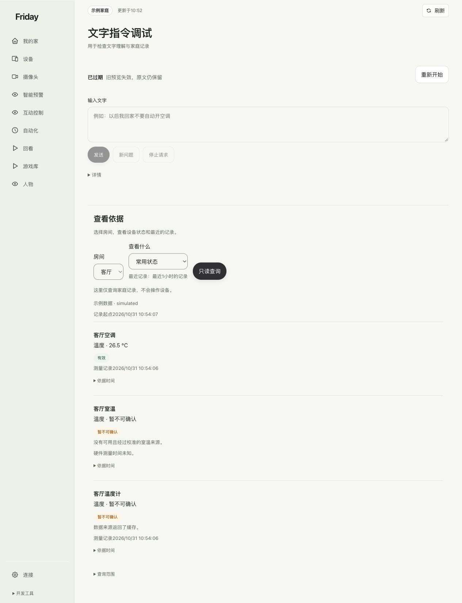

## 15. 连接中断

连通性不足时，需要重新核对状态，不能把上次测量当作现在仍有效。

遇到自己家庭的异常时，先看[页面状态](status.md)与[按现象排查](../troubleshooting/common-errors.md)。
