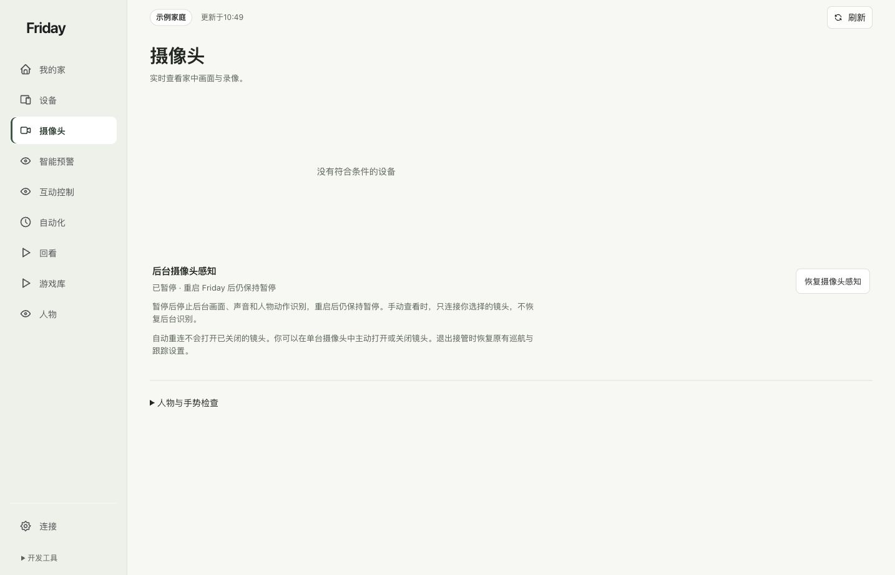
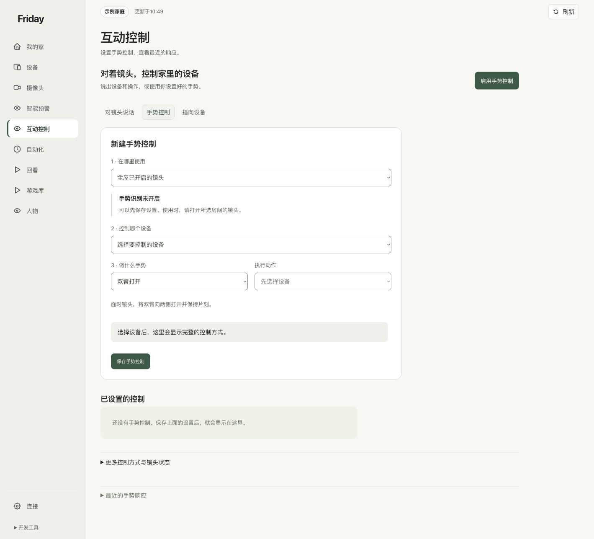

# 完成第一条手势控制

把一个身体动作绑定到一台已授权设备，并分别核对识别、响应记录和设备实际效果。

**开始前：**Friday 摄像头和本地识别已准备好；目标设备在 Friday 中允许控制；你了解本次绑定会执行什么动作。

## 1. 先看到实时识别

打开“摄像头”，展开“人物与手势检查”，点击“查看识别”。确认时间持续变化，人体或手部提示能够跟随你。电视未连接不影响本机查看。

如果这里只显示未配置，先完成[摄像头接入](../guides/cameras.md)，反复做动作不能补齐识别环境。

## 2. 选手势控制，而不是语音页

打开“互动控制”，切换到 **手势控制**。默认的“对镜头说话”是语音功能，打开页面不代表语音已经开启。

## 3. 保存一条完整规则

依次选择“使用范围 → 控制设备 → 动作 → 执行动作”。例如：在目标房间，双臂合上时关闭指定窗帘。核对后点击“保存手势控制”，再到“已设置的控制”确认规则已出现。

上方表单的默认选项不会自动修改已经保存的规则。修改旧规则要点击那条规则的“编辑”，再“保存修改”。

## 4. 开启总开关并完成动作

确认该规则的开关已启用，再点击“启用手势控制”。按钮显示“暂停手势控制”表示总开关正在运行。

站在镜头能清楚识别身体的位置，先保持稳定，再按所选动作说明完成连续变化。例如双臂合上应先张开，再向胸前合拢并短暂停留；一直保持合拢不等于新的动作。多人入镜时，由准备控制的人比 OK 保持约 2 秒选定自己，再放下手开始；已选中另一人时也可这样接管，详见[操作者切换](../guides/interactions.md#多人时选择或切换操作者)。

## 5. 看记录，再看设备

展开“最近的手势响应”。出现记录后，再观察目标设备是否实际执行。“指令已发送”不能代替现场确认；设备本来已在目标状态，也可能没有新的可见动作。

## 6. 暂时不用时暂停

点击“暂停手势控制”会保留规则，阻止后续手势触发。它不会撤回已经发出的动作；关闭网页也不会自动停掉后台。

**完成标准：**规则已保存、总开关运行、最近响应出现对应目标，并且你确认设备实际效果。任一步缺失，按[手势不触发排查](../troubleshooting/common-errors.md#手势不触发)逐层检查。
